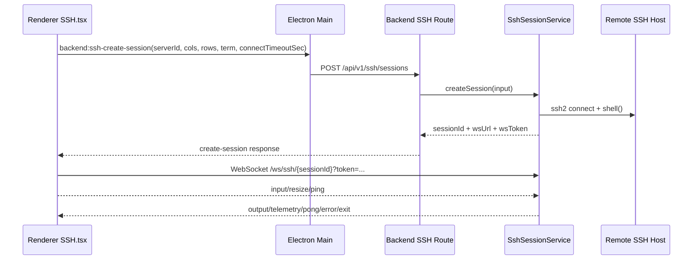

# SSH Terminal Implementation

## 1. Integration Overview (`ssh2` + `xterm.js`)

The SSH terminal is split into a control plane and a data plane:

- **Control plane**: Renderer calls the backend session-creation API through the Main-process backend proxy.
- **Data plane**: Renderer connects directly to the backend WebSocket and streams terminal I/O.

## 2. Backend Session Lifecycle

### Create Session

- Route: `POST /api/v1/ssh/sessions`
- Service: `SshSessionService.createSession`
- Inputs include viewport dimensions, connection timeout, strict-host-key policy, SSH compression policy, and optional system proxy rules.
- Backend loads the server and linked keychain, resolves trusted fingerprints, authenticates, opens an interactive shell with UTF-8 locale environment requests, records a login-audit result, registers live session state, and returns a short-lived attach token plus WebSocket endpoint.
- `LANG=C.UTF-8` and `LC_CTYPE=C.UTF-8` are requested through `ssh2`; `LC_ALL` is not injected, preserving remote user preferences for time, collation, and numeric formatting.

### Attach WebSocket

- Path: `/ws/ssh/{sessionId}?token=...`
- Invalid paths, malformed percent-encoding, unknown sessions, and invalid tokens fail closed with WebSocket close code `1008`.
- An existing attached socket is replaced with `1012`, keeping exactly one active client connection per session.
- Before attach, output is retained in a bounded queue of 2,048 chunks and 1 MiB. On attach, Backend sends `ready` before flushing retained output; overflow drops the oldest whole chunks and reports the dropped count.

### Close Session

- API-driven close uses `DELETE /api/v1/ssh/sessions/{sessionId}`.
- WebSocket close/error, SSH stream close, and SSH client errors use the same disposal path.
- Disposal sends `exit`, clears timers and live ownership, closes the SSH stream/client and WebSocket, finalizes `SshLoginAudit`, and updates the command count used for audit metadata.
- Main counts every non-disposed SSH session when evaluating window/app close. Approved bulk close calls the active-connections endpoint before destroying the window.

## 2.1 Connection Audit and Last-Used Sorting

- Server list payloads map `lastLoginAudit` to the latest successful login audit.
- Failed attempts remain persisted in `SshLoginAudit` for later inspection.
- Runtime audit events use request, session, and related-record correlation ids, sanitize metadata, and are emitted best-effort so logging cannot block connection lifecycle.

## 2.2 Local-First Security Audit Integration

`SshSessionService` writes login/session lifecycle events through `AuditEventService`. Successful and failed host verification, authentication, connection, and session-close outcomes retain enough correlated metadata to reconstruct an attempt without storing terminal output or credentials.

## 3. Data Stream Protocol

### Client → Server

- `input`: UTF-8 terminal input.
- `resize`: bounded terminal columns and rows.
- `ping`: heartbeat request.
- `close`: explicit disconnect request.

### Server → Client

- `ready`: WebSocket attach acknowledged.
- `output`: remote shell output.
- `telemetry`: CPU, memory, and network-rate snapshot.
- `pong`: heartbeat response.
- `error`: localized protocol/runtime error.
- `exit`: session closure with reason.

## 4. Host Verification and Trust Flow

- SSH connects with SHA-256 host hashing and `hostVerifier`.
- Strict mode requires a trusted fingerprint and otherwise returns `SSH_HOST_UNTRUSTED`.
- Non-strict mode accepts an unknown fingerprint for that attempt.
- For an unknown strict-mode fingerprint, Renderer shows the trust dialog; user confirmation calls the trust endpoint and retries session creation with the same target snapshot.

## 4.1 SSH Transport Compression

- The persisted server default is disabled.
- Disabled sessions explicitly negotiate `algorithms.compress = ['none']`.
- Enabled sessions prefer `zlib@openssh.com`, then `zlib`, then `none` for compatibility.
- Session creation may carry the resolved server's explicit setting so split panes and retries preserve the same transport policy. SFTP and port forwarding read the same server field.

## 5. Exception Handling and Reconnect

- Session attach timeout is 30 seconds.
- Socket close/error marks the owning pane failed; manual retry targets that pane and preserves sibling runtimes.
- Retry uses the tab's latest resolved target snapshot. If no snapshot exists, it falls back to fresh target resolution.
- Every attempt has an abortable identity; stale async results are dropped and their late sockets/session ids are closed.
- A replacement backend PTY is an explicit xterm session boundary. Renderer invalidates the old attempt, closes the old transport, captures the normal buffer without alternate-buffer content or modes, then writes reset bytes plus the sanitized snapshot as one ordered local xterm write. These bytes never reach `onData` or the backend PTY.
- The boundary clears parser state, selection, decorations, and session-local VT modes while retaining dimensions, options, addons, WebGL attachment, and event handlers. Serialization failure permits a clean reset instead of blocking recovery.
- Hidden tabs do not initiate connections. With `sshReconnectOnFocus`, reactivating a tab reconnects failed panes that have no connecting/open socket. There is no automatic exponential reconnect loop.

## 6. Performance and Renderer Interaction

- Output flushing is bounded and arrival-ordered so detached sessions cannot grow indefinitely.
- Terminal instances, addons, renderers, dimensions, and listeners persist across layout-only changes and reconnect attempts.
- Fit/resize work is animation-frame scheduled and synchronized with active sockets.
- WebGL acceleration is synchronized per pane and disabled with user feedback after context loss.
- Settings-driven xterm options include cursor, font, scroll, accessibility, contrast, character-width, inline-image, link, clipboard, and selection behavior. Invalid numeric values retain safe defaults.
- Split panes have deterministic grid placement and stable DOM ancestry. Each pane owns its transport state, xterm instance, fit/search/serialize addons, clipboard provider, and reconnect callback.
- Selection geometry uses xterm buffer coordinates first so WebGL rendering does not invalidate Orbit Bar and context-menu positioning.

## 7. Developer Debug Checklist

1. Inspect the session-creation payload and validation result.
2. Confirm whether host verification returned a session or `SSH_HOST_UNTRUSTED`.
3. Match WebSocket session id and attach token.
4. Verify `input` writes and `output` flush direction.
5. Exercise API close, transport close, and SSH error disposal paths.
6. For split panes, reproduce the issue on the owning pane and confirm sibling runtimes remain mounted.

## 8. Windows Context Launch

- Installer integration can register **Open terminal in Cosmosh** in Explorer.
- Explorer launches Cosmosh with `--working-directory <path>`.
- Main retains the path as one-shot launch context.
- `terminalContextLaunchBehavior` controls whether Renderer opens the default local terminal, opens Home focused on Local Terminals, or ignores the context.
- Default-profile selection honors `defaultLocalTerminalProfile` and falls back to the first available profile.
- A second instance pushes pending launch context to Renderer through IPC.
- On local-terminal session creation, Main forwards `cwd` once; Backend validates it and falls back to the user home directory when it is unavailable.

## 9. Keychain Credential Runtime

- SSH sessions resolve authentication material from `SshServer.keychainId`.
- Keychain auth variants are `password`, `key`, and `both`.
- Hidden keychains without remaining server references are eligible for automatic cleanup.
- Second-instance resolution uses both CLI arguments and Electron `workingDirectory` as fallback context.

## 10. macOS CLI Context Launch

- Packaged builds create `~/Library/Application Support/Cosmosh/bin/cosmosh`.
- The launcher invokes the app with `--working-directory "$PWD"`.
- Main attempts PATH symlinks in `/opt/homebrew/bin` and `/usr/local/bin`; permission failures warn without blocking startup.
- Once launched, context handling follows the same one-shot local-terminal flow as Windows.

## 11. Server Proxy Resolution

- Global proxy mode is `off`, `system`, or `custom`; default is `system`.
- Server proxy mode is `default`, `off`, or `custom`; `default` inherits global settings.
- Custom URLs support `http://`, `https://`, and `socks5://`, including credentials. Paths, query strings, and fragments are rejected.
- For system mode, Renderer asks Main to resolve the target through Electron and sends the transient rule string with session creation.
- Backend parses ordered `PROXY`, `HTTPS`, `SOCKS5`, and `DIRECT` candidates, opens the selected tunnel, and injects the socket into `ssh2`.
- Candidates share the connection timeout. Failure is terminal unless later `DIRECT` rules remain available.
