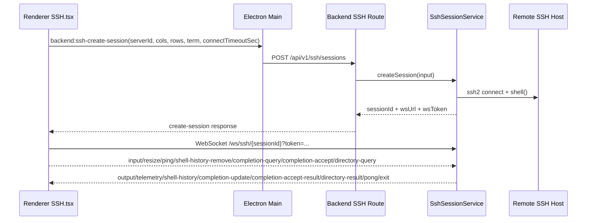
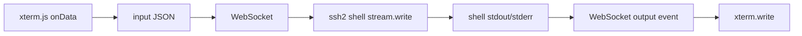
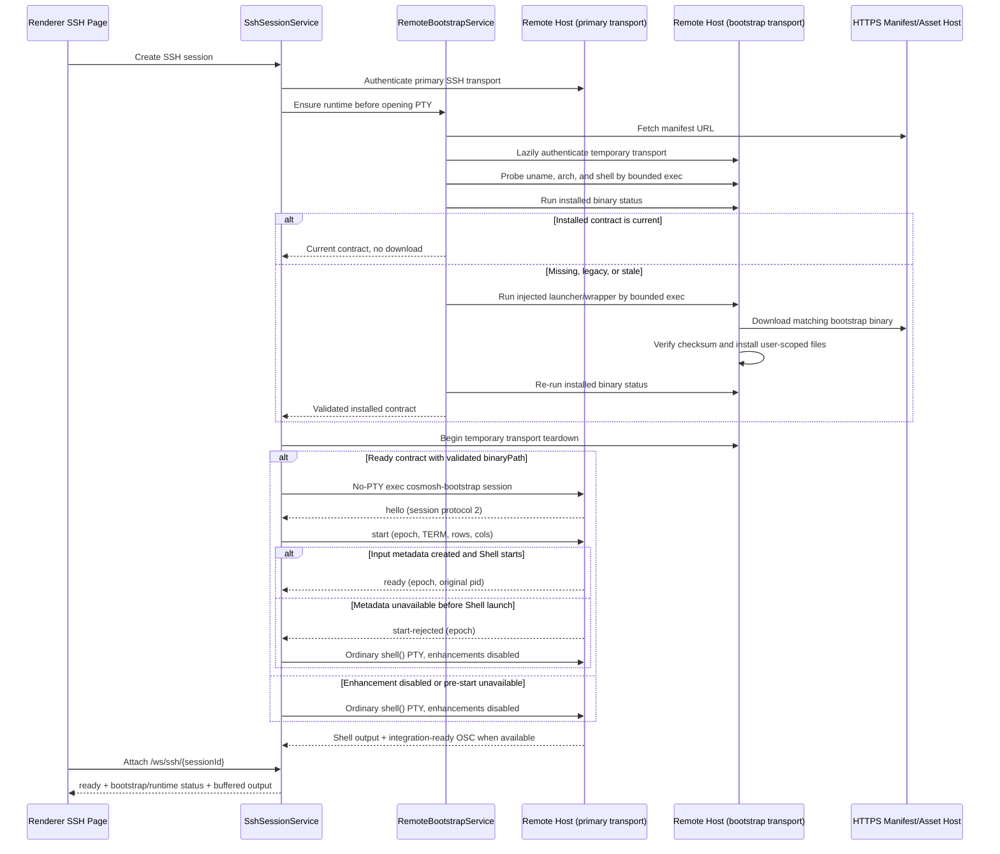

# SSH Terminal Implementation

## 1. Integration Overview (`ssh2` + `xterm.js`)

Cosmosh terminal path is split into control plane and data plane:

- **Control plane**: Renderer calls backend session creation through Main IPC bridge.
- **Data plane**: Renderer connects directly to backend WebSocket session endpoint and streams terminal I/O.



## 2. Backend Session Lifecycle

### Create Session

- Route: `POST /api/v1/ssh/sessions`
- Service: `SshSessionService.createSession`
- Request fields:
  - `cols` / `rows`: terminal viewport dimensions.
  - `connectTimeoutSec`: per-session SSH handshake timeout from Settings (`sshConnectionTimeoutSec`).
  - `strictHostKey`: explicit per-attempt host key policy propagated from SSH server configuration.
  - `enableSshCompression`: explicit per-attempt SSH transport compression policy propagated from SSH server configuration.
- Steps:
  1. Load server record + linked keychain encrypted credentials.
  2. Resolve trusted host fingerprints.
  3. Authenticate the primary SSH transport, complete optional pre-shell Remote Enhancements work on a temporary transport with the same connection policy, then open the primary shell through `ssh2.Client.shell` with a UTF-8 locale request.
  4. Write `SshLoginAudit` record:
     - `result = success` on successful session creation, with `sessionId` and `sessionStartedAt`.
     - `result = failed` on host-trust/auth/connect failures, with `failureReason`.
  5. Register live session state in memory (`Map<sessionId, SshLiveSession>`).
  6. Return short-lived attach token + WS endpoint.

Locale behavior:

- SSH shell creation requests `LANG=C.UTF-8` and `LC_CTYPE=C.UTF-8` through `ssh2` shell environment options, so UTF-8-aware terminal programs inherit a Unicode character type locale by default.
- `LC_ALL` is not set, leaving remote user preferences for time, collation, and numeric formatting intact.
- Cosmosh does not inject locale commands into the interactive shell stream. SSH servers may ignore these environment requests when their `sshd_config` does not accept them.

### Attach WebSocket

- Path: `/ws/ssh/{sessionId}?token=...`
- Invalid or malformed path encoding, token, or session is rejected (`1008`) without allowing URL decode errors to escape the connection boundary.
- Existing attached socket is replaced (`1012`) to support single active attach. Close/error events from the superseded socket are ignored after ownership moves to the new socket.
- Before attach, visible output and trusted helper events share one bounded arrival-ordered stream-frame queue (2,048 frames and 1 MiB). Attach sends `ready`, pending bootstrap statuses, and the current enhancement runtime status before flushing retained frames; overflow evicts the oldest whole frames without regrouping the remaining output and events.

### Close Session

- API-driven close: `DELETE /api/v1/ssh/sessions/{sessionId}`
- Transport-driven close: socket close/error, SSH stream close, SSH client error.
- Dispose behavior: send terminal `exit` event before marking the session disposed, then clear runtime ownership, close SSH stream/client, and close WS.
- Audit finalization: update matching `SshLoginAudit` with `sessionEndedAt` and `commandCount`.
- Main treats every non-disposed entry in the SSH session registry as active when evaluating a window/app close. If the user approves the renderer warning dialog, `DELETE /api/v1/runtime/active-connections` closes all SSH sessions through the same service disposal path before the window is destroyed.
- The General > Behavior `Ask Before Closing Window` setting defaults on. When disabled, Main skips the renderer dialog but still calls the bulk-close endpoint before continuing the close; setting read failures retain the warning.
- Local terminal sessions and SSH transports owned only by port-forwarding rules are not counted by this close warning.

## 2.1 Connection Audit and Last-Used Sorting

- Server list payload maps `lastLoginAudit` to the latest **successful** login audit (`result = success`).
- This keeps "sort by last used" aligned with actual successful connections instead of failed attempts.
- Failed attempts are still persisted in `SshLoginAudit` for future query/audit features.

## 2.2 Local-First Security Audit Integration

- SSH runtime now emits additional local-first `AuditEvent` records for security-core operations while preserving `SshLoginAudit` compatibility.
- Current SSH-adjacent audit categories include:
  - `ssh-session`: connect success/failure and close lifecycle events.
  - `ssh-host-trust`: explicit trust-fingerprint confirmation events.
  - `ssh-server` / `ssh-keychain`: server/keychain entity mutations in route layer.
- Correlation strategy:
  - `requestId` tracks request-scope action chains.
  - `sessionId` tracks runtime session continuity.
  - `relatedRecordId` links compatible records (for example existing login-audit IDs where applicable).
- Metadata is sanitized before persistence, so secret-like fields are redacted by key policy and size-capped.
- Audit emission is best-effort and does not fail SSH session creation/close flows when logging fails.

## 3. Data Stream Protocol

### Client → Server

- `input`: raw terminal input bytes as UTF-8 string.
- `resize`: terminal cols/rows with bounded normalization.
- `ping`: heartbeat.
- `close`: explicit disconnect request.
- `shell-history-remove`: request exact native removal using the displayed source ID and complete command text. No unbound history deletion is accepted.
- `completion-query` / `completion-cancel` / `completion-accept`: opaque query, cancellation and candidate selection. No current input, guessed directory, source preferences or replacement text is accepted.
- `directory-query` / `directory-cancel`: request or cancel a fresh directory-only observation for an explicit action.

### Server → Client

- `ready`: attach acknowledged.
- `output`: shell stdout/stderr output.
- `telemetry`: CPU/memory/network + command history snapshot.
- Local terminals publish no history source; telemetry contains an empty `recentCommands` array and no history files are read.
- `shell-history`: exact newest-first native records with their current source, or an explicit empty reason.
- `shell-history-remove-result`: request/source-bound native removal outcome; `removed-from-reader` leaves file persistence unconfirmed.
- `completion-update`: cumulative display-only candidates, source statuses and exact snapshot/context identity.
- `completion-accept-result`: confirmed application or explicit stale/unavailable/unsupported/unknown outcome.
- `directory-result`: fresh context-bound directory, or an explicit failure with no directory.
- `bootstrap-status`: remote bootstrap probe/download/install status from the backend side-channel installer.
- `remote-enhancement-runtime-status`: backend-owned `pending`, `active`, or `disabled` trust state plus the validated helper contract.
- `remote-shell-event`: helper shell state forwarded only through the active runtime gate.
- `pong`: ping response.
- `error`: protocol/runtime error.
- `exit`: terminal session closed with reason.

### 3.1 History Synchronization Model

- SSH history comes only from an eligible original Shell through its native history API. Qualified Bash 5.1/5.2, Zsh 5.8/5.8.1/5.9 and Fish 4.0.1 can publish a source; unsupported versions or editor/history policies report unsupported or unavailable.
- An attached session refreshes history after the helper advertises `history-read` and a current editor binding becomes available. Reads wait for any existing private editor exchange to finish; waiting is cancellable and never blocks ordinary PTY input.
- Each accepted native observation replaces all history copies. The source ID belongs to one Shell identity, namespace and permission lifetime. No mixed-file scan or file-rewriting fallback remains in SSH history.
- Local terminal launch, Enter and telemetry never scan Shell or program history files. Its native history keys remain owned by the local Shell.
- SSH and local input handlers forward PTY bytes without retaining a command buffer or adding input to completion history. Password prompts and interactive programs share the same input stream, so Enter alone cannot establish a Shell command. History comes only from Shell-owned history sources; raw `cd` input does not change the completion directory.
- When an active trusted helper advertises `command-start`, backend treats each unique `commandId` as the authoritative command-count and delayed history-refresh trigger. Duplicate lifecycle events do not double count.
- Private, unavailable or unsupported observations clear old records and pending actions. Permission revocation, Shell replacement and accepted editor-unavailable/command-start events invalidate the source; duplicate or stale events do not.
- `shell-history` publishes exact newest-first records with a source ID, or an explicit empty reason. Snapshot completion consumes that current native view directly. Telemetry cannot restore stale entries to the native sidebar.
- Removal requires confirmation explaining exact-text matches, shared native history and unconfirmed file updates. `shell-history-remove` binds the request to the displayed source and exact cached record; its result also binds the request ID. Multiline/control records offer complete copying, with insert/run disabled rather than flattening the command.

### 3.2 Auto-Complete Model

- Renderer sends only opaque query intent and candidate IDs. Backend waits for the delivered terminal boundary, reads the original editor and applies its persisted source/matching preferences. Prompt text, rendered xterm rows and locally reconstructed input are not completion authority.
- `use-ssh-completion.ts` scopes query, cancellation and acceptance to the original pane/socket/session. `terminal-completion-state.ts` rejects stale snapshot/context identities and preserves the selected candidate by ID as cumulative batches arrive.
- Only qualified SSH editors offer precise completion. Local terminals return `unavailable`, read no history files or guessed-CWD paths, and retain ordinary input plus native Shell Tab/history keys.
- Alternate buffers, IME composition, changed input, pane changes and disconnected or unconfirmed editors release menu ownership. Saved login password fill remains a separate explicit action.
- Static command metadata, current native history, snapshot-derived paths and eligible Fish completion are combined by `SnapshotCompletionController`; source results append without replacing the visible list with an empty intermediate result.
- `packages/backend/scripts/generate-inshellisense.mjs` generates spec dataset plus locale resources with language-specific policy:
  - `packages/backend/src/terminal/completion/generated-inshellisense.ts` keeps command structure as a compact tuple payload and inflates it at module load; generated entries keep `descriptionI18nKey` references only (no duplicated raw description text payload).
  - `packages/i18n/locales/en/backend-inshellisense.json` is fully regenerated from upstream descriptions.
  - `packages/i18n/locales/zh-CN/backend-inshellisense.json` keeps only manually translated keys whose English source text is unchanged; new keys are not auto-filled, and keys are pruned when source text changes or is removed.
- Backend scope i18n merges `backend-inshellisense.json` into `backend.json`, so completion descriptions can be translated without mixing generated keys into base backend locale files.
- Generator sanitizes LS/PS Unicode separators (`U+2028`/`U+2029`) to keep generated TypeScript files free of unusual-line-terminator warnings.
- `completion/metadata.ts` reads the imported catalogue using already-decoded snapshot words. Completed command/subcommand names and flags are case-sensitive; `ssh-keygen -a` therefore keeps its own value metadata instead of borrowing `-A`. Unknown flags, unresolved subcommands and `--` stop interpretation. Catalogue literals remain one argument; explicit multiword snippets still pass through Shell-specific quoting.
- Matching preserves meaningful whitespace and Unicode, prioritizes literal prefix/substring matches and optionally permits subsequences. Within a history match class, native recency takes priority. Explicit semantic Fish results rank before generic sources so a large directory/history cannot hide every requested native result; Fish order is retained for ties. Deduplication compares the complete resulting input and cursor.
- History, metadata, paths and Fish each obey their independent permission and saved display/query preferences. Path queries use only the same observation's original physical CWD/HOME and a two-second session cache, with bounded remote execution and cancellation cleanup. Source failure leaves other valid candidates visible.
- **Saved login password fill** is a separate explicit action. The backend recognizes common English password prompts in a bounded visible output tail; this heuristic does not establish the requesting program's identity. The button names the saved server login password so the user can decide whether it is appropriate. Local terminals and key-only sessions have no eligible password; a private-key passphrase is never used.
- The backend emits only an opaque one-use token and a 45-second expiry. Any input, new prompt, trusted command/prompt transition, or disposal invalidates the old offer. Complete SGR styling and bracketed-paste mode switches (`CSI ?2004h/l`) preserve visible text, including when a switch and the next password prompt share one output chunk; they and spaces cannot extend an existing offer's lifetime. Cursor/erase controls and fragmented escapes discard retained prompt text. A bounded 64-character control prefix fences unfinished sequences across chunks, while OSC/DCS/SOS/PM/APC payloads are discarded without retention; payload newlines and consumed final characters cannot create offers. Fresh visible text is required after rejection. A prompt split around an unfinished styling sequence may remain unavailable until it is fully redrawn.
- A click sends `credential-fill { token }`. The backend checks the registered session, current open WebSocket, PTY, token, expiry, eligible password, and persisted permission again after awaiting settings. Replaced sockets are rejected at the shared message boundary. The token is consumed before writing, so concurrent clicks cannot fill twice.
- Input, helper transitions and token consumption clear the offer while preserving unfinished output-control framing. Only a new or disposed output stream fully resets that framing; input cannot turn an invisible control suffix into a new password prompt.
- The action writes the exact saved login password without adding Enter. Values containing control characters or exceeding 8 KiB are ineligible. The renderer receives only offer/result metadata; credentials never enter completion responses, diagnostic history, or action logs. The user presses Enter manually after filling.
- The persisted key `terminalAutoCompletePasswordEnabled` is retained for compatibility, but now controls this independent action. Ordinary autocomplete may be disabled while the action remains enabled. Unsupported prompt formats simply expose no action.
- Acceptance sends only the chosen snapshot/candidate IDs. Backend owns the complete literal edit, stops slow sources, waits for cleanup and rechecks settings, original editor state and ordered input authority immediately before mutation. Applying fills without Enter; unknown results never retry automatically.
- Candidate descriptions are display data: the Renderer resolves an optional `detailI18nKey`, then a bounded source detail or localized source label. Insert text, edit ranges and ranking scores remain private to Backend.
- Suggestions appear passively. Until explicitly focused, `Tab`, arrows, `Enter`, and `Escape` retain their native terminal behavior.
- `terminalAutoCompleteFocusShortcut` selects the entry shortcut: `Ctrl+Shift+Space` (default), `Ctrl+Alt+Space`, or `Alt+/`. Clicking the menu also enters it; clicking a candidate fills that candidate.
- Only the focused list consumes unmodified arrows, `Escape`, and the configured apply keys (`terminalAutoCompleteAcceptKeys`: `Tab`, `Enter`, or both). An unconfigured `Enter` retains Shell submission behavior. Mouse and keyboard actions identify the exact displayed candidate ID; a removed nonselected row cannot silently map to another edit.
- Typing, modified keys, IME composition, pane/tab changes, blur, disconnect, and disabling autocomplete release list ownership. The first input event is forwarded unchanged, and invalidated request responses cannot reopen an old list. A pending manual request never owns ordinary terminal keys.
- The list exposes its active option through the xterm input's temporary combobox accessibility attributes. DOM focus remains in xterm so typing and composition continue normally; the original attributes are restored when the list closes.
- Closing an already empty menu preserves its list identity and skips unchanged focus/selection updates. Primary and secondary panes invalidate submission context first, then forward each ordinary input chunk once before optional autocomplete UI work. Both steps remain synchronous; UI exceptions are reported with pane identity only, so a rendering failure cannot discard the key or log private input. Fast-character browser coverage includes readable input, permission opt-out and disabled suggestions.
- Suggestion panel layout constraints:
  - panel anchor is clamped to terminal viewport bounds and recomputed when its wrapper or pane resizes,
  - panel width is computed from current pane available space (capped at desktop width target) and anchor clamping uses the computed width to avoid horizontal overflow,
  - panel body uses max height + vertical scroll (`max-h`) to keep large candidate sets fully reachable,
  - long labels/details are truncated to avoid horizontal overflow.



## 4. Host Verification & Trust Flow

- SSH connect uses `hostHash: 'sha256'` and `hostVerifier`.
- `strictHostKey=true`: host fingerprint must be trusted; unknown fingerprint returns `SSH_HOST_UNTRUSTED`.
- `strictHostKey=false`: unknown host fingerprint is accepted for that session attempt.
- If fingerprint is unknown:
  - backend returns `SSH_HOST_UNTRUSTED` payload.
  - renderer opens trust dialog.
  - user confirmation calls trust endpoint.
  - renderer retries create-session.

## 4.1 SSH Transport Compression

- SSH server records persist `enableSshCompression`, defaulting to `false`.
- The SSH server editor exposes this as a server-level switch under Security.
- When disabled, backend passes `algorithms.compress = ['none']` to `ssh2`, making the default "no transport compression" policy explicit.
- When enabled, backend prefers `zlib@openssh.com`, then `zlib`, and finally `none` as a compatibility fallback.
- SSH terminal session creation may carry an explicit `enableSshCompression` value so retry/split flows stay bound to the resolved server snapshot.
- SFTP sessions and port-forwarding starts read the same persisted server flag on the backend, so shell, file-system, and forwarding transports remain aligned.

## 5. Exception Handling & Reconnect

### Current Behavior (Implemented)

- Session attach timeout: 30s.
- Any socket close/error transitions UI state to failed.
- Retry is available manually through the UI retry button (`SSH.tsx`) and targets the active pane only. Its temporary target-readiness transition does not dispose or reconnect sibling pane runtimes.
- Retry is bound to the tab's latest resolved target snapshot and never re-reads global target selection.
- If the first connect fails before any snapshot is captured, manual retry falls back to fresh intent resolution for that tab.
- Each connect attempt has attempt identity (`attemptId`) with stale-result dropping and abortable pre-connect resolution.
- A pane keeps its xterm instance, loaded addons, renderer, dimensions, and event listeners across reconnect, but a replacement backend PTY is an explicit terminal-emulator session boundary. Renderer first invalidates the previous attempt, closes the previous WebSocket/backend session, drains queued old-session writes, and captures the normal buffer through `SerializeAddon` with `excludeAltBuffer` and `excludeModes` before creating the next backend session.
- The ordered boundary verifies that the attempt still owns the pane, clears pane reducer state, command markers/timeline, and autocomplete bookkeeping, then writes CAN + RIS followed by the sanitized normal-buffer snapshot, SGR reset, and a separating newline as one local xterm output chunk. This is necessary because xterm 6's synchronous JavaScript `Terminal.reset()` does not clear queued writes or an incomplete parser sequence. The reset bytes and snapshot are never sent through `onData`, WebSocket, or the backend PTY.
- The session-boundary reset returns xterm to the normal buffer, rebuilds retained text/style scrollback without restoring the alternate buffer, clears selection/decorations, resets parser state and session-local VT modes (including application cursor keys, mouse tracking, bracketed paste, insert, and origin), and retains terminal options, rows/columns, addons, WebGL attachment, and registered event/parser handlers. Inline images, command markers/timeline, selection, and alternate-buffer content are intentionally session-local and are not restored.
- If normal-buffer serialization fails, renderer logs the failure and continues with a clean reset rather than blocking reconnection; history preservation is best-effort while PTY recovery remains available.
- The same boundary applies when Cosmosh replaces a local-terminal PTY: SSH and local PTYs are independent sessions even though they share the renderer controller. Initial connection attempts do not reset a newly created xterm.
- Primary and secondary panes both gate reset and session creation with their pane-local attempt identity. Reset and history replay share one ordered xterm write, so an attempt superseded after capture cannot expose an empty or partially restored buffer to its successor. A stale attempt cannot attach its late WebSocket/session result; late results are explicitly closed.
- Hidden tabs do not trigger new connection side effects; only active tab can start connect flow.
- When `sshReconnectOnFocus` is enabled, reactivating a tab reconnects every failed pane that has no connecting/open socket. The first activation of a deferred tab always starts its primary pane, independently of that preference.
- No automatic exponential reconnection loop is implemented yet.

### Recommended Next Step (Planned)

- Add bounded auto-reconnect only for transient WS transport failures.
- Keep host-verification and auth failures as terminal (non-retriable) errors.

## 6. Performance Strategies in Current Code

- Renderer binds Settings `sshMaxRows` to xterm `scrollback` when initializing SSH terminal.
- Renderer uses `FitAddon` + resize observer to keep shell size synchronized.
- Renderer uses `@xterm/addon-webgl` for hardware-accelerated terminal rendering when Settings `terminalHardwareAccelerationEnabled` is enabled (default on).
- Renderer can use `@xterm/addon-image` for experimental terminal inline images when Settings `terminalInlineImagesEnabled` is enabled (default off). The addon parses SIXEL and iTerm inline image protocol output for newly created SSH and local-terminal panes.
- Renderer uses `@xterm/addon-web-links` to detect HTTP/HTTPS URLs in terminal output when Settings `terminalWebLinksEnabled` is enabled (default on).
- Backend normalizes terminal sizes to prevent extreme allocations (`20-400 cols`, `10-200 rows`).
- Backend rejects any single client WebSocket message above 1 MiB with close code `1009`, before terminal JSON parsing or transport writes.
- Pending output queue avoids losing early SSH output before WS attach.
- Pending output buffering is bounded by chunk count and total bytes; overflow drops oldest chunks and emits drop logs.
- Telemetry sampling is interval-based (5s) and lightweight text parsing to reduce per-frame cost.
- Background SSH exec probes used by telemetry, history, and completion are capped at 15 seconds and 1 MiB stdout; timeout, excessive output, synchronous client failure, or channel error resolves as unavailable data instead of leaving periodic work in flight.
- History refresh uses debounce + throttle to balance freshness and remote execution overhead.

## 6.1 Renderer-Configurable xterm Options (Settings-Driven)

Renderer now maps terminal runtime behavior from Settings to `ITerminalOptions` during `Terminal` initialization in `SSH.tsx`.

- **Theme / SSH Style**:
  - `altClickMovesCursor`, `cursorBlink`
  - `fontFamily`, `fontSize`
- **Theme / Advanced Style**:
  - `cursorInactiveStyle`, `cursorStyle`, optional `cursorWidth`
  - `customGlyphs`, `fontWeight`, `fontWeightBold`, `letterSpacing`, `lineHeight`
- **Terminal / Advanced Terminal**:
  - `drawBoldTextInBrightColors`
  - `scrollSensitivity`, `fastScrollSensitivity`, `minimumContrastRatio`
  - `screenReaderMode`, `scrollOnUserInput`, `smoothScrollDuration`, `tabStopWidth`
- **Terminal / Runtime**:
  - `terminalHardwareAccelerationEnabled` controls optional `WebglAddon` loading for SSH and local terminal sessions, including split panes. The setting defaults to enabled.
  - `terminalInlineImagesEnabled` controls optional `ImageAddon` loading for SSH and local terminal sessions, including split panes. The setting defaults to disabled and is constructor-driven: changing it applies to newly created terminal instances.
  - `terminalInlineImageOptions` is a JSON setting edited through Settings Editor with a strict JSON Schema. Exposed fields are limited to `enableSizeReports`, `pixelLimit`, `sixelSupport`, `sixelScrolling`, `sixelPaletteLimit`, `sixelSizeLimit`, `storageLimit`, `showPlaceholder`, `iipSupport`, and `iipSizeLimit`; Kitty/TGP options are intentionally not exposed in this pass.
  - Inline images support SIXEL and iTerm inline image protocol output only when enabled. Remote output can allocate decoded image buffers, so validation bounds pixel count, sequence byte limits, storage MB, and caps `sixelPaletteLimit` at `4096`.
  - Inline image and WebGL addons are designed to coexist: renderer loads `ImageAddon` before `terminal.open(...)`, then synchronizes `WebglAddon` after open so WebGL can bind the mounted renderer. Image addon initialization failures log a warning and do not disable WebGL or block terminal startup.
  - Inline image rendering pins only the image canvas above renderer canvases and forces that image layer to use a synchronized transparent 2D context. xterm remains responsible for DOM row, selection, decoration, and link stacking so selection text contrast stays consistent with the default renderer; the transparent context prevents the full image canvas layer from becoming an opaque black overlay when WebGL is active.
  - Inline image decoding depends on WebAssembly inside `@xterm/addon-image`, so the renderer CSP allows `script-src 'wasm-unsafe-eval'` while still omitting general JavaScript `unsafe-eval`.
  - `ignoreBracketedPasteMode` is derived from Settings `terminalBracketedPasteEnabled` (`false` when enabled, `true` when disabled).
  - Paste safety warnings are page-level guards in `SSH.tsx` before input reaches `terminal.paste(...)` or raw websocket `input`. Defaults are: `terminalWarnOnMultiLinePaste=true`, `terminalWarnOnLargePaste=true`, `terminalLargePasteWarningThreshold=5120`, and `terminalWarnOnControlCharactersPaste=true`.
  - Control-character paste detection checks for embedded ESC, BEL, ANSI control sequences, and C0/C1 control bytes other than tab/newline forms. Warning dialogs are per-paste decisions; accepting one paste does not disable later warnings.
  - Character width compatibility is derived from Settings `terminalCharacterWidthCompatibilityModeEnabled`; when enabled, renderer loads `@xterm/addon-unicode11` and switches xterm to Unicode 11 width tables for newly created terminal instances.
  - Unicode width switching uses xterm's proposed `unicode` namespace, so renderer-created SSH/local terminal instances set `allowProposedApi: true` before loading `@xterm/addon-unicode11`.
  - Context-menu paste, drag-and-drop text insertion, and selection-toolbar insert route through xterm `terminal.paste(...)` when enabled, so shell-side bracketed paste mode can keep multiline payloads from executing immediately.
  - `terminalCopyOnSelectionEnabled` defaults to `false`. When enabled, xterm selection-change events copy non-blank terminal selections to the system clipboard through `navigator.clipboard`; pure whitespace selections are ignored.
  - `terminalRightClickSelectsWord` maps directly to xterm `rightClickSelectsWord` and defaults to `false`.
  - `terminalForceSelectionModifier` defaults to `off`. `alt` maps to xterm `macOptionClickForcesSelection=true` and disables `macOptionIsMeta` for that terminal instance to avoid Option-key conflicts on macOS. `shift` and `ctrl` are persisted as setting values for future platform-specific selection handling, but current xterm-native behavior is only the macOS Option-click path.
  - `@xterm/addon-clipboard` is loaded with a Cosmosh-owned provider for terminal clipboard reads/writes (OSC 52).
  - Remote SSH sessions read clipboard policy from the server record field `terminalClipboardAccess`; local-terminal sessions read Settings `localTerminalClipboardAccess`.
  - Both policies default to `off`. Supported modes are `off`, `writeAskRead`, `readWrite`, and `askAlways`.
  - Write/read operations always surface a toast unless the operation was just approved through the explicit permission dialog; that approval is scoped to the single clipboard request.
  - `@xterm/addon-clipboard` handles protocol base64 encoding/decoding; the provider only receives and returns decoded text before calling `navigator.clipboard`.
  - `@xterm/addon-serialize` is loaded for every SSH/local xterm instance, including split panes, so renderer actions can serialize active selections without reaching into xterm internals.
  - The terminal context menu exposes `Copy as HTML` only when the active pane has a selection. The action serializes only the selected range with `serializeAsHTML({ onlySelection: true, includeGlobalBackground: true })` and writes one Clipboard API item containing both `text/html` and `text/plain`; it does not send data to backend sessions or persist clipboard history.
  - `terminalWebLinksEnabled` controls `@xterm/addon-web-links` loading for SSH and local terminal sessions, including split panes. The setting defaults to enabled, applies only to newly created xterm instances, and opens recognized HTTP/HTTPS links through Cosmosh's Electron external URL bridge.
  - `terminalWebLinksRequireModifierKey` defaults to enabled. When enabled, Windows/Linux links require `Ctrl+Click`, macOS links require `Cmd+Click`, plain clicks only select/focus terminal text, and link hovers show the pointer cursor only while the required modifier key is held. When disabled, a primary-button click opens links directly. Secondary-button clicks never open terminal links so right-click remains reserved for terminal context menus; on macOS, `Ctrl+Click` is also reserved for that context-menu gesture and never opens terminal links.

Notes:

- Optional numeric values (for example `cursorWidth`) are parsed defensively; invalid or empty input falls back to xterm defaults.
- Existing `sshMaxRows` remains bound to xterm `scrollback`.
- SSH server records may opt out with `disableCharacterWidthCompatibilityMode`; the effective rule is global setting enabled and server opt-out disabled. Local terminal sessions only use the global setting.
- Character width changes apply only to newly created xterm instances; existing SSH panes keep their active Unicode width provider until the pane/session is recreated.
- WebGL loading is best-effort: initialization failures fall back to xterm's default renderer without failing the terminal session. If WebGL context is lost, renderer disposes the add-on, disables WebGL retries for that SSH page runtime, and shows a one-time warning.

## 6.2 Split-Pane Terminal Interaction Model

- Renderer supports a constrained split progression in `SSH.tsx`:
  1. single pane,
  2. two side-by-side panes,
  3. three side-by-side panes,
  4. right-most pane split into two stacked panes.
- Split action is exposed from the terminal context menu (`Split Terminal`), and close action is exposed as `Close Terminal`.
- Terminal context menu renders platform-resolved shortcut hints for `Copy`, `Paste`, `Find...`, and `Clear Terminal`, and matching keyboard handling is wired for these actions (`⌘C`/`⌘V`/`⇧⌘F`/`⌃L` on macOS hints, `Ctrl+Shift+C`/`Ctrl+Shift+V`/`Ctrl+Shift+F`/`Ctrl+L` on non-macOS with active handlers). `Copy as HTML` is intentionally menu-only because it depends on a selected rich xterm range rather than a terminal-standard keyboard shortcut.
- Terminal right-click behavior is controlled by Settings `terminalRightClickAction` and defaults to `contextMenu`. `paste` consumes right-click and pastes clipboard text through the same paste-warning path. `copyOnSelectionElsePaste` copies the active pane selection when one exists, otherwise it pastes through the same paste-warning path.
- When an SSH tab becomes active, renderer restores keyboard focus to the active xterm instance so typing lands in the terminal immediately after tab switching.
- Maximum visible panes are capped at 4 in current implementation.
- Each split pane creates its own backend terminal session against the same resolved target (same SSH server/local profile), so panes can run independent commands.
- Secondary panes reuse the primary pane's resolved target snapshot semantics on retries.
- New split panes start from an empty viewport and render only their own session stream to avoid stale buffer carry-over from other panes.
- Every pane owns an independent xterm, WebSocket, backend session, transport state, telemetry, completion state, Remote Enhancements trust state, cwd, line state, debug history, and command markers. Primary and secondary messages pass through the same pane-aware reducer.
- Closing any pane disposes only that pane's socket/backend session and leaves surviving pane ids and runtimes unchanged. Closing the original primary does not transfer ownership by renaming another pane.
- Completion popup anchoring is resolved against the currently active pane container, and primary-pane ref updates must not overwrite active mirror-pane geometry after rerenders.
- In-terminal text search is implemented with xterm `SearchAddon` in both primary and mirror panes. `Find...` opens the shared `SearchReplacePanel` in find-only mode, with configurable filter toggles (`Case Sensitive` / `Regex`) plus compact previous/next navigation actions to highlight matches in the active pane.
- Search highlight decorations are explicitly cleared when the query becomes empty or the search panel is dismissed, which prevents stale search markers from keeping extra memory alive after search exits.
- Orbit Bar stays suppressed for the full search lifecycle (including empty query state and ESC close path) so search highlight flows do not re-open selection actions unexpectedly.
- Orbit Bar and selection-dependent terminal context-menu actions resolve selection geometry from xterm `getSelectionPosition()` first, with DOM selection blocks only as fallback. This keeps `WebglAddon` canvas rendering compatible with Orbit Bar placement and `Search Online` enablement.
- Orbit Bar and the terminal context menu hand explicit paths to SFTP. `./` and `../` require the source pane's current physical CWD; `~` requires confirmed HOME. Click actions reread that pane by id, even before a pane-activation render completes. Missing metadata disables the dependent action. Absolute paths/file URLs remain available; bare relative names and multiline selections are rejected. Backslashes, filename punctuation and quoted spaces are preserved.
- Opening a selected directory in SFTP always creates a new SFTP tab with that `initialPath`, even when another SFTP tab for the same server already exists, and does not replace the active SSH terminal tab.

## 6.3 Command Timeline

- Command Timeline defaults on under Settings > Terminal > Runtime. Each eligible SSH pane uses a 40 px right-edge command gutter only while the setting is enabled and its authenticated Remote Enhancements runtime is active and advertises `command-start`. The gutter combines a 34 px recent-command rail on the left with xterm's 6 px scrollbar on the right and sits flush against the pane edge without trailing root padding. Renderer reserves the rail through xterm padding and expands xterm's scrollable element across the full gutter, keeping the native scrollbar inside the element that owns its hover reveal, track clicks, and thumb dragging. Turning the setting off removes only the timeline rail and menu; it does not disable other Remote Enhancements capabilities. Ordinary SSH, local terminals, disabled helpers, failed handshakes, and helpers without that capability do not get a fallback rail; every terminal still uses the compact scrollbar.
- Pressing Enter records a hidden pane-local xterm input marker. A trusted `command-start` consumes the oldest pending marker only after earlier terminal output has been parsed, records the output-start row, and reconstructs only the submitted command from xterm rows. Configured or heuristic prompt parsing removes virtual-environment decorations and user/host/working-directory prompt metadata before the command is retained. The helper's sanitized executable remains lifecycle metadata and never replaces the displayed input. `command-end` records the output-end row.
- The recent-command entry is enabled only after the normal buffer contains more than two visible screens of content and more than three retained trusted commands. The threshold does not change the fixed rail reservation, so becoming eligible never changes terminal columns. Terminal pointer movement reveals the eligible entry in the normal buffer; five seconds without pointer movement hides it. Keyboard/IME input or paste originating inside xterm immediately closes its menu layers and hides the entry. Idle state hides the lines from sighted and keyboard users while preserving only their compact pointer target, so motion over the target can recover hover without waiting for a new `pointerenter`. The entry remains visible while either its command list or a row action menu is open unless xterm input dismisses it. Alternate-screen programs hide and disable the entry while retaining the fixed rail.
- The centered entry shows at most the newest eight uniform lines, each 12 px by 2 px with a 10 px gap and `color.text` at approximately 60% opacity. The lines form one menu affordance and no longer encode output size or provide per-line previous/next navigation.
- Pointer hover morphs the whole line group into one viewport-bounded, fixed 256 px shared-menu card. Its scrollbar-side edge remains fixed while the surface expands left over the rail. A normal Portal mount plus CSS `@starting-style` drives the 180 ms transform/opacity entry, while only pointer exit retains the Portal for a 140 ms reverse transition. `relatedTarget` checks and one 80 ms leave grace window cover transitions among the trigger, command card, and portaled row action menu, and a rapid re-entry retargets the current transition instead of restarting it. The row action menu blocks focus-out dismissal caused only by the hover-open parent restoring xterm focus and pins the parent card while it is open, so a pointer transition that skips the action-menu Portal cannot close both surfaces. Outside interaction, Escape, and selection still close the action menu and its parent card. The compact hit target uses the default arrow cursor because hover opens the card without a click. Keyboard opening is immediate, and `prefers-reduced-motion` retains only a short opacity transition.
- The card shows every valid marker still retained by the source pane, ordered from oldest to newest. Opening or updating it scrolls to the bottom. Long rows stay single-line and truncated; hovering or focusing a row shows its complete in-memory command in a wrapping shared tooltip. Selecting a row calls `scrollToLine` for that command's input marker and restores xterm focus. A row context menu can copy the in-memory command or insert it into the same pane without Enter; while the row action menu is open, pointer departure leaves both layers available until outside interaction, Escape, or selection closes them.
- Full command strings stay in renderer memory only. They are never persisted, logged, sent, added to telemetry, or copied into Remote Enhancements diagnostics. Trust loss, reconnect/reset, pane disposal, or xterm scrollback disposal releases both markers and command text; entries therefore belong only to the current pane, current connection, and retained normal-buffer scrollback.
- Primary and secondary runtimes refresh the model after parsed writes, scrolling, resizing, buffer changes, and marker disposal. Rail-reservation changes explicitly enter the existing pane fit/resize pipeline because descendant xterm padding does not resize the stable host by itself. The xterm host and fixed rail keep stable DOM ancestry across trust, activity, menu, and alternate-screen changes so TUI entry/exit and idle visibility never recreate the runtime or leave PTY columns out of sync.

## 7. Developer Debug Checklist

When SSH session behavior is wrong, verify in order:

1. Session creation API payload and validation path.
2. Host verification branch (`SSH_HOST_UNTRUSTED` vs direct session creation).
3. WS attach token/sessionId matching.
4. Stream direction integrity (`input` write and `output` flush).
5. Session disposal path (API close vs transport close vs SSH error).

### 7.1 Reproducible Real-Shell Tests

`pnpm test:terminal` runs the shared backend terminal/SSH and renderer SSH unit suites. Real PTY behavior has a separate required-fixture entry point: start the disposable OpenSSH container with `pnpm terminal:fixture start`, run `pnpm test:terminal:live`, then stop it with `pnpm terminal:fixture stop`.

The fixture owns temporary Bash, Zsh, and Fish accounts, generated test-only SSH keys, a pinned host fingerprint, and a loopback-only listener. Its files cover spaces, quotes, Unicode, symlinks, and large directories. It does not mount host homes or production credentials. Windows uses the container runtime in Debian WSL; Linux uses Docker, with Podman available through `COSMOSH_FIXTURE_RUNTIME`. See `scripts/terminal-fixture/README.md` for lifecycle and environment options.

The live suite fails explicitly if the fixture is unavailable. Unit test success alone does not establish real Shell, latency, or Electron interaction coverage.

Input-order validation includes Linux metadata/session tests, three real Bash SSH scenarios with 0/150/300 ms simulated RTT, and 35 Fish editor scenarios through the production delivered transport. Native Zsh application also has real PTY/file-lock checks on 5.8 and 5.9. Qualified versions are Bash 5.1/5.2, Zsh 5.8/5.8.1/5.9 and Fish 4.0.1; Zsh 5.8.1 has not been independently exercised in this validation. Full Electron and architecture/version-matrix acceptance remain required. These checks do not activate the candidate-ID menu or establish complete terminal-rescue acceptance.

Account preparation can run again when the same disposable container restarts. It reuses the expected directory symlink and rejects a changed target instead of overwriting it. Recheck the loopback port after a manual container restart because the runtime may allocate a new port.

Credential regressions exercise real password input without automatic submission and real encrypted-key authentication without passphrase reuse. Tests isolate only database/transport boundaries and use the production credential handler. Unit coverage includes delayed settings, duplicate clicks, new/erased prompts, expiration, replaced sockets, session disposal, and pane-local results.

### 7.2 Browser Interaction Checks

Run `pnpm --filter @cosmosh/renderer dev --port 28767`, then open `http://127.0.0.1:28767/tests/terminal-autocomplete.html` with `playwright-cli open`. From the repository root, run `playwright-cli run-code --filename=packages/renderer/tests/terminal-completion.browser.cjs`. Output artifacts live in ignored `.playwright-cli/`; close the browser and stop Vite after testing.

For the independent credential action, open `/tests/terminal-credential.html` and run `playwright-cli run-code --filename=packages/renderer/tests/terminal-credential.browser.cjs`. This uses the production component and pane reducer with real xterm; server offer/result delivery and request capture are the only substituted boundaries. It verifies pending-button behavior, focus preservation, opaque requests, manual-Enter status, expiry, disconnect, and narrow viewport bounds. Full Electron session wiring remains a separate acceptance check.

These checks exercise the production xterm, autocomplete hook and menu for passive keys, explicit focus, modifiers, IME, stale replies, pane/focus changes, native-Tab output reconciliation, and stable transport-effect callbacks. Only WebSocket delivery is replaced. Real remote editor behavior and full Electron session lifecycle still require the SSH/Electron acceptance suite.

## 8. Remote Enhancements Runtime

Remote Enhancements are the optional runtime layer for host-aware SSH features such as OS/distribution detection, future SFTP helpers, and command shortcut/completion support. The current phase maintains a versioned helper contract and exposes bounded cwd/command-lifecycle events; later capabilities must attach behind the same gates and reuse the same user-scoped remote helper boundary.

### 8.1 Ownership and Gates

- `packages/backend/src/remote-bootstrap/service.ts` owns pre-shell orchestration. It fetches the manifest, probes the remote host, reads installed status, injects a download wrapper only when required, verifies the result, returns a trusted runtime contract, parses JSON-line statuses, and writes audit events.
- `packages/remote-bootstrap` owns the Go installer, helper generator, OSC protocol/capability declarations, installed-state validator, and wrapper renderer. See `packages/remote-bootstrap/README.md` for module-level build, test, path, and security details.
- The effective gate is `global setting && persisted server field && request override !== false`. The request field is disable-only: a stale renderer snapshot cannot re-enable a server that the current database record has disabled. The global and persisted server defaults are true, so deployment-level activation is controlled by the manifest URL until a user disables either gate.
- When either gate is disabled, backend does not run any remote command, ignores runtime shell OSC events from previously installed helpers, and emits a skipped `bootstrap-status` with code `REMOTE_ENHANCEMENTS_DISABLED`.
- Backend requires a manifest URL to load the bootstrap manifest. `COSMOSH_REMOTE_BOOTSTRAP_MANIFEST_URL` is the first-class override. Unpackaged development runs default to the rolling `remote-bootstrap-dev` manifest so local development can exercise Remote Enhancements without per-shell setup. Packaged CI builds may also carry `remote-bootstrap/manifest-url.json`, generated before app packaging, so installers can discover the GitHub-hosted manifest without a user-provided environment variable. Tagged releases point at the same versioned GitHub Release as the app installers; `main` push builds point at `remote-bootstrap-dev`; pushed branches whose name contains `remote-bootstrap` and manual workflow dispatch runs can point at branch-scoped temporary prereleases such as `remote-bootstrap-branch-codex-remote-bootstrap-ci-release`. Ordinary PR and feature-branch builds do not package a default URL. Missing configuration does not run a remote probe or any other remote command; it only emits an explicit `MANIFEST_URL_NOT_CONFIGURED` failure when Remote Enhancements are enabled.

During development, the default manifest URL is `https://github.com/agoudbg/Cosmosh/releases/download/remote-bootstrap-dev/cosmosh-remote-bootstrap-manifest.json`. Set `COSMOSH_REMOTE_BOOTSTRAP_MANIFEST_URL` in the same terminal that launches Cosmosh only when you need to override that default, for example to test a branch-scoped temporary prerelease:

Start `pnpm dev:renderer` first and wait for `http://127.0.0.1:2767`, then start `pnpm dev:main` in a second terminal. Remote Enhancements must be tested in the Electron window: opening the Vite URL directly has no preload bridge and does not start Main's managed backend child, so renderer-only browser testing cannot complete bootstrap or create an SSH session.

```powershell
$env:COSMOSH_REMOTE_BOOTSTRAP_MANIFEST_URL="<manifest-url>"
pnpm dev:main
```

```sh
COSMOSH_REMOTE_BOOTSTRAP_MANIFEST_URL="<manifest-url>" pnpm dev:main
```

### 8.2 Session Flow

Directory opt-out clears current/last-known context metadata and prevents navigation from using it. Previously received diagnostic events may remain in the bounded pane debug history; the permission does not erase every past report or unload the remote helper.

For repeatable status UI checks, open `/tests/terminal-enhancement-status.html` in the existing renderer test server and run `playwright-cli run-code --filename=packages/renderer/tests/terminal-enhancement-status.browser.cjs`. The production selector and dialog consume fixture observations only; this verifies browser behavior, not Electron/SSH transport or new completion activation.

The per-server enhancement gate is captured when a terminal is opened. Changing that server setting requires opening a new connection from the server list; retrying the existing tab preserves its original connection intent. Fish support copy names the verified 4.0.1/native-key profile and the requirement to disable native autosuggestions, without inferring which condition failed from a generic unavailable result.

Fish framing recognizes native Tab, Shift+Tab and Ctrl+R. With the qualified native key profile, their completion/history-pager actions pause observations while active and permit a fresh check once the original reader is eligible again; they no longer make the whole connection permanently uncertain. Unknown sequences and script bindings still pause precise operations. Incomplete key/paste frames wait for their remaining bytes, and a prompt cannot erase unresolved framing. The empty history view directs users to Enhancement Status; ordinary input and native Shell keys continue to work.

The SSH sidebar exposes **Enhancement Status** without requiring debug mode. Connection failure takes precedence over retained runtime metadata. A successful empty native-history view remains available even when input/CWD are paused or disabled. Logical-only CWD is partial; last-known CWD never appears as current. Global/server opt-outs, missing helper, contract mismatch, timeout, unsupported capability and unconfirmed editor have separate explanations. Re-enabling the global helper switch requires a new connection. The CWD permission stops using directory metadata in current context, but an installed helper may still emit reports. Precise filling requires both snapshot/application capabilities and a currently confirmed original editor. Path and Fish source status reflects their independent settings and latest text-free query outcomes. Opening diagnostics retains this evidence; new input, context, pane, session or permission changes clear it. Manual empty queries explain failure without notifying on every typing query. The old prompt-regex setting is hidden; saved values remain readable for command-timeline display and do not control completion.



- The primary SSH transport authenticates first but opens no channel before bootstrap completes. When the first remote command is required, backend lazily opens a second authenticated transport with the same credentials, host-key policy, compression setting, and proxy policy. Every proxy-backed transport receives its own socket.
- Bootstrap probe/install/status `exec` channels stay on the temporary transport. Backend begins teardown before the primary opens a terminal channel; actual socket closure may complete asynchronously. With a validated ready contract and `binaryPath`, the primary opens a no-PTY `exec` running the installed helper's `session` command. The helper owns the inner PTY and original login Shell; sshd MOTD, PAM tty and utmp behavior are not guaranteed. Disabled enhancements, known failure before `start`, or an exact matching `start-rejected` before `ready` permit ordinary `client.shell(...)` with enhancements disabled. Every other uncertain post-start result fails the connection without a second Shell or input replay.
- Disabled gates or missing/invalid manifest data never open the temporary transport. Its decrypted login password is discarded and is never copied into session state, status payloads, or audit metadata.
- Backend checks the installed binary before downloading. It skips download only when manifest version and asset SHA-256, supported protocol, helper contents, and profile hook are current. Missing fields from an older binary are incompatible and trigger reinstall. A second status read validates the installation before PTY creation.
- Successfully validated manifests are cached for five minutes and concurrent sessions share one in-flight load. Failed loads are not cached. Cancelling one session only stops that session from waiting and does not cancel the shared manifest request for other sessions.
- Each side-channel command uses `ssh2 exec` with `REMOTE_BOOTSTRAP_EXEC_OPTIONS`: 60 seconds and 256 KiB output. The entire optional pre-shell ensure has a stricter shared 15-second budget across settings, manifest I/O, temporary proxy/SSH connection, and exec work. Expiry stops waiting for proxy preparation, closes active exec channels, destroys the temporary client, emits `BOOTSTRAP_ENSURE_TIMEOUT`, and immediately continues to ordinary PTY creation. A preconnected proxy socket that completes after cancellation is destroyed on arrival. Installer output is parsed as JSON lines and never written into the interactive terminal stream.
- Ensure connection failure or timeout never turns a valid primary SSH authentication into a failed shell session. Backend begins temporary-transport teardown, opens the primary PTY with runtime state `disabled`, reports the failure, and ignores all helper-derived events for that session. If the primary transport itself fails during ensure, its error cancels temporary work and the ordinary session creation fails through the existing SSH error path.
- Go `install`/`status` output establishes installation identity and trust state; it does not directly provide cwd, input state, or command lifecycle data. Live shell data comes later from the Go-generated helper over OSC 777 and remains subject to the runtime gate.
- Renderer stores bootstrap status, runtime trust state, trusted cwd/line state, telemetry, lifecycle state, and a bounded 200-entry Remote Enhancements debug history independently for every pane. When Settings `remoteEnhancementsDebugEnabled` is enabled, the terminal context menu exposes `Remote Enhancements Debug` for the source pane; its overlay follows the active pane and never substitutes primary-pane data.
- Renderer reconstructs command-only timeline labels from its own rendered xterm rows after trusted `command-start`; helper event payloads continue to carry only the sanitized executable. Prompt identity metadata is discarded before retention, and timeline labels never enter the debug history or transport protocol.
- The debug overlay records status/event payloads only. It does not record terminal `input`, terminal `output`, passwords, private key material, or full screen output.
- Terminal `ready`, `output`, telemetry, history, completion, and shell-state messages remain independent from bootstrap progress. Disabling enhancement data after a framed session starts does not close its terminal transport.

### 8.2.0 Connection-Scoped Input Delivery

The framed terminal transport is independent of OSC 777 Shell observation protocol v3. Its version is `2`: the helper sends `hello`, Backend sends `start` with a canonical lowercase UUID v4 epoch and initial `TERM`/size, and the helper creates input-order metadata before starting one login Shell. `ready` includes the original PID, validated by Backend as an integer from 2 through 2,147,483,647. An old protocol is unavailable before start. An exact `start-rejected { epoch }` before ready proves metadata creation failed before Shell launch and allows ordinary SSH fallback. Other post-start failures are ambiguous and never start another Shell. The helper restores login `argv[0]`, controlling terminal, foreground process group, `TERM`, `SSH_TTY` and inherited working directory. It closes the child on connection loss and reports exit after terminal output; signaled exits use code `128+signal`.

After ready, every nonempty input write, including paste and credential fill, receives consecutive safe-integer sequences and chunks of at most 64 KiB. Input/output bytes use Base64 newline-delimited JSON with a 96 KiB frame bound. The independent remote reader advances `received` and revokes outstanding authority before queueing each input frame, even while an earlier PTY write is blocked. Only a complete PTY master write advances `delivered` and emits its acknowledgement. Delivery does not mean the Shell or foreground program consumed the bytes. Backend allows 1 MiB of unacknowledged input; the helper bounds its queue to 4,096 frames and 1 MiB. Invalid frames, overload, partial-write failure and disconnect close without replay. Resize shares the ordered channel. Input/output never enter persistent files, process arguments, raw logs or debug events; Shell-native history and ordinary OSC output remain separate.

`internal/inputorder` keeps exactly 128 bytes at `/tmp/cosmosh-input-<uid>/<epoch>.state`. This file contains magic/versioned layout, epoch, original PID, received/delivered sequences, one request UUID, authorization state/sequence and monotonic expiry; it contains no input, history, directory or replacement text. Creation is exclusive, with a 0700 owned directory and a 0600 regular single-link file. Opens reject symlinks, validate UID/size/mode and compare the pathname with the opened inode. Cleanup removes only the owned inode. A grant requires `received == delivered == requested sequence`, is single-use, and expires after 1.5 seconds on the remote monotonic clock.

The private controller requires `inputBoundary: { epoch, sequence }` for every request, waits for delivery and checks that the terminal's original PID matches its editor binding. It rejects an ordinary SSH transport, changed context, permissions, owner or input boundary. After a matching `prepared` observation, `authorize-editor` and `editor-authorized` exchange the exact epoch/sequence/request ID on the ordered terminal channel; the acknowledgement always includes a boolean and sequence, including zero. Only then may Backend send `apply: true` to the private worker. Explicit cancellation/completion/timeout sends `revoke-editor`; new input revokes locally and its remote receipt invalidates the same grant. Late valid acknowledgements cannot revive canceled work. Authorization frames carry no editor text.

The Shell must still prove an eligible original reader and exact observation. Its final critical section takes the metadata lock without waiting, rechecks state and queued input, consumes the live grant, performs the local mutation and releases the lock before signals, redraw or remote acknowledgement can run. Thus input receipt and mutation have one defined order: a later received sequence rejects the edit; an edit already inside the critical section completes before that receipt can proceed. The lock never covers waiting for desktop authorization. Forwarder updates retry lock acquisition for at most 1.5 seconds; inability to proceed closes the session, with no forced unlock or replay. This bounds a damaged or interrupted adapter's effect on ordinary input.

The delivered transport also covers real SSH credential input, job control, Ctrl+D/exit, disconnect and a foreground editor. The precise menu is integrated; full Electron acceptance remains pending. Turning off enhancement data after startup keeps the established terminal transport alive; opening with enhancements off uses ordinary `shell()`.

### 8.2.1 Remote Shell Event Protocol

After Remote Bootstrap installs the helper, interactive shell startup files source a user-scoped shell integration. The helper emits runtime shell state through OSC 777 control sequences on the interactive PTY:

```text
ESC ] 777 ; cosmosh ; <base64-json> BEL
```

Backend parsing rules:

- `SshSessionService` streams SSH output through `RemoteShellEventOscParser` before writing to xterm.
- The parser returns an ordered sequence of visible-output and helper-event frames, and `SshSessionService` forwards those frames without regrouping them by type. Visible bytes before an event, especially the echoed input/newline before `command-start`, must reach xterm first so renderer markers capture valid input/output boundaries.
- The same ordering contract applies while the WebSocket is detached: visible output and accepted helper events enter one bounded pending-frame queue and are flushed in arrival order after the attach control messages. If runtime trust is disabled before attach, queued helper events are removed while ordinary terminal output remains available for replay.
- Cosmosh OSC sequences are stripped from visible terminal output and decoded, but events are forwarded and applied only after the backend runtime gate becomes `active`.
- The gate starts `pending` after pre-shell validation and a final permission check, then becomes `active` on a matching `integration-ready`. Missing handshakes disable it after 10 seconds. A version/capability mismatch from the original Shell disables its runtime; another Shell instance pauses usability without replacing the original identity.
- Non-Cosmosh OSC sequences and ordinary ANSI output stream through visibly and unchanged, including sequences split across SSH chunks.
- Invalid JSON, invalid event shapes, noncanonical Base64, decoded JSON over 32 KiB, and encoded OSC over 48 KiB are dropped. Individual cwd and executable fields retain their 4 KiB and 255-byte limits.
- Split SSH chunks are supported; incomplete OSC data is buffered until a BEL or ST terminator arrives.
- Protocol constants and Backend/Renderer unions come from `packages/api-contract/src/terminal-protocol.ts`. The current helper protocol is v3. Existing install/status validation refreshes old helpers; v2 events cannot activate a v3 session.

Server-to-renderer payload:

```ts
type RemoteShellEventMessage = {
  type: "remote-shell-event";
  event:
    | "integration-ready"
    | "prompt-ready"
    | "cwd"
    | "cwd-invalidated"
    | "command-start"
    | "command-end"
    | "foreground-command"
    | "line-state";
  shell: "bash" | "zsh" | "fish" | "sh" | "ash";
  shellInstanceId: string;
  helperVersion: string;
  protocolVersion: number;
  capabilities: string[];
  cwd?: string;
  physicalCwd?: string | null;
  homeDirectory?: string | null;
  command?: string;
  exitCode?: number;
  durationMs?: number;
  commandId?: string;
  promptGeneration?: number;
  lineLength?: number;
  cursorIndex?: number;
  timestamp: number;
};
```

The shared TypeScript type is a discriminated union rather than the optional-field sketch above. `cwd` requires an absolute decoded cwd; command events require a bounded sanitized executable and `commandId`; `command-end` additionally requires `exitCode` and `durationMs`; `line-state` requires `lineLength`, `cursorIndex`, and `promptGeneration`. An event is rejected unless its name is advertised by the exact capability set. Dynamic cwd/command strings are canonical Base64 fields inside the helper JSON envelope, preventing tabs, newlines, quotes, or backslashes from corrupting JSON.

Current first-phase helper behavior:

- Bash 5.1 or newer preserves existing string/array `PROMPT_COMMAND` hooks as native array entries, retaining their order, original exit status and error behavior. Cosmosh callbacks return success and are protected from `errexit`; Bash itself restores the previous command status. Older versions retain plain terminal behavior without these hooks. The helper emits `cwd`, `prompt-ready`, and a `command-end` with matching command id, exit code, and duration. A guarded `DEBUG` trap emits one `command-start` and one `foreground-command` per submitted command line after prompt setup finishes. See [Bash interactive behavior](https://www.gnu.org/software/bash/manual/html_node/Interactive-Shell-Behavior).
- Zsh uses `precmd` and `preexec` hooks plus `line-pre-redraw` for numeric editor metadata. It explicitly loads `zsh/zle` before initializing `add-zle-hook-widget`, including on minimal Zsh 5.8 installations where ZLE is not preloaded. Required registrations must succeed; partial failures remove installed hooks. Prompt CWD remains pending until an idle ZLE observation confirms it after user prompt hooks. An additive `chpwd` hook invalidates asynchronous directory changes; redraw also detects changed PWD/HOME. Its metadata callbacks save the previous command's exit status before local emulation and isolate DEBUG tracing with `LOCAL_TRAPS`/`noxtrace`; the user's handler resumes afterward, so its output cannot enter metadata command substitutions.
- Fish uses `fish_preexec`, `fish_postexec` and `fish_prompt` events while leaving user prompt functions intact. Fish calls prompt/title functions after the prompt event; if any later function changes PWD/HOME, one `cwd-invalidated` event disables that generation. The next stable report/prompt pair can recover. Metadata goes directly to the PTY even inside Fish's captured prompt output. Prompt functions that continually change directories require a fresh qualified private editor observation before their directories can be used.
- Sh/Ash install a prompt-capture fallback and advertise only `cwd` and `prompt-ready`; they do not claim command lifecycle support.
- Every shell emits `integration-ready` only after its advertised hook set has installed successfully. Non-interactive shells emit no OSC events.
- `command-start` and `foreground-command` are emitted for every submitted command that can be reduced to an executable name; they carry only that sanitized executable name (for example `vim`), not the full command line or arguments.
- OSC events never emit full command text, input buffers, passwords, or native completion lists. Zsh `line-state` contains numeric length/cursor metadata only. Requested editor snapshots use the separate private exchange below.

Backend state model:

- `terminal/shell-context.ts` owns the authoritative `ShellContext`, published as `{ type: 'shell-context', context }`. It contains session/Shell identity, exact version/capabilities, independent permissions, usability (`unavailable`, `initializing`, `ready`, `busy`, `paused`), reason codes and revision/input/prompt/cwd generations. No current input or credentials enter this model. Renderer retains the latest context per pane outside debug history; older revisions and replayed cwd/prompt events cannot overwrite it.
- Each interactive Shell gets a Linux UUID. Repeated sourcing preserves identity and hook registration; child processes get new identities, and Fish internal metadata is not exported. Only a newer original-Shell prompt resumes a foreign-shell pause. Sh/Ash keep directory capability with generation-less prompts and advertise no editor capability.
- Input invalidates asynchronous work before PTY forwarding. Enter, newline, Ctrl+C and Ctrl+D pause usability; command end stays busy until a new prompt. Directory operation boundaries and final results recheck current generations and permissions.
- Renderer invalidates its source pane before sending a submission. An opaque `submissionToken` echoed by Backend prevents already-queued older contexts from reopening directory actions. Submissions while busy/initializing/already submitting/in another Shell, or multiple boundaries in one chunk (CRLF counts once), keep `requiresEditorConfirmation` in Backend-only state. Bare prompts cannot restore usability. Qualified Bash, Zsh and Fish recovery waits for the current delivered boundary and a fresh original-Shell observation. Unsupported Bash key profiles and unknown Fish framing remain paused; a newer prompt cannot override those limits.
- Default-scope settings revisions update live sessions. CWD opt-out clears caches and rejects cwd events; input opt-out stops enhancement input tracking, candidate requests and rendered command capture while normal terminal I/O continues. History/path preferences populate separate permissions. Native completion defaults to manual queries; off revokes the source permission. Global opt-out disables the runtime; re-enabling requires reconnecting. Setup settings reads stay inside the optional 15-second budget, so failures preserve ordinary SSH. Snapshot queries and acceptance reread persisted preferences independently.
- Completion boundary: Bash, Zsh and Fish advertise `editor-state`, `input-snapshot`, `input-apply` and `history-read`, with actual availability checked separately. The opaque snapshot coordinator combines structured paths, static metadata, current Shell-owned history and eligible isolated Fish completion. Native Tab remains unchanged. Each consumer uses fresh original-Shell PWD/HOME from its actual observation, rechecks ownership/permissions and rejects unconfirmed operations. Terminal-to-SFTP actions obtain that observation through `directory-query`. Long-lived `ready` metadata cannot prove perpetual freshness.
- The framed session binds private observations and final mutations to its delivered epoch/sequence. Desktop write callbacks, debounce delays and empty local queues on ordinary SSH provide no such authority. Snapshot IDs also bind the exact transport and input boundary; new input makes cached candidates unusable even before a public context update. The new menu sends intent and opaque IDs through the snapshot coordinator.
- Each session owns an explicit `pending`, `active`, or `disabled` enhancement runtime state, the contract validated before PTY creation, and a handshake timer that is cleared on activation, disablement, or session disposal.
- Each `SshLiveSession` keeps confirmed directory/foreground state plus the latest command id, sanitized executable, exit code, and duration. Unique structured `command-start` events drive command counting and history refresh; without that capability, Enter boundaries update only the counter and schedule Shell-owned history refresh, without retaining input text.
- `ShellContext.cwd` is the only usable remote directory source. A backend-only pending report is promoted at the matching `promptGeneration`; missing, stale or interrupted pairs leave CWD unavailable. Sh/Ash use one fresh report per generation-less prompt, cleared on submit/pause. `lastKnownCwd` is display-only. Logical paths are for display; physical paths and HOME drive file operations. Physical lookup uses an external `pwd -P` child of the actual Shell, avoiding cached built-in results for deleted directories; only its final output LF is removed. Unset/relative HOME and failed physical lookup remain null. No directory values are trimmed. Bash reports after existing `PROMPT_COMMAND` hooks while preserving their input exit status.
- When `remoteShellForegroundCommand` is set by `foreground-command`, backend returns an empty completion response until the next `prompt-ready`; `command-end` does not clear suppression early. This covers short commands, long-running foreground processes, and unknown TUI/REPL programs without maintaining a command whitelist.
- Renderer uses the current `shell-context` for CWD, prompt generation and submission state. Raw `cwd`, `prompt-ready` and `line-state` events remain diagnostic metadata and cannot authorize completion or restore a submitted directory. Command lifecycle events still maintain pane-local xterm navigation markers.
- The explicit saved login password action uses bounded output detection in the local backend; Shell hooks never capture password input, and completion has no credential source.

#### Private Bash editor exchange

Editor availability is reported separately from directory readiness. `ShellContext.editorAvailable` reflects an original adapter bound to the current prompt; static `input-snapshot`/`input-apply` advertisement alone is insufficient. An unavailable editor does not erase independently confirmed CWD. A retained adapter on a paused context permits a new context observation, but every snapshot or edit still validates the native reader and delivered input at operation time.

The installed absolute binary path is retained from validated bootstrap status. Backend launches only that quoted path with the fixed `editor-request` subcommand. Request JSON goes to stdin and includes the required ordered `inputBoundary`; context-only requests omit input, while history requests omit input and CWD. Input never appears in OS command arguments, OSC events, audit records, files or debug history. Existing SSH channels and a request-scoped Go process implement this exchange; no daemon is added.

Bash 5.1/5.2 uses the packaged `cosmosh-bash.so` loadable builtin. It resolves every required Bash/Readline symbol before attaching an idle callback on the Shell's normal thread. The callback uses nonblocking private socket I/O and returns while the worker awaits desktop authorization. No terminal binding or injected escape sequence is installed. Missing modules, unsupported versions/symbols and unqualified editing profiles leave ordinary terminal operation available with the editor capability disabled.

`scripts/build-shell-native.mjs` and `scripts/shell-native` build four modules: Bash and Zsh for Linux amd64/arm64, in a pinned Debian Bullseye container with a glibc 2.31 ceiling. A tagged Go binary embeds them and installs the matching Shell/architecture module beside its executable under the user's XDG data directory. Status reports `nativeModulePath` and `nativeModuleCurrent`; exact bytes, owner, mode 0600 and inode identity are checked, and a later install atomically repairs damage or unsafe permissions. Ordinary development builds omit native modules and leave those editor capabilities unavailable. Cross-compiled arm64 ELF checks do not replace runtime validation.

```mermaid
sequenceDiagram
  participant B as Backend session
  participant T as Ordered PTY forwarder
  participant G as Bounded Go worker
  participant E as Original Bash Readline
  B->>T: Wait for current input delivery
  T-->>B: Delivered epoch and sequence
  B->>G: Identity, inputBoundary and permitted fields via stdin
  G->>G: Verify PID generation, executable and foreground PTY
  G-->>B: Ready
  B->>B: Recheck context, permission and client ownership
  B->>G: Activate the callback request
  E->>G: Idle callback connects with original process identity
  G->>E: Explicit permitted fields
  E->>G: Actual buffer/cursor or context-only observation
  alt Snapshot
    G-->>B: Validated observation
  else Apply
    G-->>B: Prepared exact observation; reader remains available
    B->>T: authorize-editor (epoch, sequence, requestId)
    T-->>B: editor-authorized (approved)
    B->>G: apply only if ownership and boundary remain current
    G->>E: Replacement as data, without blocking the reader
    E->>E: Mask signals; lock; recheck; consume; assign; unlock
    E->>G: Assigned-buffer acknowledgement
    G-->>B: Applied or unknown
  end
```

- Each request has a 1.5-second remote lifetime, including its first stdin frame; Backend caps the exchange at three seconds and allows at most another 1.75 seconds for channel cleanup. Cancellation sends stdin EOF before waiting for channel closure. The worker removes its owned endpoint before sending a final result, including SSH termination signals. One operation and one snapshot are retained per session; the snapshot is actively erased after ten seconds. Buffers are limited to 8 KiB of UTF-8; JSON frames to 256 KiB. Line breaks, unsupported control characters and invalid cursor boundaries are rejected.
- The callback independently checks native Bash execution/trap state, primary-prompt metadata, Readline state, the original PID, foreground stdin PTY and pending kernel bytes. `read`, `read -e`, `read -s`, signal-trap readers, continuation input and search are never input snapshots. Removing the user DEBUG trap cannot turn a builtin reader into the primary reader. Bash's existing signal callback remains responsible for cancellation and user traps on the normal thread. If Bash abandons an incremental search through its normal interrupt path, cleanup runs only at the next qualified primary Readline startup; active searches and other reader states are not altered speculatively.
- The owner-only `/tmp/cosmosh-editor-<uid>` directory uses mode 0700; sockets use 0600. Bash peers must have the exact original PID and UID, with the same start time and controlling terminal. Script-based Zsh/Fish adapters retain their descendant checks. Existing endpoints are not removed. Cleanup checks inode identity before unlinking its own endpoint.
- The module/worker exchange uses length-prefixed binary protocol v2, capped at 256 KiB. It carries the input epoch/sequence and explicit permission fields before any input is read; the desktop exchange remains JSON. Incomplete, oversized, unexpected-version and unsolicited fields are rejected. Socket cancellation and a bounded lifetime erase the module's in-memory buffers.
- Editor cursors and completion ranges use Unicode codepoints throughout the shared protocol. The native adapter translates Readline byte positions using the qualified UTF-8 locale. Combining marks and ZWJ are separate codepoints. Applying compares the complete original text, cursor, mode, prompt generation and requested directory metadata, then uses Readline's native deletion/insertion and cursor APIs within one undo group. It sends no Enter and evaluates no command text. Native undo restores the previous text in one step; the restored cursor can be at line end.
- A zero-output PS2 prefix marks continuation input unavailable. The adapter preserves the user's suffix, requires `promptvars` and withdraws access if the marker changes. Repeated source preserves ownership and creates no keyboard bindings. Each primary prompt arms a fresh metadata generation. Unloading restores only a still-owned callback; `NODELETE` keeps any callback retained by another module valid.
- CWD capture reads kernel `/proc/self/cwd` metadata. The disposable Go worker checks that the callback's physical path resolves to the target Shell's `/proc/PID/cwd` under its deadline, keeping potentially slow filesystem lookups outside the interactive Shell. It preserves the Shell's logical PWD spelling without resolving that spelling in the worker's own process. Context-only requests never access the input buffer.
- Automatic Bash editor requests require a verified native Emacs editing profile. User macros, foreign `bind -x` handlers, unsafe printable-key mappings, vi modes and non-UTF-8 locales make that profile ineligible. Backend preserves native keys and invalidates pending snapshots before forwarding Tab, search/macro/mode shortcuts or unknown escape sequences. Editing can resume after a new eligible original-reader observation and confirmation of the current delivered-input boundary; a prompt alone does not prove consumption. Bash history has a separate, lasting privacy refusal after a reader enters vi mode or signal cleanup discards a recalled entry's provenance.
- Observation and application both check the ordered input boundary. Final application masks signals, acquires a nonblocking metadata flock, rechecks native eligibility and the complete captured observation, consumes the exact unexpired grant and edits within one undo group. It closes the lock descriptor before restoring signals and redisplaying. New input cannot advance the received sequence between this final comparison and assignment. Desktop authorization and socket I/O take place outside this critical section.
- CWD and input permission are independent. Input, changed permissions, replacement WebSocket clients, lifecycle events and teardown cancel pending work and erase cached snapshots. Native callback cancellation never needs to retire an injected key. Lost acknowledgement after authorization remains `unknown`; a mutation is never replayed automatically.
- Sensitive buffers go directly between native memory and the private socket. Shell tracing, DEBUG and replaced `printf` functions do not receive them. The private `history` primitive reads Bash's accepted in-memory history, newest first, with no input/CWD fields. It returns private when history recording is off or HISTFILE is unset/empty; bounds are 200 records, 8 KiB per record, 64 KiB total and 2,000 inspected records. Exact deletion uses a separately authorized native full-list scan and never writes a history file; its limits and reader-only result are described below.

The real SSH regressions are `src/terminal/integration/editor-bridge.live-test.ts` and `native-bash.live-test.ts`. They exercise native editing/undo, privacy, cancellation, module failure, signal-key remapping, original prompt/DEBUG behavior and private endpoint ownership. Ordered Bash checks also run at 0/150/300 ms RTT. Final Electron and complete version-matrix acceptance remain required.

#### Private Zsh editor exchange

The Zsh adapter reuses the bounded worker, private socket, input boundary, permission checks and snapshot lifetime above. Its notification uses an anonymous pipe owned by the original Shell. Both ends are nonblocking and close-on-exec; no filesystem FIFO or resident process is created. Go opens the reported `/proc/PID/fd/FD` and verifies FIFO type, UID, inode, PID generation and foreground PTY before writing one metadata-only byte. Desktop activation is required before notifying or accepting an observation, so a leftover byte from a canceled request cannot authorize a later request. For mutation, the first capture returns and releases the callback before `prepared` waits for desktop authority. The worker notifies again after approval and compares a second capture before returning replacement data.

Zsh 5.8, 5.8.1 and 5.9 on 64-bit Linux require the packaged `cosmosh_zsh.so`, multibyte support and UTF-8. After explicitly loading `zsh/zle`, a function temporarily sets `module_path` to only the validated installed directory and calls `builtin zmodload cosmosh_zsh`; the user's path is restored on return. Zsh does not accept an absolute module name. The module registers one builtin, `cosmosh_editor_apply`, for status, notification-pipe allocation and atomic application; it adds no hooks, traps or keys. Missing modules, symbols or qualified versions leave editing unavailable.

After module loading, `builtin cosmosh_editor_apply notification` creates the pipe in the original Shell process, outside a subshell. The adapter first declares `__COSMOSH_EDITOR_NOTIFY_FD` and `__COSMOSH_EDITOR_NOTIFY_KEEP_FD` as empty, mutable ordinary scalars. The builtin uses `pipe2(O_NONBLOCK | O_CLOEXEC)`, moves both descriptors to numbers of at least 10, reapplies `FD_CLOEXEC` after duplication, and registers them as Zsh `FDT_EXTERNAL` descriptors. It assigns the read/write numbers directly without printing them. This provides nonblocking allocation on Zsh 5.8, whose `sysopen` lacks the `nonblock` option. Failed allocation closes new descriptors with `zclose`; failed observer registration closes both ends through the Shell. A successful pair belongs to the Shell and survives native-module unloading until explicitly closed with `exec {name}<&-` / `>&-` or process exit.

The module declares a dependency on `zsh/zle`, preventing ZLE unload while its native parameter methods are referenced. Unloading `cosmosh_zsh` removes the builtin; a qualified reload can restore it. The module checks its original process ownership and the real Emacs/local keymap identity, so copied metadata or a same-named custom map cannot grant access.

An ordinary `zle -F` callback drains notifications. A one-shot callback-local DEBUG trap exposes read-only editor parameters; the user's string/function trap is restored afterward. Reading through a user widget would change Zsh's native kill/yank bookkeeping, even with `nolast`. Therefore snapshots and context-only requests never invoke a writable widget. Input is read only after the worker confirms its permission scope; context requests omit BUFFER/CURSOR entirely. Tracing is disabled before private data is read.

- Supported observations require UTF-8, primary Emacs editing, no continuation, active region, recursive reader, partial key, pending terminal byte or queued macro key. Native search, completion menus, `vared` and vi mode are rejected without changing their keys. User widgets are accepted only after their functions have returned to ordinary editing.
- Zsh inputs pause directory usability before forwarding, even for printable characters that a user may bind to a custom reader. Recovery waits 120 ms after input; it performs only a context request and never blocks PTY forwarding. Requests coalesce and wait for an earlier worker's EOF cleanup before reading the newest context. Client attachment and permission changes reschedule canceled recovery; context can recover with input permission off when CWD permission remains on. A missing callback or unsupported state remains paused.
- Only approved application temporarily registers a uniquely named writable widget. Its single native `cosmosh_editor_apply` call reads local scalar data without command-text arguments, masks signals and takes the input lock without waiting. It verifies actual ZLE parameter methods, primary reader, foreground `SHTTY`, queued input, generation and exact buffer/cursor; then it consumes the grant and invokes native BUFFER/CURSOR setters. The lock closes before signals or redraw resume. Cleanup removes only the still-owned widget. Final confirmation follows widget return, including combining-character cursor normalization; a mismatch remains `unknown` and must not be retried blindly.
- A Shell-script lock around separate checks/assignments cannot provide this boundary: SIGWINCH can re-enter prompt expansion between builtins, letting prompt code run while input receipt waits for the lock. The native builtin keeps signal deferral, comparison and assignment within one local operation and releases the lock before any prompt or network work.
- Cancellation does not inject keys or lock the prompt epoch. Repeated helper sourcing preserves the pipe and identity; removed user registrations are never silently reclaimed. The read callback checks descriptor, FIFO type, inode, UID and registration ownership before reading. Revoked descriptors remain untouched; EOF/permanent errors remove only Cosmosh's own callback, while empty polls keep it available.

`src/terminal/integration/zsh-editor.live-test.ts` exercises real Zsh 5.9, autosuggestions 0.7.0, syntax-highlighting 0.7.1, native completion and prompt hooks. It covers tracing privacy, kill/yank continuity, queued keys, password readers, cancellation/activation races, asynchronous CWD/HOME and combining characters. The native module also has real PTY/file-lock checks on Zsh 5.8 and 5.9 for application, undo, refusal, keymap identity and module lifetime. Zsh 5.8.1 is explicitly allowed but has not been independently run in this validation; the complete Electron/architecture matrix remains required. API behavior follows the [Zsh line editor documentation](https://zsh.sourceforge.io/Doc/Release/Zsh-Line-Editor.html); read-only trap behavior was checked against Zsh editor implementation and live SSH tests.

#### Private Fish editor exchange

Fish uses the same private request/authorization/confirmation exchange. A fixed `notification: { signal: 'URG' }` replaces terminal key injection. On Linux amd64/arm64, the worker obtains a pidfd, validates the original process/foreground PTY and sends SIGURG through that descriptor. Kernels without pidfd support cannot activate this adapter. A missing callback cannot terminate Fish because SIGURG's default disposition is ignored. User SIGURG handlers are never replaced.

- The supported baseline is Fish 4.0.1 with UTF-8 and the primary Emacs reader. Fish 3.6 and 4.0.0 retain ordinary terminal, native Tab and independently confirmed directory behavior. The adapter requires the newer live `commandline` and `status is-interactive-read` behavior; a version string alone never enables it.
- Native autosuggestions must already be explicitly disabled by the user (`fish_autosuggestion_enabled=0`). Cosmosh never changes this setting. Enabled autosuggestions can autoload arbitrary completion scripts while typing, including scripts that alter key bindings after inspection. They therefore keep their native grey-text behavior while Cosmosh precise input reading/filling remains unavailable.
- Key inspection runs only at the first native title evaluation after the prompt event. The original title runs first, with its incoming status and pipeline status preserved. Its event subscriptions and existing private-name conflicts prevent wrapping. Replacing the wrapper withdraws ownership. Signal callbacks never call `bind`: Fish can hold its key-map mutex while waiting for another key.
- Only a closed set of native actions and verified stock dependencies is eligible. Custom printable prefixes, raw escape prefixes, mode-changing mappings, functional abbreviations, optional user key/history hooks and unknown event handlers pause precise editing. Function-name inspection does not autoload user files. Stock function origins are checked; generated native definitions use exact 4.0.1 pins, so unrecognized distributions/versions fail closed.
- Every request rechecks handler ownership, unchanged handler registration, the autosuggestion setting, primary reader state, Emacs mode, search/pager/selection state and pending terminal bytes before reading input. Nested `read`, password readers, breakpoints, multiline input and programs are unsupported. Context-only requests omit input completely.
- Backend retains only fixed escape/paste framing metadata. Incomplete sequences wait for their remaining bytes. Tab, Shift+Tab and Ctrl+R are recognized; qualified native `complete`, `complete-and-search` and `history-pager` actions do not permanently poison the connection. Active search/pager states still reject precise observation until the reader returns to an eligible state. Unknown sequences and unqualified/script mappings remain paused; a new prompt cannot erase unresolved framing. Ordinary terminal input and native keys are always forwarded.
- Mutation releases the first capture callback before waiting for desktop authorization, then uses a second pidfd notification to recapture and compare. The application function defers events with `block --local`; a scoped inherited FD 9 pins the metadata lock while a helper consumes the grant and checks pending PTY bytes. The function rechecks actual reader/mode/pager/selection, complete text and cursor before native buffer/cursor assignment. Its descriptor closes before undo-group completion, queued events, repaint, rejection or remote acknowledgement. The lock never spans desktop waiting or redraw.
- Exact application also compares requested directory metadata and groups replacement/cursor movement into one native undo operation, then confirms the actual assigned input. It never evaluates replacement or sends Enter. Empty buffers use an explicit private sentinel because Fish drops empty command-substitution fields. Input data stays in memory and the private pipe/socket exchange. History deletion consumes its own exact-record grant, releases the lock, and only then performs history/file work; it does not edit the current input buffer.

`src/terminal/integration/fish-editor.live-test.ts` covers the official 4.0.1 runtime and distribution Fish 3.6 over real SSH. It verifies Unicode, editing in the middle, stale rejection, one-step undo, native grey suggestions, password readers, search/selection/vi/multiline rejection, custom key boundaries and non-autoloading inspection. The fixture pins official release artifacts by SHA-256. Full Electron/latency/version-matrix validation and renderer completion integration remain later plan steps.

#### Isolated Fish native completion source

The private `native-completion` operation requires a current Backend-owned input snapshot, the independent native-completion/input/CWD permissions, an eligible original Fish editor and a confirmed physical directory. The worker recaptures and compares input, cursor, prompt, mode and directory at the unchanged delivered boundary. The widget transfers the original exported environment only through the authenticated remote socket; it never includes that environment in a desktop response. The snapshot coordinator applies the persisted query mode and merges display-only Fish candidates with the other current sources.

`terminalNativeCompletionMode` uses the existing settings selector at `advanced.runtime.remoteEnhancements.nativeCompletionMode`: `off`, `manual` (new-profile default), or `automatic`. These represent no queries, queries when entering the suggestion list, and queries while typing. Until menu integration is complete, the UI explicitly says the preference is saved for later use; selecting a mode starts no query. Backend permission is false for `off` and still requires both global and server enhancement gates for the other modes. The eventual consumer must enforce the selected query timing as well as input/CWD capability and permission checks.

Stored profiles and the renderer startup cache use the same settings normalizer. The retired `terminalNativeCompletionEnabled: false` becomes `off`, and `true` becomes `manual`. A valid explicit mode wins over that legacy switch. An explicit invalid mode, or a malformed legacy switch without a mode, becomes `off`; absent settings use the new default. Normalized profiles omit the retired key. Current HTTP/JSON writes require the current schema and reject retired or invalid fields, without a database schema migration.

```mermaid
sequenceDiagram
  participant B as Backend snapshot owner
  participant G as Request-scoped Go worker
  participant E as Original Fish editor
  participant Q as Independent Fish query
  B->>G: Expected snapshot and explicit native request
  G->>E: Existing authenticated notification
  E->>G: Actual snapshot and remote-only exported environment
  G->>G: Compare the entire expected observation
  G-->>E: Release the original reader
  G->>Q: Fixed program plus private pipe data
  Q-->>G: Bounded candidate records
  G-->>B: Native result, without environment
  B->>B: Recheck snapshot and permissions; construct literal edits
```

The independent process runs as the same user, using the original Fish executable, a fresh OS session/process group, no terminal, and private mode. It inherits exported environment and loads saved **noninteractive** Fish configuration and installed completion files. Interactive-only configuration, temporary functions and unexported session variables are not copied. Fish only autoloads a command's completion file when that command exists as a builtin, function or PATH executable. Configuration can execute programs and change variables; the fixed program restores the confirmed logical directory and verifies its physical location before querying. This process isolation is not a sandbox for user scripts: file and network side effects remain possible.

Query text is data on an inherited private pipe, not an OS argument, temporary file or evaluated command. Startup stdout/stderr are discarded under a combined 64 KiB bound, separate from the result pipe. The exported environment is limited to 1,024 distinct names and 64 KiB; result framing is limited to 256 KiB, 128 candidates and 64 KiB of candidate text. Native execution has a one-second deadline inside the existing 1.5-second worker lifetime. Cancellation, EOF or excessive output terminate the owned process group before reaping its leader. Input/output pipe closure and bounded process waits keep a detached descendant's retained descriptors from holding the request open; independently detached processes are not promised to be terminated.

Fish's public `complete --do-complete --escape` returns the **completed current token**, not an append-only suffix. It has no cursor argument or structured candidate/flag API. This source therefore supports the existing simple literal grammar only at the end of a single-line buffer. Fish itself decodes the token; Backend additionally validates its literal syntax and compares that value, then quotes it again for insertion. Bare expansions, command substitutions, multiple-word fragments and unsupported encoded escapes are omitted. Leading `~/` uses HOME from the same original snapshot; quoted tildes stay literal. No separator space is inferred because Fish does not expose its `NO_SPACE` flag.

Descriptions are plain display text with a 1 KiB limit; control-bearing descriptions are omitted. Fish appends descriptions without escaping LF/TAB, so a multiline description can look exactly like another candidate. The public interface cannot recover that provenance. Such rows still undergo literal validation and quoting, but the source is advisory and cannot promise a lossless copy of native Tab. Unsupported control-bearing filenames are omitted and reported as `partial`; native Tab remains available. A fixed final frame is required before results are accepted. `timeout` and `unavailable` carry no candidates, and changed input/permissions/ownership discard even a result received during SSH cleanup.

The real SSH suite `native-completion.live-test.ts` covers actual Git branches, installed custom completions, original exports/CWD, excluded temporary definitions, stale input, reader responsiveness and cancellation of a slow script's child. Linux helper tests cover special filenames, raw-description ambiguity, startup/result limits, same-name function overrides, timeout and a detached reader with a deliberately small input pipe. These tests do not replace the final Electron, latency and packaged-release acceptance matrix.

#### Snapshot-bound completion edits

`completion/snapshot-edits.ts` recognizes a restricted literal simple command from the actual full editor buffer. Word ranges include original quotes and the part after the cursor; the decoded prefix contains only characters before the cursor. Space and tab delimit words, while nonbreaking spaces remain filename characters. Unfinished quotes are supported only in the current word. Expansion, pipelines, redirection, compound commands, ambiguous escapes and unsupported syntax yield no precise candidate; native Shell completion stays available.

Literal arguments use Shell-specific single quoting. Fish escapes backslashes/apostrophes inside single quotes; Bash/Zsh close the quote, escape an apostrophe and reopen it. Relative filenames beginning with `-` receive `./`. Unquoted `~/` is marked for resolution using the same snapshot's confirmed HOME; quoted `~` stays literal. Quoting is performed before a complete replacement is validated against the 8 KiB bound. No quoting function evaluates text.

Each `ShellEditorController` privately stores at most 128 candidate replacements alongside its ten-second snapshot. Providers supply codepoint ranges; the controller constructs complete buffers while preserving every character outside the range. Display candidates contain opaque IDs, labels, details, kind and source, with no insertion text or edit range. Later sources append without changing earlier identifiers. Applying an identifier repeats the existing session/context/permission/expiry checks and the original Shell's complete observation comparison. Input, snapshot replacement, revocation, expiry and teardown erase all associated edits.

`SnapshotCompletionController` exposes these edits through opaque query/cancel/accept messages. The new Renderer consumer never submits replacement text. Raw editor snapshots and replacement buffers are not part of the public WebSocket. `completion-edits.live-test.ts` exercises actual Bash, Zsh and Fish editors, then explicitly executes a fixed argument-inspection command to verify filename bytes and the unchanged suffix. The tests separately assert that accepting a candidate did not execute it.

#### Directory confirmation at use time

`directory-query` has a lifetime separate from completion and history. Backend records the original socket, session, Shell/process binding, prompt, input generation and ordered terminal epoch/sequence before waiting. It cancels the current completion query, rereads current persisted settings, waits for path/native and editor cleanup, and forces a directory-only private observation even if the public context is already ready. Only CWD permission is required; no input or history snapshot is requested. Pure context confirmation may advance the revision, but new input or a different owner cannot become the source of the old action.

Success publishes the confirmed Shell context before the directory result. Missing physical directory metadata, disabled permission, unsupported runtime or the ten-second Backend deadline returns `unavailable` with no directory; changed input/ownership returns `stale`. Socket replacement/disposal drops the old reply. The Renderer waits at most twelve seconds and sends `directory-cancel` on abandonment; that ID revokes only its own observation. Ordinary input never waits for any of these operations. Explicit absolute SFTP paths bypass CWD lookup; relative and tilde paths require this fresh result. This API never substitutes `lastKnownCwd` or a cached ready context.

#### Cumulative snapshot completion

Qualified Fish candidates describe the current command's argument semantics, so they take precedence over generic history, static metadata and filesystem guesses, preserving Fish's returned order. Remaining rows retain their existing relevance and recency scoring. This is a source-priority rule rather than a score offset: even a directory or history with many generic matches cannot hide every requested native result. Exact-result deduplication still applies. Every previously published candidate remains bound to its immutable edit until the query ends; Renderer may keep its focused row within the item limit when a later batch would otherwise displace it.

Completion notifications are optional observers. Cancellation clears private candidates and aborts sources before publishing a stale result. A failed initial update also releases the query; failed acceptance acknowledgements are contained and never repeat an edit. WebSocket failures while publishing Shell context or clearing a credential offer cannot interrupt ordinary input. Diagnostics include only a fixed failure category and message type, never payloads or exception text.

One query records the Shell instance, input generation and ordered terminal epoch/sequence at arrival. Backend reads current persisted enablement, source choices, matching mode, item limit, typing threshold and native mode. Disabled input permission prevents capture entirely. A paused editor is confirmed through the context-only operation before capture; an already running context/history exchange is allowed to finish cleanup. Context confirmation can advance its revision, but new input cannot silently become the input of an older query. Every awaited boundary repeats this check.

The first update combines eligible current native history and static command metadata. Path and isolated Fish sources then independently append to the same private draft set. Every update ranks/deduplicates by complete resulting input and cursor, keeps stable IDs for previously bound edits, and includes all currently ranked items with independent source states. A timeout or unsupported source does not clear other sources. The persisted 3–20 item limit and at most three cumulative publications bind no more than 60 edits, inside the editor's 128-candidate bound. Snapshots and private drafts expire after ten seconds. Fish results use `source: 'fish'`; its default `manual` mode only queries on an explicit request, while `automatic` also permits typing requests that meet the threshold.

A replacement query aborts old sources and waits for cleanup before dispatching another one. Existing background history and context work is awaited; new background work remains queued while the menu owns a snapshot. Accepting a candidate hides the menu without canceling its query, stops remote sources, awaits cleanup, rereads settings and then applies the still-bound candidate. It must preserve the candidate while canceling native work. Input or cancellation of either the query ID or new acceptance ID still invalidates everything. Loss of acknowledgement after mutation authorization returns `unknown`; no retry or Enter is sent. Ordinary input forwarding never awaits these optional operations.

Renderer owns each pane's displayed request/snapshot and pending acceptance separately. It tolerates the initial context-only confirmation while a query is pending, then accepts displayed updates only at the exact current `contextRevision`. Pane, focus, permission/settings, input and transport changes cancel pending work. Public completion updates contain display metadata only; raw snapshots, replacements and source-query data are neither persisted nor logged. Local terminals return an explicit unavailable result for this protocol.

`snapshot-completion.test.ts` exercises real editor/provider controllers at isolated SSH/settings boundaries: queued context/history, input during waits, cumulative IDs, acceptance during slow queries, late cancellation, unknown acknowledgement, source privacy, settings changes and expiration. `path-cleanup.test.ts` separately verifies delayed channel close and safe source disablement. These checks do not replace complete Electron-to-SSH acceptance.

#### Snapshot history and command metadata foundation

`resolveSnapshotSuggestions` consumes an actual editor buffer, native newest-first history and independently enabled source flags. It reuses the bundled command catalogue with already decoded words; completed command/subcommand names match exactly, while only the active word uses the matching preference. Unknown flags, unresolved subcommands and an option-ending `--` stop metadata suggestions. The active word is not counted as a completed subcommand or an already used option. Metadata distinguishes single argument values from explicit multiword snippets: a value such as `data science` stays one quoted argument. Supported snippets preserve conventional bare command/flag spelling and quote special literal characters for the original Shell. Word edits preserve the entire suffix. A whole-history suggestion is offered only with the cursor at the end of the input; multiline/control entries cannot become applicable edits.

`normalizeShellHistory` preserves exact complete entries, keeps the newest duplicate and bounds one source observation to 200 entries, 8 KiB per entry and 64 KiB total. The native history adapter provides only the current Shell's permitted records. This pure normalizer neither verifies a remote source nor filters Shell-private history on its behalf. `scoreCompletionMatch` preserves significant whitespace and scores literal prefix, substring and optional Unicode subsequence matches. Within each history match class, recency takes precedence over command length. A path that does not match receives no source bonus. `rankSnapshotSuggestions` deduplicates by the complete resulting text and cursor, with deterministic source ties and a 128-candidate ceiling. Equal labels with different edits remain distinct.

History permission is enforced independently of request flags, including direct refresh and deletion requests. `remoteEnhancementsHistoryEnabled` is the separate, default-on read permission; `terminalAutoCompleteHistoryEnabled` only controls suggestion visibility. Disabling suggestion display leaves permitted history reads and the history list intact. Disabling read permission, helper disable and disconnect cancel scheduled and in-flight history work and immediately clear both session copies. Re-enabling permission starts a new cancellation lifetime; replies from a previous lifetime cannot repopulate history even if their SSH result had already resolved before the opt-out. Old settings documents retain their suggestion preference and receive the new read permission's default through the shared registry. Closing an SSH channel cannot undo a remote deletion already performed. Unsupported Shells have no file-rewriting deletion fallback.

The renderer combines history read permission with the suggestion visibility setting. Changing a suggestion source invalidates the open menu and its outstanding request before the next paint; a late reply cannot restore removed history suggestions. Bash, Zsh and Fish native sources use exact cache replacement and source-bound sidebar removal. The snapshot coordinator consumes only the current permitted source and rechecks its identity before applying a history candidate.

#### Shell-owned native history observation and removal

The private editor worker accepts `history` and `history-delete` for qualified Bash, Zsh and Fish. These Backend-only operations require independent history permission and an eligible original-Shell callback, without input/CWD permission. `ShellNativeHistory` carries `ok`/`partial`/`private` status and complete newest-first records without an input buffer or directory. Only the original Shell's native reader supplies records; no renderer command directly invokes the primitive or selects a history file. A source ID binds Shell identity, opaque native namespace and permission lifetime. A changed source, disabled/private policy, missing exact record or revoked ordered grant prevents deletion. Success means absence from that reader only; neither Bash nor Zsh rewrites a history file, and Fish's native save result cannot prove file persistence.

##### Fish

The Fish adapter uses `builtin history search --null --max 200` from the original interactive process. It never reads guessed history files or launches a second login Shell. Before searching it rejects private mode and an explicitly empty namespace. A custom or autoloadable `fish_should_add_to_history` marks this original Shell's history policy untrusted for the remainder of its lifetime, including when editor inspection is initially unavailable. Removing the function, another prompt or another ordinary command does not clear this privacy decision. Default leading-ASCII-space records are filtered inside Fish before reaching the Go helper, because Fish can temporarily retain them as ephemeral history.

NUL framing preserves embedded/trailing newlines and significant whitespace; `read --delimiter ''` ignores user IFS tokenization. Both native search and the record-reading loop must complete successfully. A user `fish_read_limit` failure rejects the source instead of publishing a truncated list as success. The private parser bounds transferred bytes, JSON expansion, record count and individual/total record sizes; supported complete records survive oversized entries with `partial`. Cancellation, including after `done` while SSH cleanup is pending, prevents the controller from returning a successful history observation. The worker deadline bounds the exchange, but does not interrupt Fish's internal history-file I/O; `--max` limits returned records, not every underlying file access.

`history-delete` binds one exact record and namespace to the original Shell identity and prompt generation. Fish performs an exact, case-sensitive native search for that text, then the existing private exchange rechecks Backend authorization before granting deletion. It executes native `history delete --exact --case-sensitive --`, calls native `history save`, and repeats the exact search. A bounded recent-history list cannot confirm absence; the exact query must finish with complete NUL framing and the final success marker. Leading dashes, embedded/trailing newlines and significant spaces remain data. A changed namespace, missing record, private/custom policy or revoked permission cannot authorize the operation.

The result `history-removed-from-reader` confirms only that the original reader no longer returns that exact text. It never confirms persistence. Fish's save builtin can return success after an unsuccessful file write; a recent in-memory entry can disappear from the reader while its saved file record survives. An older file-backed record that remains visible, or a lost acknowledgement after authorization, returns `unknown`. Input edits alone use `applied`; the transport rejects either success result for the other operation. The UI must handle the history-specific outcome explicitly and explain that the file update remains unconfirmed.

Fish exact deletion matches all equal texts in the current namespace. Native save or later normal exit can update the shared history file and affect other sessions; it cannot be described as a one-row, connection-only deletion. The original Fish process caches its named history objects and first-resolved data directory, so changing exported HOME/XDG values does not change that same process's source identity. Source activation and deletion UX must represent both the matching scope and persistence limit.

`fish-history.live-test.ts` exercises actual Fish 4.0.1 over SSH, including newest-first deduplication, exact Unicode/multiline records, tracing, leading-space privacy, private mode, disabled history, custom-policy removal, oversized entries and configured native read limits. Removal tests cover exact text, changed namespaces, authorization loss, saved records and both old/recent records in an unwritable dedicated data directory. A second native reader verifies that the recent-file record can survive a current-reader removal. Unit and transport tests also cover separate permissions, unexpected fields, bounded JSON, cancellation, late cleanup and operation-specific acknowledgements.

`history-session.live-test.ts` drives the production OSC parser, session service, controller and SSH transport from a real Fish PTY. It verifies automatic publication, namespace/source replacement, exact removal, stale-source rejection and permission clearing with input/CWD reads disabled. `tests/terminal-history.browser.cjs` exercises the production pane reducer and sidebar with the WebSocket boundary substituted: exact copying, multiline restrictions, source/pane/permission invalidation, explicit removal scope, pending/result states and narrow layouts. Complete Electron-to-Backend-to-SSH acceptance remains a separate planned check.

##### Bash

Bash reads its GNU History memory list inside the original Readline idle callback. Recording disabled or an empty/unset `HISTFILE` yields `private`; leading ASCII-space entries stay out of the private response, including when `HISTCONTROL=ignorespace` omits them at insertion. Readline can temporarily replace a recalled entry with unsubmitted edits and attach an undo list. The adapter omits every such entry and returns `partial`; deletion is refused while one remains. On signal cleanup with a recalled entry, Readline can erase the undo pointer without restoring the original text. A vi-mode reader can likewise leave an unsubmitted edit in memory after returning to Emacs. Observing either condition makes history reads and deletion unavailable for the rest of that Shell process, including after later commands or module re-registration. Ctrl+C on a fresh draft does not impose this restriction. A module first loaded after the first primary prompt also cannot prove earlier entries and keeps history unavailable. This history restriction does not disable input snapshot, application or CWD requests. The adapter does not alter Readline's line or undo state to recover text. Reads inspect at most 2,000 entries and publish at most 200 complete entries, 8 KiB each and 64 KiB total; incomplete bounds also return `partial`. The namespace uses the original Shell UUID plus a module-randomized revision. Observed `HISTFILE`, `HISTSIZE`, recording-state changes and list contraction rotate it, so previously selected entries cannot be reused across these changes or module reloads.

For deletion Bash first scans the complete current native list, refusing more than 10,000 entries, 8 MiB total text, any entry above 8 KiB or more than 200 exact matches before mutation. It proves the one selected text exists, obtains a separate ordered authorization, then masks signals and locks the input metadata for final source, sequence and exact target membership checks. The native `bash_delete_history_range` helper removes every byte-exact match, updates Bash's own session counter, and a second full scan verifies reader absence. A mismatch is `stale`; an indeterminate result after authorization is `unknown`. No history-file read, rewrite or save is performed by this operation; normal Bash exit may later persist its remaining memory history. Bash 5.1's native deletion helper does not free the returned pointer array, so up to 200 small allocations can remain per request until that Shell exits; Bash 5.2 frees it. GNU History does not update its position after range removal, so the adapter uses `where_history()` and `history_set_pos()` to retain the same logical entry. It refuses a target that is currently recalled before seeking authorization, because Readline could otherwise write the edited line back into a different entry.

##### Zsh

Zsh reads its original `hist_ring` newest first, excluding the current ZLE line, `TMPSTORE`/`NOWRITE` entries and ASCII-leading-space entries. It publishes up to 200 complete entries within 8 KiB per entry and 64 KiB total, scanning no more than 10,000 nodes; a bounded truncation is `partial`. `HISTSIZE<=1` is `private`. A nonempty `HISTORY_IGNORE` makes history unsupported for the rest of that Shell's lifetime, even if the option is later cleared or the module reloaded; native `zshaddhistory` decisions remain in effect. Its opaque namespace uses the Shell UUID and a randomized revision that rotates on observed `HISTFILE`, native history context, `HISTSIZE` or list contraction.

Zsh deletion preflights all byte-exact duplicates in the current reader, then rechecks the complete source and ordered grant inside a short signal-masked native flock. It refuses a whitespace-normalized history group containing a different original text, private `TMPSTORE`/`NOWRITE` nodes and entries referenced by the current edited line or undo state. All eligible exact duplicates are removed from Zsh's native ring and hash ownership without invoking history-file I/O, user hooks or network operations while locked. The reader-only acknowledgement does not claim a persisted file deletion; normal Shell exit may save its remaining history according to Zsh settings.

#### Bounded structured path source

Navigation suggestions currently support direct `cd path` / `pushd path` only. Option forms, multiple arguments and Shell wrappers (`builtin`, `command`, `noglob`, `nocorrect`) defer to native Tab; they are never treated as ordinary file arguments to bypass the navigation checks.

Command-position path suggestions require an explicit path prefix; bare names belong to executable lookup through PATH. `cd`/`pushd` candidates display and insert the exact absolute source path so CDPATH cannot redirect them. Parent navigation is supported only for leading relative `.`/`..` components when logical and physical CWD agree. Parents after an ordinary component, absolute paths containing `..`, and parents from a symbolic logical CWD are unsupported because Shell logical navigation can differ from filesystem traversal. Native Tab remains available. Ordinary file arguments (including `rmdir`) retain kernel path traversal semantics.

The installed helper's fixed `path-query` command reads `ShellPathQueryRequest` JSON from stdin: literal absolute `directory`, literal filename `fragment`, `directoriesOnly`, `fuzzyMatch` and `limit` (1–128). No path or filename appears in the command string. Go standard-library directory reads preserve full names and remote `link/..` semantics. Matching happens before the candidate limit; scans stop at 10,000 entries and return `partial` when more remain. Symlinks to directories are recognized. Unsupported filename encoding is excluded.

The result contains complete `ShellPathEntry` records, a scan count and one of `ok`, `partial`, `denied`, `missing`, `not-directory`, `invalid`, `unavailable`, `timeout` or `cancelled`. The remote process has a three-second lifetime, including stdin and blocked filesystem calls. Backend uses the existing bounded SSH executor with a 3.5-second transport limit, a 1 MiB output bound and streaming UTF-8 decoding. Cancellation attempts TERM/close and waits up to 1.75 seconds for close acknowledgement, including a pending channel-open callback. If cleanup cannot be confirmed, future path launches remain unavailable for that session; a late channel is still closed. The remote deadline remains independent. No raw filesystem error or command text is logged.

`RemotePathQueryController` coalesces identical in-flight queries, cancels obsolete queries and retains at most eight query results for two seconds. Permission/session owners must call `cancel()` on changed input and `clear()` on revocation or teardown. Retained filenames are actively expired, and callers receive isolated copies. `resolveSnapshotPaths` reads full input and CWD/HOME from the same private snapshot, preserves quote-aware tilde intent and builds quoted codepoint edits. Names containing line breaks or unsupported controls cannot produce an applicable candidate.

The previous Shell-glob/line-splitting remote provider is removed. The snapshot coordinator exposes structured source outcomes and enforces session/permission lifetimes; the legacy raw PTY insertion route cannot consume these candidates. Tests cover more than 1,000 files, a 10,001-entry scan, unusual names, symlink parents, permission failures, blocked reads, cancellation and asynchronous HOME/CWD changes.

### 8.3 Manifest and Asset Contract

```json
{
  "version": "1.2.3",
  "assets": [
    {
      "os": "linux",
      "arch": "amd64",
      "url": "https://downloads.example.test/cosmosh-remote-bootstrap-linux-amd64",
      "sha256": "0123456789abcdef0123456789abcdef0123456789abcdef0123456789abcdef"
    },
    {
      "os": "linux",
      "arch": "arm64",
      "url": "https://downloads.example.test/cosmosh-remote-bootstrap-linux-arm64",
      "sha256": "fedcba9876543210fedcba9876543210fedcba9876543210fedcba9876543210"
    }
  ]
}
```

- `version` must contain only letters, digits, `.`, `_`, `+`, or `-`.
- `assets` must be non-empty.
- Every manifest asset must include an HTTPS `url` and lowercase 64-character `sha256`; one malformed asset invalidates the whole manifest so polluted release metadata fails visibly.
- The current target matrix selects assets only for Linux `amd64` and `arm64` remotes.
- The injected wrapper treats all manifest fields as quoted data, never as executable shell source, then downloads the binary with `curl` or `wget`, verifies it with `sha256sum` or `shasum`, and runs `cosmosh-bootstrap install`.
- `cosmosh-wrappergen` independently enforces the manifest version grammar, HTTPS asset URLs, and lowercase SHA-256 input validation before rendering shell source.
- `scripts/build-remote-bootstrap-release.mjs` builds `cosmosh-remote-bootstrap-linux-amd64` and `cosmosh-remote-bootstrap-linux-arm64`, computes SHA-256 values, and writes the git-ignored `packages/remote-bootstrap/dist/cosmosh-remote-bootstrap-manifest.json`. CI can override the download tag/base URL and the manifest `version`, so a fixed GitHub release tag can still publish a manifest version such as `dev-<commit-sha>`.
- Tagged release CI stages the helper assets plus manifest with the desktop packages, validates the complete inventory, generates checksums and provenance attestations, and only then uploads the bundle to the draft GitHub Release for the same tag. The app packages that tagged manifest URL. The `cosmosh-remote-bootstrap-*` prefix intentionally distinguishes helper assets from user-facing app installers on the release page.
- `build-main` CI always validates the Go package and manifest generation path. On `push` to `main`, a separate write-scoped job rebuilds the helper assets, publishes them to the fixed prerelease tag `remote-bootstrap-dev` with `--clobber`, and packages `https://github.com/<repo>/releases/download/remote-bootstrap-dev/cosmosh-remote-bootstrap-manifest.json` into the main build artifacts. On `push` to any branch whose name contains `remote-bootstrap`, or on manual `workflow_dispatch` with `publishRemoteBootstrap=true`, the same job publishes to a branch-scoped prerelease tag `remote-bootstrap-branch-<sanitized-branch>` and packages that manifest URL into the branch build artifacts. These branch prereleases are temporary internal test buckets and can be deleted after the PR is merged or abandoned. Ordinary branches and PRs only validate the build path unless a maintainer explicitly opts into the publish path.

### 8.4 Remote Requirements and Installed Files

Supported remote hosts:

| Dimension    | Supported values                   |
| ------------ | ---------------------------------- |
| OS           | `linux`                            |
| Architecture | `amd64`, `arm64`                   |
| Shell        | `bash`, `zsh`, `fish`, `ash`, `sh` |

Required remote tools:

- `mktemp` for temporary wrapper and download directories.
- `base64` for decoding the backend-injected wrapper payload.
- `curl` or `wget` for HTTPS asset download.
- `sha256sum` or `shasum` for checksum verification.
- The target shell selected by the probe.

Installed files stay under the remote user's scope:

| Purpose          | Default path                                                                                                                        |
| ---------------- | ----------------------------------------------------------------------------------------------------------------------------------- |
| Bootstrap binary | `$XDG_DATA_HOME/cosmosh/bootstrap/bin/cosmosh-bootstrap` or `~/.local/share/cosmosh/bootstrap/bin/cosmosh-bootstrap`                |
| Native modules   | `cosmosh-bash.so` (Bash) or `cosmosh_zsh.so` (Zsh), beside the installed binary; exact owned mode 0600                              |
| Version marker   | `$XDG_DATA_HOME/cosmosh/bootstrap/bin/.version` or `~/.local/share/cosmosh/bootstrap/bin/.version`                                  |
| POSIX helper     | `$XDG_CONFIG_HOME/cosmosh/bootstrap/helper.sh` or `~/.config/cosmosh/bootstrap/helper.sh`                                           |
| Fish helper      | `$XDG_CONFIG_HOME/cosmosh/bootstrap/helper.fish` or `~/.config/cosmosh/bootstrap/helper.fish`                                       |
| Bash hooks       | `~/.bashrc` plus the active login profile (`~/.bash_profile`, else `~/.bash_login`, else `~/.profile`) inside Cosmosh marker blocks |
| Zsh hook         | `~/.zshrc` inside a Cosmosh marker block                                                                                            |
| Sh/Ash hook      | `~/.profile` inside a Cosmosh marker block                                                                                          |
| Fish hook        | `$XDG_CONFIG_HOME/fish/conf.d/cosmosh.fish` or `~/.config/fish/conf.d/cosmosh.fish`                                                 |

The installer is idempotent. It emits `skipped` only when the installed version, exact binary/helper/native-module contents, module ownership/mode and every required shell hook are current. Bash login-profile blocks guard on `BASH_VERSION`, so a generic `.profile` read by Dash does not load the Bash helper. Login-profile selection checks the `.bash_profile` and `.bash_login` directory entries themselves, so a dangling dotfile-manager symlink remains the active Bash candidate and its target is created instead of incorrectly falling back to `.profile`. Binary/helper/module/version/profile replacement is atomic; existing profile permissions and symlink targets are preserved. The version marker is written only after all file and profile updates succeed. `status` reports both the compatibility `profilePath` and complete `profilePaths` collection.

### 8.5 Security and Failure Model

- Wrapper files and bootstrap working directories are created with `mktemp` under `${TMPDIR:-/tmp}` using restrictive permissions and exit cleanup.
- The remote wrapper uses `umask 077`; installer files use `0700` for directories/binaries and `0600` for new helpers/profiles where applicable. Existing profile modes are retained during atomic replacement.
- Missing `mktemp`, `base64`, downloader, hash tool, or target shell remains an explicit `bootstrap-status` failure rather than a silent fallback.
- The Go installer persists files under the remote user's XDG paths and only updates shell profile files inside a Cosmosh marker block. It does not require root and does not write global locations.
- Bootstrap audit metadata is status-only and must stay secret-free. SSH credentials, private keys, and terminal input are not part of this contract.
- Bootstrap/settings/manifest/install failures fail closed for enhancement data but fail open for the ordinary authenticated SSH shell. Previously installed helpers cannot be consumed unless the current ensure succeeded and the live helper handshake matches it.

Common status codes:

| Code                           | Meaning                                                                                                                                  |
| ------------------------------ | ---------------------------------------------------------------------------------------------------------------------------------------- |
| `REMOTE_ENHANCEMENTS_DISABLED` | Global Settings or server-level gate disabled bootstrap before any remote command; runtime shell OSC events are ignored for the session. |
| `MANIFEST_URL_NOT_CONFIGURED`  | Remote Enhancements are enabled, but backend has no manifest URL.                                                                        |
| `MANIFEST_FETCH_FAILED`        | Backend could not fetch the manifest URL.                                                                                                |
| `MANIFEST_INVALID`             | Manifest shape, asset URL, or SHA-256 failed validation.                                                                                 |
| `ASSET_NOT_FOUND`              | Manifest has no asset for the probed OS/architecture.                                                                                    |
| `PROBE_FAILED`                 | Remote OS, architecture, or shell is unsupported or could not be parsed.                                                                 |
| `BASE64_NOT_FOUND`             | Remote host cannot decode the injected wrapper payload.                                                                                  |
| `MKTEMP_NOT_FOUND`             | Remote host lacks `mktemp`.                                                                                                              |
| `DOWNLOADER_NOT_FOUND`         | Remote host has neither `curl` nor `wget`.                                                                                               |
| `HASH_TOOL_NOT_FOUND`          | Remote host has neither `sha256sum` nor `shasum`.                                                                                        |
| `CHECKSUM_MISMATCH`            | Downloaded binary did not match the manifest SHA-256.                                                                                    |
| `BOOTSTRAP_ENSURE_TIMEOUT`     | The complete optional pre-shell ensure exceeded 15 seconds; active side-channel work was cancelled and ordinary PTY creation continued.  |
| `INSTALLATION_NOT_CURRENT`     | Post-install status did not match the selected version and supported runtime contract.                                                   |
| `HELPER_HANDSHAKE_TIMEOUT`     | No valid `integration-ready` event arrived within 10 seconds after PTY creation; runtime helper data was disabled.                       |
| `HELPER_CONTRACT_MISMATCH`     | Live `integration-ready` or a later helper event did not match the pre-shell contract; runtime data was disabled.                        |
| `FILE_INSTALL_FAILED`          | Installer could not create or copy user-scoped files.                                                                                    |
| `PROFILE_UPDATE_FAILED`        | Installer could not update the target shell profile hook.                                                                                |
| `VERSION_WRITE_FAILED`         | Installer could not write the final version marker.                                                                                      |

When debugging bootstrap behavior, first check which gate stopped the run, then verify manifest validity, remote probe support, remote tool availability, and finally user profile write permissions. A missing manifest URL should produce no remote probe command at all.

## 9. Windows Context-Launch to Local Terminal CWD

- Installer integration can register `Open terminal in Cosmosh` in Explorer context menus.
- Installer writes shell verb metadata (`MUIVerb`, icon) for Explorer context menu compatibility.
- Explorer launches Cosmosh with `--working-directory <path>`.
- When terminal-app registration is enabled, installer also generates `%LOCALAPPDATA%\Microsoft\WindowsApps\cosmosh.cmd` as a stable CLI launcher shim.
- Main process parses this argument and keeps it as one-shot pending launch context.
- Renderer launch behavior is controlled by Settings `terminalContextLaunchBehavior`:
  - `openDefaultLocalTerminal`: auto-opens an SSH tab with the default local terminal profile.
  - `openLocalTerminalList`: opens Home and focuses the Local Terminals group.
  - `off`: ignores context-launch auto-navigation.
- When `openDefaultLocalTerminal` is enabled, profile selection honors Settings `defaultLocalTerminalProfile` (`auto` or a concrete profile id loaded from current local terminal profiles) and falls back to first available profile.
- If Cosmosh is already running, `second-instance` pushes launch context to renderer via IPC event.

## 10. Keychain Credential Runtime Notes (2026-03)

- Session connect flow now resolves auth material from `SshServer.keychainId`.
- Supported keychain auth variants remain `password`, `key`, `both`; this keeps SSH runtime behavior stable while allowing future auth variant expansion in one place.
- Hidden keychains are eligible for automatic cleanup when no server references remain, preventing long-term secret record drift.
- `second-instance` resolution uses both CLI args and Electron `workingDirectory` as fallback, reducing context-loss cases where only focus happened.
- On local terminal session creation (`POST /api/v1/local-terminals/sessions`), Main forwards `cwd` once.
- Backend validates `cwd` and falls back to `os.homedir()` when path is invalid or inaccessible.

## 11. macOS CLI Context-Launch to Local Terminal CWD

- On packaged macOS builds, Main prepares a user-level launcher script at `~/Library/Application Support/Cosmosh/bin/cosmosh`.
- The launcher invokes the app executable with `--working-directory "$PWD"`, so terminal launch context is inherited from the current shell directory.
- Main tries to create a symlink to that launcher in common PATH locations (`/opt/homebrew/bin`, `/usr/local/bin`) without requiring runtime crashes on permission failures.
- If symlink creation fails due to permission restrictions, app startup continues and warns in logs; users can add the launcher directory to PATH or create a symlink manually.
- Once launched, context handling path is identical to Windows: Main resolves pending launch cwd and forwards it into the next local terminal session creation.

## 12. Server Proxy Resolution

- Global proxy mode is `off`, `system`, or `custom`; default is `system`.
- Server proxy mode is `default`, `off`, or `custom`; `default` inherits global settings.
- Custom URLs support `http://`, `https://`, and `socks5://`, including URL credentials. Paths, query strings, and fragments are rejected.
- For system mode, renderer asks Main to resolve `https://{host}:{port}/` through Electron `Session.resolveProxy` and sends the transient rule string with session creation.
- Backend parses ordered `PROXY`, `HTTPS`, `SOCKS5`, and `DIRECT` candidates, opens the tunnel, and injects the resulting socket into `ssh2`.
- Proxy candidates share the session connection timeout. Failure is terminal unless the system rules explicitly include a later `DIRECT` candidate.
