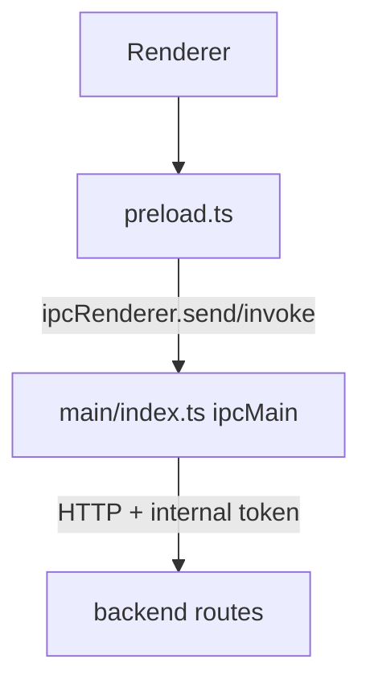

# IPC 协议字典

## 1. Channel 拓扑

目录元数据通过现有 SSH `shell-context` WebSocket 消息传输。`cwd`事件携带逻辑目录、可为空的物理目录/HOME 及提示符代数，匹配提示符后才启用。SFTP IPC/HTTP 结构保持一致，远端路径保留空白及`link/..`直到服务器解析，不增加 IPC 通道。

提交终端`input`时可附带不含输入内容的 UUID `submissionToken`。Backend 在`ShellContext`中回显最近收到的标识；Renderer 在匹配且可用的上下文到达前持续停用旧 ready 快照。这只确认 Backend 收到输入。无法确定归属的连续输入保持暂停，等待可信编辑器确认。Fish 和 Zsh 的`cwd-invalidated`只携带当前提示符代数，用于停用报告后发生变化的目录。

公开终端 WebSocket 只接受不透明的补全查询／取消／填写操作，不能读取原始编辑器快照或提供替换文本。原始输入、修改范围和替换缓冲保留在 Backend 持有的私有交互中；已移除的`completion-request`、`editor-snapshot`、`editor-apply`及未绑定来源的`history-delete`消息均被拒绝。没有发送方的无来源`history`服务端消息也已移除；原生历史通过携带原始 Shell 来源的`shell-history`提供。替换 WebSocket 会取消旧编辑器操作。不含文本的`editor-state` OSC 事件携带 PID／启动时间、提示符代数、可用性及当前拥有的触发标识，不增加 Electron IPC 通道。

可用的 Zsh 编辑器要求`notification: { fd, inode }`；可用的 Fish 编辑器严格要求`notification: { signal: 'URG' }`。显式加载 ZLE 与原生模块后，Zsh 的`cosmosh_editor_apply notification`操作创建匿名管道；原始 Shell 持有并关闭这些非阻塞、执行子程序时关闭的描述符。这两种不含文本的通知不能混用或用于其他 Shell。Fish 通过验证后的 pidfd 发送固定信号，前端不能指定任意信号。私有 Go 工作进程报告准备完成后，Backend 再检查权限，并通过该进程的 stdin 发送`{ requestId, activate: true }`；之后才允许通知 Shell 或接受其观察结果。通知元数据、激活与私有输入都不增加 Electron IPC 通道。

可用的 Bash 编辑器严格要求`notification: { callback: 'readline' }`。该回调标记不含文件描述符、信号或终端按键；Backend 激活请求后，原始 Bash 5.1/5.2 模块在正常线程的 Readline 空闲回调内轮询经过身份检查的私有工作进程。C／Go 有界二进制交换只经过远端私有 socket，不执行 Shell 文本，也不在 Readline 内等待桌面授权。激活与 PTY 写入确认本身不授权输入修改；仍须匹配准备阶段的观察、当前权限及原始 Shell 的最终确认。不增加 Renderer 或 Electron IPC 通道。

## 2. Channel 字典

仅供 Backend 使用的编辑器`native-completion`操作要求 Fish、输入／CWD／原生权限、`includeDirectory: true`和完整匹配的`expected`快照，不允许替换内容。原始回调的导出环境只保留在远端 socket 协议中，不属于`ShellEditorSnapshot`。独立的`native-completions`结果包含`ShellNativeCompletionResult`：`ok`／`partial`最多携带 128 项`{ token, value, detail }`，`timeout`／`unavailable`不携带候选。这些结果不能作为输入修改、历史移除或普通快照的确认。`ShellCompletionCandidate`增加`argument`展示类型，通过不透明补全查询提供结果，不增加 Electron IPC 通道。

私有`editor-request`进程为 Bash、Zsh 和 Fish 提供`history`及`history-delete`。这两个仅供 Backend 使用的操作要求独立历史权限和`includeDirectory: false`；观察包含提示符／模式元数据和`ShellNativeHistory`，不附带当前输入或 CWD。私密模式结果不含命名空间或记录。删除要求`expected`包含一条完整原生记录和命名空间，不允许`replacement`，并在原生成员与来源检查后另行取得有序授权。`history-removed-from-reader`只确认原始读取器不再返回目标，不能确认历史文件持久化，也不能替代输入修改的`applied`结果。符合条件的三种 Shell 均声明`history-read`；Backend 使用这些操作同步原生历史并执行绑定来源的移除，不增加 Electron IPC 通道。补全使用不透明候选编号及同一经过验证的私有编辑器边界。

`ShellPathQueryRequest`/`ShellPathQueryResult`定义已安装助手固定`path-query`命令的私有 stdin/stdout JSON，不是由前端指定的 Shell 命令，也不增加 Electron IPC 通道。请求包含字面目录、文件名前缀和有界匹配选项，结果包含完整文件名记录与固定来源状态。仅接受快照的路径草稿转换为不透明候选；前端不能指定目录或插入文本。

编辑器`cursor`字段和私有补全范围使用 Unicode 码点计数，不使用 UTF-16 代码单元。共享的`ShellCompletionCandidate`仅用于展示，包含不透明标识、标签、说明、来源和类型；修改范围与完整替换内容保留在 Backend 会过期的会话快照中。公开 WebSocket 只传递展示候选；选择时返回不透明编号，再进行私有填写。

| Channel                                    | IPC Type                   | Params                                                                                                                     | Return Schema                                                                                                                                                                                                                                                                                                                                                                                                       | Main Handler Behavior                                                                                                              |
| ------------------------------------------ | -------------------------- | -------------------------------------------------------------------------------------------------------------------------- | ------------------------------------------------------------------------------------------------------------------------------------------------------------------------------------------------------------------------------------------------------------------------------------------------------------------------------------------------------------------------------------------------------------------- | ---------------------------------------------------------------------------------------------------------------------------------- |
| `app:close-window`                         | `send`                     | none                                                                                                                       | none                                                                                                                                                                                                                                                                                                                                                                                                                | 请求关闭当前聚焦窗口或主窗口；主窗口关闭守卫会先检查 backend SSH/SFTP 活动状态再允许销毁                                           |
| `app:close-confirmation-request`           | Main-to-renderer event     | `{ requestId: string }`                                                                                                    | none                                                                                                                                                                                                                                                                                                                                                                                                                | 请求使用共享 renderer 对话框显示关闭警告；preload 校验不透明 ID，并在 React listener 挂载前暂存一个提前到达的请求                  |
| `app:close-confirmation-response`          | `send`                     | `{ requestId: string, confirmed: boolean }`                                                                                | none                                                                                                                                                                                                                                                                                                                                                                                                                | 仅解析由当前发送 `webContents` 持有且不透明 request ID 匹配的进行中关闭决策                                                        |
| `i18n:get-locale`                          | `invoke`                   | none                                                                                                                       | `Promise<string>`                                                                                                                                                                                                                                                                                                                                                                                                   | Returns current resolved locale                                                                                                    |
| `i18n:set-locale`                          | `invoke`                   | `locale: string`                                                                                                           | `Promise<string>`                                                                                                                                                                                                                                                                                                                                                                                                   | Resolves/persists in-memory locale and updates title                                                                               |
| `app:get-runtime-user-name`                | `invoke`                   | none                                                                                                                       | `Promise<string>`                                                                                                                                                                                                                                                                                                                                                                                                   | Returns OS username fallback chain                                                                                                 |
| `app:get-version-info`                     | `invoke`                   | none                                                                                                                       | `Promise<{ appName: string; version: string; buildVersion: string; buildTime: string; commit: string; electron: string; chromium: string; node: string; v8: string; os: string }>`                                                                                                                                                                                                                                  | 为关于页返回应用名称、版本号、构建时间与运行时技术信息                                                                             |
| `app:get-pending-launch-working-directory` | `invoke`                   | none                                                                                                                       | `Promise<string \| null>`                                                                                                                                                                                                                                                                                                                                                                                           | 返回当前待消费的上下文启动工作目录（来自 CLI 参数）                                                                                |
| `app:get-downloads-path`                   | `invoke`                   | none                                                                                                                       | `Promise<string>`                                                                                                                                                                                                                                                                                                                                                                                                   | 返回系统下载目录，供本地保存默认路径使用                                                                                           |
| `app:create-sftp-temporary-file`           | `invoke`                   | `fileName: string`                                                                                                         | `Promise<string>`                                                                                                                                                                                                                                                                                                                                                                                                   | 恢复缺失的稳定 SFTP 临时根目录，再为 backend 下载/打开流程创建唯一目标                                                             |
| `app:create-sftp-downloads-file`           | `invoke`                   | `fileName: string`                                                                                                         | `Promise<string>`                                                                                                                                                                                                                                                                                                                                                                                                   | 在系统 Downloads 目录下为发起请求的 renderer 授权一个精确的单次下载目标                                                            |
| `app:select-sftp-upload-files`             | `invoke`                   | none                                                                                                                       | `Promise<{ canceled: boolean; files: Array<{ name: string; localPath: string; size: number; modifiedAt: string }> }>`                                                                                                                                                                                                                                                                                               | 打开原生多文件选择器，并将所选普通文件复制到受控 SFTP 临时根目录下的隔离目录                                                       |
| `app:stage-sftp-dropped-upload-files`      | `invoke`                   | `entries: Array<{ name: string; localPath?: string }>`                                                                     | `Promise<{ canceled: false; files: Array<{ name: string; localPath: string; size: number; modifiedAt: string }>; rejectedEntries?: Array<{ name: string; reason: 'directory-unsupported' \| 'not-file' \| 'path-unavailable' \| 'unreadable' }> }>`                                                                                                                                                                 | 暂存 preload 已解析的、拖放到 SFTP 目录目标上的本地文件，并在不向 renderer 暴露任意路径暂存能力的前提下报告不支持的文件夹/非文件项 |
| `app:cleanup-sftp-temporary-files`         | `invoke`                   | `localPaths: string[]`                                                                                                     | `Promise<boolean>`                                                                                                                                                                                                                                                                                                                                                                                                  | 尽力删除经过校验的上传暂存文件及其已清空的隔离临时目录                                                                             |
| `app:open-sftp-temporary-file`             | `invoke`                   | `localPath: string`                                                                                                        | `Promise<boolean>`                                                                                                                                                                                                                                                                                                                                                                                                  | 使用系统默认应用打开 Cosmosh SFTP 临时根目录下的既有文件                                                                           |
| `app:read-sftp-temporary-image-preview`    | `invoke`                   | `localPath: string`                                                                                                        | `Promise<string>`                                                                                                                                                                                                                                                                                                                                                                                                   | 校验 Cosmosh SFTP 临时根目录下的既有图片文件，并返回有大小上限的 data URL 供 renderer 图片预览使用                                 |
| `app:start-sftp-temporary-file-watch`      | `invoke`                   | `localPath: string`                                                                                                        | `Promise<string>`                                                                                                                                                                                                                                                                                                                                                                                                   | 为 Cosmosh SFTP 临时根目录下的既有文件启动防抖监听，并返回 watch id                                                                |
| `app:stop-sftp-temporary-file-watch`       | `invoke`                   | `watchId: string`                                                                                                          | `Promise<boolean>`                                                                                                                                                                                                                                                                                                                                                                                                  | 停止此前创建的 SFTP 临时文件监听                                                                                                   |
| `app:show-sftp-open-with-dialog`           | `invoke`                   | `localPath: string`                                                                                                        | `Promise<boolean>`                                                                                                                                                                                                                                                                                                                                                                                                  | 仅 Windows：校验临时文件路径，并通过 shell `openas` verb 打开系统“打开方式”选择器                                                  |
| `app:list-sftp-open-with-applications`     | `invoke`                   | `localPath: string`                                                                                                        | `Promise<Array<{ id: string; name: string; path: string; bundleIdentifier?: string; iconDataUrl?: string }>>`                                                                                                                                                                                                                                                                                                       | 仅 macOS：校验临时文件路径，并返回 NSWorkspace 判定可打开该文件的应用列表                                                          |
| `app:open-sftp-file-with-application`      | `invoke`                   | `localPath: string, applicationPath: string`                                                                               | `Promise<boolean>`                                                                                                                                                                                                                                                                                                                                                                                                  | 仅 macOS：校验临时文件与所选应用属于可用应用列表后，使用该应用打开文件                                                             |
| `app:sftp-temporary-file-changed`          | `event (main -> renderer)` | `{ watchId: string; localPath: string; size: number; modifiedAt: string }`                                                 | none                                                                                                                                                                                                                                                                                                                                                                                                                | 向拥有该监听的 renderer webContents 推送一次防抖后的 SFTP 临时文件变更事件                                                         |
| `app:get-database-security-info`           | `invoke`                   | none                                                                                                                       | `Promise<{ runtimeMode: 'development' \| 'production'; resolverMode: 'development-fixed-key' \| 'safe-storage' \| 'master-password-fallback'; safeStorageAvailable: boolean; databasePath: string; securityConfigPath: string; hasEncryptedDbMasterKey: boolean; hasMasterPasswordHash: boolean; hasMasterPasswordSalt: boolean; hasMasterPasswordEnv: boolean; fallbackReady: boolean }>`                          | 为设置 → 高级页返回非敏感的数据库加密引导诊断信息                                                                                  |
| `app:resolve-system-proxy`                 | `invoke`                   | `{ host: string; port: number }`                                                                                           | `Promise<{ proxyRules: string }>`                                                                                                                                                                                                                                                                                                                                                                                   | 校验一个 SSH 服务器目标，并为 `https://host:port/` 解析 Chromium 系统/PAC 代理规则                                                 |
| `app:launch-working-directory`             | `event (main -> renderer)` | `cwd: string`                                                                                                              | none                                                                                                                                                                                                                                                                                                                                                                                                                | 当第二实例触发时，向渲染层推送上下文启动工作目录                                                                                   |
| `app:menu-action`                          | `event (main -> renderer)` | `action: 'open-about' \| 'open-settings' \| 'new-tab' \| 'close-current-tab' \| 'close-right-tabs' \| 'show-tab-switcher'` | none                                                                                                                                                                                                                                                                                                                                                                                                                | 将 macOS 系统菜单触发的应用菜单命令以受控枚举形式分发到渲染层标签页/状态处理器                                                     |
| `app:open-devtools`                        | `invoke`                   | none                                                                                                                       | `Promise<boolean>`                                                                                                                                                                                                                                                                                                                                                                                                  | 为当前主窗口打开 DevTools（窗口可用时）                                                                                            |
| `app:toggle-devtools`                      | `invoke`                   | none                                                                                                                       | `Promise<boolean>`                                                                                                                                                                                                                                                                                                                                                                                                  | 切换当前主窗口的分离式 DevTools（已打开则关闭，已关闭则打开）                                                                      |
| `app:reload-webview`                       | `invoke`                   | none                                                                                                                       | `Promise<boolean>`                                                                                                                                                                                                                                                                                                                                                                                                  | 重新加载当前活动 renderer webContents，并忽略缓存以保证调试刷新可预测                                                              |
| `app:restart-backend-runtime`              | `invoke`                   | none                                                                                                                       | `Promise<boolean>`                                                                                                                                                                                                                                                                                                                                                                                                  | 在开发环境中原位重启 backend 运行时，无需重启整个应用                                                                              |
| `app:show-in-file-manager`                 | `invoke`                   | `targetPath?: string`                                                                                                      | `Promise<boolean>`                                                                                                                                                                                                                                                                                                                                                                                                  | Opens file/folder in OS file manager                                                                                               |
| `app:open-external-url`                    | `invoke`                   | `targetUrl: string`                                                                                                        | `Promise<boolean>`                                                                                                                                                                                                                                                                                                                                                                                                  | 使用系统默认浏览器打开受信任的 HTTP(S) 链接                                                                                        |
| `app:set-windows-system-menu-symbol-color` | `invoke`                   | `symbolColor: string`                                                                                                      | `Promise<boolean>`                                                                                                                                                                                                                                                                                                                                                                                                  | 将 token 驱动的 Windows 标题栏系统菜单符号色应用到当前主窗口 overlay                                                               |
| `app:show-save-file-dialog`                | `invoke`                   | `defaultPath?: string`                                                                                                     | `Promise<{ canceled: boolean; filePath?: string }>`                                                                                                                                                                                                                                                                                                                                                                 | 打开原生保存对话框，并为发起请求的 renderer 授权所选路径执行一次 SFTP 下载                                                         |
| `app:import-private-key`                   | `invoke`                   | none                                                                                                                       | `Promise<{ canceled: boolean; fileName?: string; content?: string }>`                                                                                                                                                                                                                                                                                                                                               | 调起系统文件选择器并在选择后返回文件名与 UTF-8 私钥内容                                                                            |
| `app:get-process-performance-stats`        | `invoke`                   | none                                                                                                                       | `Promise<{ sampledAt: number; cpuPercent: number \| null; mainProcessMemory: { rssBytes: number; heapTotalBytes: number; heapUsedBytes: number; externalBytes: number; arrayBuffersBytes: number }; rendererProcessMemory: { residentSetBytes: number; privateBytes: number; sharedBytes: number } \| null; backendProcess: { pid: number; cpuPercent: number \| null; memoryRssBytes: number \| null } \| null }>` | 为调试浮层采样主进程 CPU/内存，基于当前活动窗口获取渲染进程内存，并补充 backend 子进程 CPU/RSS 内存数据                            |
| `app:export-main-heap-snapshot`            | `invoke`                   | none                                                                                                                       | `Promise<{ ok: boolean; filePath?: string; message?: string }>`                                                                                                                                                                                                                                                                                                                                                     | 将主进程 V8 堆快照写入应用 user-data 下的 debug 快照目录                                                                           |
| `debug:backend-request-trace-list`         | `invoke`                   | none                                                                                                                       | `Promise<BackendRequestTrace[]>`                                                                                                                                                                                                                                                                                                                                                                                    | 返回已保留的脱敏 backend 请求镜像列表，并让该 renderer webContents 订阅后续 trace event；未启用请求追踪时返回空列表                |
| `debug:backend-request-trace-clear`        | `invoke`                   | none                                                                                                                       | `Promise<boolean>`                                                                                                                                                                                                                                                                                                                                                                                                  | 清空开发态请求镜像 ring buffer                                                                                                     |
| `debug:backend-request-trace-event`        | `event (main -> renderer)` | `BackendRequestTrace`                                                                                                      | none                                                                                                                                                                                                                                                                                                                                                                                                                | 向已订阅的 renderer webContents 推送一条已完成且脱敏的 backend proxy 请求镜像                                                      |
| `backend:test-ping`                        | `invoke`                   | none                                                                                                                       | `Promise<ApiTestPingResponse \| ApiErrorResponse>`                                                                                                                                                                                                                                                                                                                                                                  | Calls backend health test endpoint                                                                                                 |
| `backend:settings-get`                     | `invoke`                   | none                                                                                                                       | `Promise<ApiSettingsGetResponse \| ApiErrorResponse>`                                                                                                                                                                                                                                                                                                                                                               | GET 已持久化设置                                                                                                                   |
| `backend:settings-update`                  | `invoke`                   | `payload: ApiSettingsUpdateRequest`                                                                                        | `Promise<ApiSettingsUpdateResponse \| ApiErrorResponse>`                                                                                                                                                                                                                                                                                                                                                            | PUT 设置快照                                                                                                                       |
| `backend:audit-list-events`                | `invoke`                   | `query?: ApiAuditEventListQuery`                                                                                           | `Promise<ApiAuditEventListResponse \| ApiErrorResponse>`                                                                                                                                                                                                                                                                                                                                                            | GET 审计事件列表（支持过滤与分页）                                                                                                 |
| `backend:audit-get-event-by-id`            | `invoke`                   | `eventId: string`                                                                                                          | `Promise<ApiAuditEventDetailResponse \| ApiErrorResponse>`                                                                                                                                                                                                                                                                                                                                                          | GET 单条审计事件详情                                                                                                               |
| `backend:ssh-list-servers`                 | `invoke`                   | none                                                                                                                       | `Promise<ApiSshListServersResponse \| ApiErrorResponse>`                                                                                                                                                                                                                                                                                                                                                            | GET SSH server list                                                                                                                |
| `backend:ssh-create-server`                | `invoke`                   | `payload: ApiSshCreateServerRequest`                                                                                       | `Promise<ApiSshCreateServerResponse \| ApiErrorResponse>`                                                                                                                                                                                                                                                                                                                                                           | POST create SSH server                                                                                                             |
| `backend:ssh-update-server`                | `invoke`                   | `serverId: string, payload: ApiSshUpdateServerRequest`                                                                     | `Promise<ApiSshUpdateServerResponse \| ApiErrorResponse>`                                                                                                                                                                                                                                                                                                                                                           | PUT update SSH server                                                                                                              |
| `backend:ssh-get-server-credentials`       | `invoke`                   | `serverId: string`                                                                                                         | `Promise<ApiSshGetServerCredentialsResponse \| ApiErrorResponse>`                                                                                                                                                                                                                                                                                                                                                   | GET decrypted credentials                                                                                                          |
| `backend:ssh-list-folders`                 | `invoke`                   | none                                                                                                                       | `Promise<ApiSshListFoldersResponse \| ApiErrorResponse>`                                                                                                                                                                                                                                                                                                                                                            | GET folder list                                                                                                                    |
| `backend:ssh-create-folder`                | `invoke`                   | `payload: ApiSshCreateFolderRequest`                                                                                       | `Promise<ApiSshCreateFolderResponse \| ApiErrorResponse>`                                                                                                                                                                                                                                                                                                                                                           | POST create folder                                                                                                                 |
| `backend:ssh-update-folder`                | `invoke`                   | `folderId: string, payload: ApiSshUpdateFolderRequest`                                                                     | `Promise<ApiSshUpdateFolderResponse \| ApiErrorResponse>`                                                                                                                                                                                                                                                                                                                                                           | PUT update folder                                                                                                                  |
| `backend:ssh-list-tags`                    | `invoke`                   | none                                                                                                                       | `Promise<ApiSshListTagsResponse \| ApiErrorResponse>`                                                                                                                                                                                                                                                                                                                                                               | GET tag list                                                                                                                       |
| `backend:ssh-create-tag`                   | `invoke`                   | `payload: ApiSshCreateTagRequest`                                                                                          | `Promise<ApiSshCreateTagResponse \| ApiErrorResponse>`                                                                                                                                                                                                                                                                                                                                                              | POST create tag                                                                                                                    |
| `backend:ssh-list-keychains`               | `invoke`                   | none                                                                                                                       | `Promise<ApiSshListKeychainsResponse \| ApiErrorResponse>`                                                                                                                                                                                                                                                                                                                                                          | GET 钥匙链列表                                                                                                                     |
| `backend:ssh-create-keychain`              | `invoke`                   | `payload: ApiSshCreateKeychainRequest`                                                                                     | `Promise<ApiSshCreateKeychainResponse \| ApiErrorResponse>`                                                                                                                                                                                                                                                                                                                                                         | POST 创建钥匙链                                                                                                                    |
| `backend:ssh-update-keychain`              | `invoke`                   | `keychainId: string, payload: ApiSshUpdateKeychainRequest`                                                                 | `Promise<ApiSshUpdateKeychainResponse \| ApiErrorResponse>`                                                                                                                                                                                                                                                                                                                                                         | PUT 更新钥匙链                                                                                                                     |
| `backend:ssh-get-keychain-credentials`     | `invoke`                   | `keychainId: string`                                                                                                       | `Promise<ApiSshGetKeychainCredentialsResponse \| ApiErrorResponse>`                                                                                                                                                                                                                                                                                                                                                 | GET 解密后的钥匙链凭据                                                                                                             |
| `backend:ssh-create-session`               | `invoke`                   | `payload: ApiSshCreateSessionRequest`                                                                                      | `Promise<ApiSshCreateSessionResponse \| ApiSshCreateSessionHostVerificationRequiredResponse \| ApiErrorResponse>`                                                                                                                                                                                                                                                                                                   | POST create SSH shell session                                                                                                      |
| `backend:ssh-trust-fingerprint`            | `invoke`                   | `payload: ApiSshTrustFingerprintRequest`                                                                                   | `Promise<ApiSshTrustFingerprintResponse \| ApiErrorResponse>`                                                                                                                                                                                                                                                                                                                                                       | POST trust host fingerprint                                                                                                        |
| `backend:ssh-close-session`                | `invoke`                   | `sessionId: string`                                                                                                        | `Promise<{ success: boolean }>`                                                                                                                                                                                                                                                                                                                                                                                     | DELETE SSH session                                                                                                                 |
| `backend:ssh-delete-server`                | `invoke`                   | `serverId: string`                                                                                                         | `Promise<{ success: boolean }>`                                                                                                                                                                                                                                                                                                                                                                                     | DELETE SSH server                                                                                                                  |
| `backend:ssh-delete-folder`                | `invoke`                   | `folderId: string`                                                                                                         | `Promise<{ success: boolean }>`                                                                                                                                                                                                                                                                                                                                                                                     | DELETE SSH folder                                                                                                                  |
| `backend:ssh-delete-keychain`              | `invoke`                   | `keychainId: string`                                                                                                       | `Promise<{ success: boolean }>`                                                                                                                                                                                                                                                                                                                                                                                     | DELETE SSH 钥匙链                                                                                                                  |
| `backend:port-forward-list-rules`          | `invoke`                   | none                                                                                                                       | `Promise<ApiPortForwardListRulesResponse \| ApiErrorResponse>`                                                                                                                                                                                                                                                                                                                                                      | GET 已持久化的 SSH 端口转发规则，并合并内存运行状态                                                                                |
| `backend:port-forward-create-rule`         | `invoke`                   | `payload: ApiPortForwardCreateRuleRequest`                                                                                 | `Promise<ApiPortForwardCreateRuleResponse \| ApiErrorResponse>`                                                                                                                                                                                                                                                                                                                                                     | POST 创建一条 stopped 端口转发规则                                                                                                 |
| `backend:port-forward-update-rule`         | `invoke`                   | `ruleId: string, payload: ApiPortForwardUpdateRuleRequest`                                                                 | `Promise<ApiPortForwardUpdateRuleResponse \| ApiErrorResponse>`                                                                                                                                                                                                                                                                                                                                                     | PUT 更新一条 stopped 端口转发规则                                                                                                  |
| `backend:port-forward-start-rule`          | `invoke`                   | `ruleId: string, payload: ApiPortForwardStartRuleRequest`                                                                  | `Promise<ApiPortForwardStartRuleResponse \| ApiErrorResponse>`                                                                                                                                                                                                                                                                                                                                                      | POST 启动一条规则，并可携带临时系统代理规则；可能返回共享 `SSH_HOST_UNTRUSTED` payload 供指纹信任后重试                            |
| `backend:port-forward-stop-rule`           | `invoke`                   | `ruleId: string`                                                                                                           | `Promise<ApiPortForwardStopRuleResponse \| ApiErrorResponse>`                                                                                                                                                                                                                                                                                                                                                       | POST 停止一条活动规则；已停止规则由 backend 幂等处理                                                                               |
| `backend:port-forward-delete-rule`         | `invoke`                   | `ruleId: string`                                                                                                           | `Promise<{ success: boolean }>`                                                                                                                                                                                                                                                                                                                                                                                     | DELETE 一条 stopped 端口转发规则                                                                                                   |
| `backend:sftp-create-session`              | `invoke`                   | `payload: ApiSftpCreateSessionRequest`                                                                                     | `Promise<ApiSftpCreateSessionResponse \| ApiSftpCreateSessionHostVerificationRequiredResponse \| ApiErrorResponse>`                                                                                                                                                                                                                                                                                                 | POST 创建 SFTP 文件系统会话                                                                                                        |
| `backend:sftp-list-directory`              | `invoke`                   | `sessionId: string, query?: ApiSftpListDirectoryQuery`                                                                     | `Promise<ApiSftpListDirectoryResponse \| ApiErrorResponse>`                                                                                                                                                                                                                                                                                                                                                         | GET 单个 SFTP 目录列表                                                                                                             |
| `backend:sftp-get-entry-details`           | `invoke`                   | `sessionId: string, payload: ApiSftpEntryDetailsRequest`                                                                   | `Promise<ApiSftpEntryDetailsResponse \| ApiErrorResponse>`                                                                                                                                                                                                                                                                                                                                                          | POST 获取已选 SFTP 条目的非递归元数据                                                                                              |
| `backend:sftp-read-file`                   | `invoke`                   | `sessionId: string, query: ApiSftpReadFileQuery`                                                                           | `Promise<ApiSftpReadFileResponse \| ApiErrorResponse>`                                                                                                                                                                                                                                                                                                                                                              | GET 当前 SFTP 会话内有上限的 UTF-8 文件预览                                                                                        |
| `backend:sftp-write-file`                  | `invoke`                   | `sessionId: string, payload: ApiSftpWriteFileRequest`                                                                      | `Promise<ApiSftpWriteFileResponse \| ApiErrorResponse>`                                                                                                                                                                                                                                                                                                                                                             | POST 经过远程 size/mtime 冲突检查后，将可编辑 UTF-8 SFTP 预览内容保存回一个远程普通文件；远程冲突返回 `SFTP_UPLOAD_CONFLICT`       |
| `backend:sftp-download-file`               | `invoke`                   | `sessionId: string, payload: ApiSftpDownloadFileRequest`                                                                   | `Promise<ApiSftpDownloadFileResponse \| ApiErrorResponse>`                                                                                                                                                                                                                                                                                                                                                          | POST 仅将一个远程普通 SFTP 文件流式写入 app utility IPC 为该 renderer 所有者授权的精确路径                                         |
| `backend:sftp-upload-file`                 | `invoke`                   | `sessionId: string, payload: ApiSftpUploadFileRequest`                                                                     | `Promise<ApiSftpUploadFileResponse \| ApiErrorResponse>`                                                                                                                                                                                                                                                                                                                                                            | POST 将一个受控本地临时文件流式写入新的远程路径，或在快照/显式覆盖确认后替换既有普通文件；冲突返回 `SFTP_UPLOAD_CONFLICT`          |
| `backend:sftp-get-transfer-progress`       | `invoke`                   | `transferId: string`                                                                                                       | `Promise<ApiSftpTransferProgressResponse \| ApiErrorResponse>`                                                                                                                                                                                                                                                                                                                                                      | GET 一个活动或近期完成的 SFTP 传输的字节进度、滚动速度、状态与可选失败原因                                                         |
| `backend:sftp-create-directory`            | `invoke`                   | `sessionId: string, payload: ApiSftpCreateDirectoryRequest`                                                                | `Promise<ApiSftpCreateDirectoryResponse \| ApiErrorResponse>`                                                                                                                                                                                                                                                                                                                                                       | POST 创建远程 SFTP 目录                                                                                                            |
| `backend:sftp-create-file`                 | `invoke`                   | `sessionId: string, payload: ApiSftpCreateFileRequest`                                                                     | `Promise<ApiSftpCreateFileResponse \| ApiErrorResponse>`                                                                                                                                                                                                                                                                                                                                                            | POST 创建远程 SFTP 空文件                                                                                                          |
| `backend:sftp-rename-entry`                | `invoke`                   | `sessionId: string, payload: ApiSftpRenameRequest`                                                                         | `Promise<ApiSftpRenameResponse \| ApiErrorResponse>`                                                                                                                                                                                                                                                                                                                                                                | POST 重命名或移动远程 SFTP 条目                                                                                                    |
| `backend:sftp-copy-entry`                  | `invoke`                   | `sessionId: string, payload: ApiSftpCopyRequest`                                                                           | `Promise<ApiSftpCopyResponse \| ApiErrorResponse>`                                                                                                                                                                                                                                                                                                                                                                  | POST 复制远程 SFTP 文件或目录树                                                                                                    |
| `backend:sftp-delete-entry`                | `invoke`                   | `sessionId: string, payload: ApiSftpDeleteRequest`                                                                         | `Promise<ApiSftpDeleteResponse \| ApiErrorResponse>`                                                                                                                                                                                                                                                                                                                                                                | POST 删除远程 SFTP 文件、符号链接或目录树                                                                                          |
| `backend:sftp-batch-operation`             | `invoke`                   | `sessionId: string, payload: ApiSftpBatchOperationRequest`                                                                 | `Promise<ApiSftpBatchOperationResponse \| ApiErrorResponse>`                                                                                                                                                                                                                                                                                                                                                        | POST 对多个 SFTP 条目执行有序批量复制、移动、创建链接或删除                                                                        |
| `backend:sftp-start-task`                  | `invoke`                   | `sessionId: string, payload: ApiSftpStartTaskRequest`                                                                      | `Promise<ApiSftpStartTaskResponse \| ApiErrorResponse>`                                                                                                                                                                                                                                                                                                                                                             | POST 启动一个异步 SFTP 任务；下载任务转发前必须消费精确匹配 owner/path/`transferId` 的授权                                         |
| `backend:sftp-list-tasks`                  | `invoke`                   | `sessionId: string`                                                                                                        | `Promise<ApiSftpListTasksResponse \| ApiErrorResponse>`                                                                                                                                                                                                                                                                                                                                                             | GET 保留的任务快照，并释放属于调用 renderer 的终态下载授权租约                                                                     |
| `backend:sftp-get-task`                    | `invoke`                   | `sessionId: string, taskId: string`                                                                                        | `Promise<ApiSftpGetTaskResponse \| ApiErrorResponse>`                                                                                                                                                                                                                                                                                                                                                               | 使用任务接纳时的 session id 获取一个保留快照；观察到下载终态时释放绑定 owner 的授权租约                                            |
| `backend:sftp-get-archive-capabilities`    | `invoke`                   | `sessionId: string`                                                                                                        | `Promise<ApiSftpArchiveCapabilitiesResponse \| ApiErrorResponse>`                                                                                                                                                                                                                                                                                                                                                   | GET 获取并缓存一个 SFTP 会话的固定远端归档工具能力矩阵                                                                             |
| `backend:sftp-start-archive-operation`     | `invoke`                   | `sessionId: string, payload: ApiSftpArchiveOperationRequest`                                                               | `Promise<ApiSftpArchiveOperationAcceptedResponse \| ApiErrorResponse>`                                                                                                                                                                                                                                                                                                                                              | POST 提交结构化压缩或解压请求；Main 不接受也不构造命令文本                                                                         |
| `backend:sftp-get-archive-operation`       | `invoke`                   | `sessionId: string, operationId: string`                                                                                   | `Promise<ApiSftpArchiveOperationStatusResponse \| ApiErrorResponse>`                                                                                                                                                                                                                                                                                                                                                | GET 获取归档任务的保留状态、具名阶段（包括解压后的`verifying`）、冲突摘要、取消状态和稳定终态结果                                  |
| `backend:sftp-resolve-archive-conflict`    | `invoke`                   | `sessionId: string, operationId: string, payload: ApiSftpArchiveConflictResolutionRequest`                                 | `Promise<ApiSftpArchiveConflictResolutionResponse \| ApiErrorResponse>`                                                                                                                                                                                                                                                                                                                                             | POST 为暂存解压冲突提交任务级`overwrite`、`keep-both`或`cancel`决定                                                                |
| `backend:sftp-cancel-archive-operation`    | `invoke`                   | `sessionId: string, operationId: string`                                                                                   | `Promise<ApiSftpArchiveCancelResponse \| ApiErrorResponse>`                                                                                                                                                                                                                                                                                                                                                         | DELETE 请求有界取消；通过归档任务轮询观察最终状态                                                                                  |
| `backend:sftp-close-session`               | `invoke`                   | `sessionId: string`                                                                                                        | `Promise<{ success: boolean }>`                                                                                                                                                                                                                                                                                                                                                                                     | DELETE SFTP 会话                                                                                                                   |
| `backend:local-terminal-list-profiles`     | `invoke`                   | none                                                                                                                       | `Promise<ApiLocalTerminalListProfilesResponse \| ApiErrorResponse>`                                                                                                                                                                                                                                                                                                                                                 | GET local terminal profile list                                                                                                    |
| `backend:local-terminal-create-session`    | `invoke`                   | `payload: ApiLocalTerminalCreateSessionRequest`                                                                            | `Promise<ApiLocalTerminalCreateSessionResponse \| ApiErrorResponse>`                                                                                                                                                                                                                                                                                                                                                | POST 本地终端会话（Main 可能注入一次性 `cwd` 上下文）                                                                              |
| `backend:local-terminal-close-session`     | `invoke`                   | `sessionId: string`                                                                                                        | `Promise<{ success: boolean }>`                                                                                                                                                                                                                                                                                                                                                                                     | DELETE local terminal session                                                                                                      |

## 3. Schema 来源

- API payload 类型来自 `@cosmosh/api-contract`，并由 `packages/api-contract/openapi/cosmosh.openapi.yaml` 生成。
- Backend、Main IPC 代理与 renderer HTTP 调用端必须通过 `@cosmosh/api-contract` 中生成的 `API_PATHS` 及相关合同导出访问 API，不允许硬编码路由字符串。
- 归档 IPC 只接受生成的结构化路径、枚举和冲突决定。远端命令文本、flag、工具输出与暂存路径绝不跨越 preload 边界。
- 未由 OpenAPI 生成的 IPC-only payload（包括 `AppMenuAction`、`SftpOpenWithApplication`、`SftpTemporaryFileWatchChange` 与 `BackendRequestTrace`）定义在 `packages/api-contract/src/ipc.ts`，供 main、preload 与 renderer 类型声明共同消费。
- 终端 WebSocket payload 与远端增强协议常量定义在 `packages/api-contract/src/terminal-protocol.ts`；backend 与 renderer 直接导入其中的 discriminated union。
- `BackendRequestTrace` 仅用于开发诊断。它会在未打包开发运行中由 main-process backend proxy 填充；生产包不会采集 trace，也不会加载 DevTools extension。

### 3.1 SSH 视觉元数据字段

以下 SSH 实体相关载荷已包含用于持久化图标/配色自定义的视觉字段：

- `ApiSshCreateServerRequest` / `ApiSshUpdateServerRequest`：可选 `iconKey`、可选 `colorKey`。
- `ApiSshCreateFolderRequest` / `ApiSshUpdateFolderRequest`：可选 `iconKey`、可选 `colorKey`。
- `ApiSshListServersResponse`：每个服务器条目包含 `iconKey` 与 `colorKey`。
- `ApiSshListFoldersResponse`：每个文件夹条目包含 `iconKey` 与 `colorKey`。

`colorKey` 受 API 契约中的预设配色枚举约束。

当前 SSH 安全策略相关字段：

- `ApiSshCreateServerRequest` / `ApiSshUpdateServerRequest`：主机/transport 与 renderer 策略字段包括 `strictHostKey`、`enableSshCompression`、`remoteEnhancementsEnabled`、`disableCharacterWidthCompatibilityMode`、`terminalClipboardAccess` 与 proxy policy。
- `ApiSshListServersResponse`：每个 server 条目都必须包含持久化的 `strictHostKey`、`enableSshCompression`、`remoteEnhancementsEnabled`、`disableCharacterWidthCompatibilityMode`、`terminalClipboardAccess` 与 `proxyMode`；响应缺少策略时，消费端不得通过本地默认值 fail open。
- `ApiSshCreateSessionRequest`：可选 `strictHostKey`、`enableSshCompression` 与 `remoteEnhancementsEnabled` 会把单次尝试绑定到已解析快照。远端增强请求字段只能进一步关闭；最终权限为当前全局设置、持久化服务器字段与 `request !== false`。
- 字符宽度兼容模式不会传入 SSH session create 或终端 WS 消息；renderer 会在创建 xterm 实例时应用该规则。

### 3.2 SSH 端口转发契约

端口转发 payload 由 OpenAPI 源生成，并被 backend、main、preload 与 renderer wrapper 共同消费：

- `ApiPortForwardListRulesResponse`
- `ApiPortForwardCreateRuleRequest` / `ApiPortForwardCreateRuleResponse`
- `ApiPortForwardUpdateRuleRequest` / `ApiPortForwardUpdateRuleResponse`
- `ApiPortForwardStartRuleResponse`
- `ApiPortForwardStopRuleResponse`

规则类型为 `local`、`remote` 或 `dynamic`。

类型专属字段：

- Local：`localBindHost`、`localBindPort`、`targetHost`、`targetPort`
- Remote：`remoteBindHost`、`remoteBindPort`、`targetHost`、`targetPort`
- Dynamic：`localBindHost`、`localBindPort`

运行状态通过 `runtime.status` 返回，但不会持久化。Start 可能返回 `SSH_HOST_UNTRUSTED`；renderer 必须先通过 `backend:ssh-trust-fingerprint` 信任指纹，然后再重试。

### 3.3 SFTP 批量操作契约

SFTP batch payload 由 OpenAPI 生成，并由 renderer、main IPC proxy 与 backend routes 原样共用。

- `ApiSftpBatchOperationRequest.operation` 可取 `copy`、`move`、`link` 或 `delete`。
- `targetDirectoryPath` 对 `copy`、`move` 与 `link` 必填；对 `delete` 会被忽略。
- `link` 会在目标目录中创建指向源远程绝对路径的绝对符号链接。目标名称使用源 basename，并沿用复制操作的冲突后缀策略。
- 响应形状保持为 `ApiSftpBatchOperationResponse`：按顺序返回每个条目的结果、completed/failed/skipped 计数、fail-fast 执行，并且不回滚已经完成的条目。

### 3.4 终端 WebSocket 契约（Renderer ↔ Backend）

终端流式消息虽然不属于 Electron IPC channel，但同样属于跨进程接口。`terminal-protocol.ts`是唯一来源，当前远端 helper 协议版本为 3。

- 客户端到服务端（`/ws/ssh/{sessionId}` 与 `/ws/local-terminal/{sessionId}`）：
  - `input`、`resize`、`ping`、`close`
  - `completion-query { requestId, trigger }`的触发方式为`typing`或`manual`；另有`completion-cancel { requestId }`与`completion-accept { requestId, snapshotId, candidateId }`。编号必须是规范的小写 UUID v4，额外字段会被拒绝。查询不携带输入、CWD 提示、修改内容或设置覆盖。填写使用新的请求编号；取消可以指定当前查询或等待中的填写。
  - SSH `shell-history-remove { requestId, sourceId, command }`：两个编号均为 UUID，命令是一条有界的完整原生记录。Backend 要求当前来源及缓存成员匹配，不接受前端指定历史库或文件路径。

  - `credential-fill`只包含不超过 128 个字符的非空操作`token`，不携带凭据
- 服务端到客户端：
  - `ready`、`output`、`telemetry`、`pong`、`error`、`exit`；本地遥测不包含历史记录
  - `completion-update { requestId, snapshotId, contextRevision, status, complete, sources, items }`包含同一快照的累积展示候选；没有可用快照时`snapshotId: null`。状态为`ready`、`stale`、`unavailable`、`unsupported`或`unknown`；`sources`固定包含`history`、`metadata`、`paths`、`native`，各自状态为`loading`、`ok`、`partial`、`disabled`、`unsupported`、`unavailable`、`timeout`或`private`。前端只展示当前请求且上下文修订号完全相同的候选。
  - `completion-accept-result { requestId, status }`的状态为`applied`、`stale`、`unavailable`、`unsupported`或`unknown`。填写只改变原始编辑器输入；授权后出现`unknown`时不允许自动重试。
  - SSH `shell-history { view }`：`ok`／`partial`包含`{ id, shell: 'bash' | 'zsh' | 'fish', namespace }`及按最新优先排列的完整原生记录；`disabled`／`unsupported`／`unavailable`／`private`的`source`为`null`且无记录。
  - `shell-history-remove-result { requestId, sourceId, status }`：状态为`removed-from-reader`、`stale`、`unavailable`、`unsupported`或`unknown`。当前读取器中的移除确认不代表原生历史文件已更新。

  - `credential-fill-offer`包含`{ token, expiresAt }`或`null`；`credential-fill-result`包含标识与`filled`或`rejected`状态，拒绝原因包括`stale`、`expired`、`disabled`、`unavailable`、`failed`，不返回密码
  - `bootstrap-status`，用于侧通道 Remote Bootstrap 安装/探测状态
  - `remote-enhancement-runtime-status`，包含 backend 持有的状态（`pending`、`active` 或 `disabled`），以及可选 `helperVersion`、`protocolVersion`、`capabilities`、`code` 与 `message`
  - `shell-context`携带 Backend 最新的 ShellContext 身份、能力、权限、可用状态/原因及代数，不包含输入或凭据。附加连接与重要状态转换时发送，不进入历史事件缓冲。
    - `editorAvailable`是必填布尔值，由原始适配器匹配当前提示符的绑定推导。适配器尚不可用或能力已撤销时为`false`，独立于已就绪的 CWD 和能力声明。私有绑定细节不会序列化；每次请求仍要确认实际原生编辑状态和有序输入。
  - `remote-shell-event`携带 OSC 777 Shell 状态；每条 v3 事件必须包含`shellInstanceId`、`helperVersion`、整数`protocolVersion`、`capabilities`、`shell`、`event`与`timestamp`

远端 shell event union 规则：

- `cwd` 必须包含解码后的绝对 `cwd`，并声明 `cwd` capability。
- `command-start` 与 `foreground-command` 必须包含清洗后的 `command` 及 `commandId`；`command-end` 还必须包含整数 `exitCode` 与 `durationMs`。
- `line-state` 必须包含 `lineLength`、`cursorIndex` 与 `promptGeneration`，不携带输入文本，目前仅由 Zsh 声明。
- Sh/Ash 只声明 `cwd` 与 `prompt-ready`。事件名与必填字段不符合交互 shell 打开前的精确 capability 契约时一律拒绝。

补全候选契约说明：

- 新的`completion-update.items`使用`ShellCompletionCandidate`：不透明`id`、`label`、可为空的`detail`、可选`detailI18nKey`、`source`及`kind`。来源为`history`、`inshellisense`、表示路径的`runtime`以及表示独立原生结果的`fish`。类型在命令／资料／历史分类之外包含`argument`与`path`。不传递填写文本、分值或修改范围。
- 凭据使用独立的操作／请求／结果消息，不能进入补全候选。公开补全操作只携带不透明编号；来源设置、快照和修改由 Backend 持有。
- 凭据使用独立的操作提示／请求／结果消息。共享 WebSocket 入口拒绝已释放／未注册会话和被替换／正在关闭的连接。SSH 在填入前再次检查操作标识与持久化权限；本地终端以`unavailable`拒绝凭据操作。

当前实现说明：

- `terminal/shared.ts`统一规范化两类请求。SSH 为每个合格的原始 Shell 创建一个`SnapshotCompletionController`，在查询与填写时读取已保存设置，慢来源返回后保持已有候选编号，并将全部编辑器操作绑定原始终端已送达的输入边界。本地终端对新查询／填写返回`unavailable`，安全忽略取消，普通输入继续可用。
- `remote-enhancement-runtime-status` 与 `remote-shell-event` 仅用于 SSH session，不会出现在 local-terminal session。交互 shell 打开前的 Bootstrap ensure 成功后，运行时以 `pending` 开始；10 秒内到达且匹配的 `integration-ready` 会切换为 `active`。Ensure 失败、`BOOTSTRAP_ENSURE_TIMEOUT`、`HELPER_HANDSHAKE_TIMEOUT` 或 live 契约不匹配都会切换为 `disabled`。Renderer 会把最新运行状态与有界事件历史分别保存，并且只能将其用于诊断，不得据此重建 backend helper 状态。
- `remote-shell-event`不得携带密码、secret、完整输出、命令行或输入缓冲区。动态 cwd/command 字段在 JSON 内使用规范 Base64，校验后才转发。Backend 将解码 JSON 限制在 32 KiB、编码 OSC 限制在 48 KiB，剥离 Cosmosh OSC，原样传递非 Cosmosh OSC。
- Renderer 会把完整 server message union 路由到来源 pane 的 runtime/reducer。补全响应、密码提示、状态、telemetry、错误、退出、调试事件、重连与命令 marker 都不得隐式回退到 primary/active pane 状态。

公开的目录即时操作为`directory-query { requestId }`和`directory-cancel { requestId }`，编号必须是规范的小写 UUID v4，不能附带其他字段。`directory-result { requestId, status, contextRevision, directory }`返回`ok`、`stale`或`unavailable`；失败时`directory`始终为`null`。成功结果只包含刚取得的`ShellDirectoryContext`，在对应`shell-context`发布之后发送。查询不能覆盖 CWD 权限，也不能提供路径或输入提示。本地终端返回不可用；旧取消编号不能终止较新的请求或无关补全。

#### 私有终端与编辑器协议（Backend ↔ 远端助手）

这些消息经过私有 SSH 通道，与 Electron IPC 和 OSC 观察协议 v3 分开。会话协议 v2 传递终端输入／输出，以及只包含元数据的顺序控制帧：

| 方向           | 数据帧                                                       | 含义                                                                  |
| -------------- | ------------------------------------------------------------ | --------------------------------------------------------------------- |
| 助手 → Backend | `hello { protocol: 2 }`                                      | 在启动 Shell 之前协商版本。                                           |
| Backend → 助手 | `start { protocol: 2, epoch, term, rows, cols }`             | 使用规范的小写 UUID v4 创建一个会话。                                 |
| 助手 → Backend | `ready { epoch, pid }`                                       | 原始 Shell 已启动；Backend 接受 2 至 2,147,483,647 的 PID。           |
| 助手 → Backend | `start-rejected { epoch }`                                   | 启动 Shell 前创建元数据失败；仅在 ready 之前且字段完全一致时接受。    |
| 助手 → Backend | `delivered { epoch, sequence }`                              | 完整输入批次已写入远端 PTY 主端。                                     |
| Backend → 助手 | `authorize-editor { epoch, sequence, requestId }`            | 在收到与送达序号均未变化的边界，为新的规范 UUID v4 请求授予一次权限。 |
| 助手 → Backend | `editor-authorized { epoch, sequence, requestId, approved }` | 必须正好包含五个字段，包括值为零的序号和布尔批准结果。                |
| Backend → 助手 | `revoke-editor { epoch, requestId }`                         | 只撤销这一次尚未消费的授权，无须回执。                                |

所有帧都必须包含`type`。输入／输出继续使用有大小限制的 Base64 帧。只有启动前确认不可用，或收到精确的`start-rejected`，才允许回退到普通 SSH；其他启动后的失败都关闭连接，不重放输入。新输入在写入远端 PTY 前撤销授权。取消、超时和操作结束都会撤销未消费的授权；迟到的有效回执不能授权其他请求或延长时限。格式错误或来自其他会话的帧会终止传输。

私有`ShellEditorRequest`必须包含`inputBoundary: { epoch, sequence }`，由 Backend 从当前`DeliveredTerminal`获取。控制器等待送达，要求报告的原始 PID 与编辑器绑定一致，并复核上下文、权限、客户端生命周期和序号。普通 SSH 传输无法满足此边界。字段范围明确限定：上下文请求省略输入，历史请求省略输入／CWD，快照及填写只包含获准字段。输入、替换内容、历史和导出环境都不能进入顺序控制帧、顺序文件、OSC 事件或调试历史。

工作进程返回的`prepared`快照匹配后，Backend 才向终端请求授权，随后向私有工作进程发送`apply: true`决定。Shell 必须在实际修改前持有本地顺序锁并消费尚未到期的一次性授权，然后确认结果。授权按单调时钟在 1.5 秒后到期。收到或送达都不能单独证明编辑器观察符合条件；最终回执丢失时保持`unknown`，不会自动重放修改。不透明候选填写使用这条边界，并已进入完整 Electron 验收矩阵。

### 3.5 Main 持有的活动连接契约

关闭守卫将活动状态权威性保留在带鉴权的 Main 到 Backend HTTP 调用中，只向 renderer 暴露窄化的确认握手：

- `GET /api/v1/runtime/active-connections` 从 backend 会话注册表返回 `sshCount`、`sftpCount` 及二者之和 `totalCount`。
- `DELETE /api/v1/runtime/active-connections` 关闭当前所有已注册 SSH/SFTP 会话，并返回本次关闭的数量。
- Electron Main 模式下两个 HTTP 操作都要求内部 token。它们不会通过 `preload.ts` 暴露，因此 renderer 既不能批量断开会话，也不能向守卫提供活动计数。
- `app:close-window` 保持现有 fire-and-forget 签名。守卫挂在主 `BrowserWindow` 的关闭生命周期上，因此标题栏关闭、最后标签页关闭、macOS close role 与应用退出共享同一权威判断。
- 仅当权威探测要求确认时，Main 才发送 `app:close-confirmation-request`。Renderer 使用共享 `Dialog` 展示警告，再返回 `app:close-confirmation-response`；Main 只接受来自所属 `webContents` 且不透明 request ID 匹配的响应。

## 4. 变更规则

当新增/修改 channel 时，必须在一个变更中同步更新：

1. `packages/main/src/preload.ts`
2. `packages/main/src/index.ts`
3. `packages/renderer/src/vite-env.d.ts`
4. 相关 renderer transport/service 封装
5. 本文件（`docs/zh-CN/developer/core/ipc-protocol.md`）

## 5. Channel 新增模板

新增 channel 时建议按以下清单执行：

1. Channel 命名：`domain:action-name`
2. IPC 类型：`invoke` 或 `send`
3. 参数 schema：在 bridge 与 renderer 声明中显式类型化
4. 返回 schema：成功与错误结构
5. Main 行为：后端代理或本地特权动作
6. 安全说明：token/header 处理、权限边界、暴露范围
7. 文档同步：同一变更集更新中英文协议文档

## 6. 服务器代理契约

- `ApiSshCreateServerRequest` / `ApiSshUpdateServerRequest` 可携带 `proxyMode = default | off | custom` 与可选 `proxyUrl`。
- `ApiSshListServersResponse` 返回持久化代理模式和 URL，用于编辑与连接规划。
- `ApiSshCreateSessionRequest`、`ApiSftpCreateSessionRequest` 与 `ApiPortForwardStartRuleRequest` 可携带临时 `systemProxyRules`；该字段永不持久化。
- `SystemProxyResolveRequest` 与 `SystemProxyResolveResult` 是 `packages/api-contract/src/ipc.ts` 中的 IPC-only 类型。
- Main 根据已校验 host/port 构造解析 URL，Renderer 不能向 `Session.resolveProxy` 提交任意 URL。
