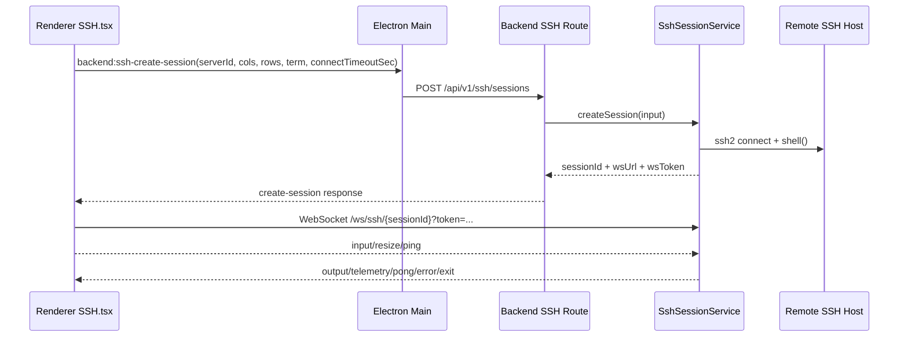

# SSH 终端实现

## 1. 集成概览（`ssh2` + `xterm.js`）

SSH 终端分为控制面和数据面：

- **控制面**：Renderer 通过 Main 进程的后端代理调用会话创建 API。
- **数据面**：Renderer 直连 Backend WebSocket，并传输终端 I/O。

## 2. 后端会话生命周期

### 创建会话

- 路由：`POST /api/v1/ssh/sessions`
- 服务：`SshSessionService.createSession`
- 输入包含视口尺寸、连接超时、严格主机密钥策略、SSH 压缩策略和可选系统代理规则。
- Backend 加载服务器与关联钥匙链、解析受信任指纹、完成认证，以 UTF-8 locale 环境请求打开交互 shell，写入登录审计，注册内存中的活动会话，并返回短期附加令牌与 WebSocket 地址。
- 连接会请求 `LANG=C.UTF-8` 和 `LC_CTYPE=C.UTF-8`；不会注入 `LC_ALL`，因此保留远端用户的时间、排序和数字格式偏好。

### 附加 WebSocket

- 路径：`/ws/ssh/{sessionId}?token=...`
- 无效路径、无效百分号编码、未知会话或无效令牌都会以 WebSocket 关闭码 `1008` 拒绝。
- 已附加的旧连接会被 `1012` 替换，每个会话始终保持一个活动客户端连接。
- 附加前，输出保留在有界队列中：2,048 个 chunk 与 1 MiB。附加时 Backend 先发送 `ready`，再刷新保留输出；溢出会淘汰最旧的完整 chunk 并记录丢弃数量。

### 关闭会话

- API 关闭使用 `DELETE /api/v1/ssh/sessions/{sessionId}`。
- WebSocket 关闭/错误、SSH 流关闭和 SSH 客户端错误都会进入相同的释放路径。
- 释放流程发送 `exit`、清理定时器与活动所有权、关闭 SSH 流/客户端和 WebSocket、完成 `SshLoginAudit`，并更新审计使用的命令计数。
- Main 评估窗口/应用关闭时会统计所有未释放的 SSH 会话。用户确认批量关闭后，先调用活动连接端点，再销毁窗口。

## 2.1 连接审计与最近使用排序

- 服务器列表负载将 `lastLoginAudit` 映射为最近一次成功登录审计。
- 失败尝试仍保留在 `SshLoginAudit` 中供后续检查。
- 运行时审计事件使用请求、会话与关联记录 id，清理 metadata，并尽力发送；日志失败不会阻塞连接生命周期。

## 2.2 本地优先安全审计接入

`SshSessionService` 通过 `AuditEventService` 写入登录与会话生命周期事件。成功与失败的主机校验、认证、连接和会话关闭结果保留足以还原尝试过程的相关 metadata，但不保存终端输出或凭据。

## 3. 数据流协议

### Client → Server

- `input`：UTF-8 终端输入。
- `resize`： bounded 的终端列数与行数。
- `ping`：心跳请求。
- `close`：显式断开请求。

### Server → Client

- `ready`：确认 WebSocket 附加。
- `output`：远端 shell 输出。
- `telemetry`：CPU、内存与网络速率快照。
- `pong`：心跳响应。
- `error`：本地化协议/运行时错误。
- `exit`：带原因的会话关闭。

## 4. 主机校验与信任流程

- SSH 连接使用 SHA-256 主机哈希与 `hostVerifier`。
- 严格模式要求指纹已受信任，否则返回 `SSH_HOST_UNTRUSTED`。
- 非严格模式为本次尝试接受未知指纹。
- 严格模式遇到未知指纹时，Renderer 显示信任对话框；用户确认后调用信任端点，并使用同一目标快照重试会话创建。

## 4.1 SSH 传输压缩

- 服务器持久化默认值为关闭。
- 关闭时会显式协商 `algorithms.compress = ['none']`。
- 开启时优先使用 `zlib@openssh.com`，然后是 `zlib`，最后以 `none` 保持兼容。
- 会话创建可以携带已解析服务器的显式设置，让分屏与重试保持相同传输策略。SFTP 与端口转发读取同一服务器字段。

## 5. 异常处理与重连

- 会话附加超时为 30 秒。
- Socket 关闭/错误会将所属分屏标记为失败；手动重试只作用于该分屏，并保留兄弟运行时。
- 重试使用标签页最新的已解析目标快照；没有快照时回退为重新解析目标。
- 每次尝试都有可中止的身份标识；过期异步结果会被丢弃，其迟到 socket/session id 也会被关闭。
- 替换 Backend PTY 是明确的 xterm 会话边界。Renderer 先使旧尝试失效、关闭旧传输、捕获不含备用缓冲内容与模式的 normal buffer，再以一次有序的本地 xterm 写入发送重置字节和清理后的快照。这些字节不会进入 `onData` 或 Backend PTY。
- 该边界清理 parser 状态、选区、装饰和会话本地 VT 模式，同时保留尺寸、选项、插件、WebGL 附件与事件处理器。序列化失败会允许干净重置，而不会阻塞恢复。
- 隐藏标签页不会发起连接。启用 `sshReconnectOnFocus` 后，重新激活标签页会重连没有连接中/打开 socket 的失败分屏。当前没有自动指数重连循环。

## 6. 性能与渲染层交互

- 输出刷新有界且按到达顺序排列，分离的会话不会无限增长。
- 终端实例、插件、渲染器、尺寸和监听器在仅布局变化与重试尝试中保留。
- Fit/resize 通过 animation frame 调度，并与活动 socket 同步。
- WebGL 加速按分屏同步；上下文丢失后禁用并向用户反馈。
- 设置驱动的 xterm 选项覆盖光标、字体、滚动、无障碍、对比度、字符宽度、内联图片、链接、剪贴板与选区行为。无效数字值保留安全默认值。
- 分屏具有确定的网格位置和稳定 DOM 层级。每个分屏拥有自己的传输状态、xterm 实例、fit/search/serialize 插件、剪贴板 provider 和重连回调。
- 选区几何优先使用 xterm buffer 坐标，WebGL 渲染不会使 Orbit Bar 与上下文菜单定位失效。

## 7. 开发排查清单

1. 检查会话创建负载与校验结果。
2. 确认主机校验返回的是会话还是 `SSH_HOST_UNTRUSTED`。
3. 匹配 WebSocket session id 与附加令牌。
4. 验证 `input` 写入方向与 `output` 刷新方向。
5. 分别演练 API 关闭、传输关闭与 SSH 错误释放路径。
6. 对分屏问题，在所属分屏复现，并确认兄弟运行时仍保持挂载。

## 8. Windows 上下文启动

- 安装器集成可在 Explorer 中注册**在 Cosmosh 中打开终端**。
- Explorer 以 `--working-directory <path>` 启动 Cosmosh。
- Main 将路径保留为一次性启动上下文。
- `terminalContextLaunchBehavior` 控制 Renderer 打开默认本地终端、打开 Home 并聚焦本地终端，或忽略该上下文。
- 默认配置选择遵循 `defaultLocalTerminalProfile`，并回退到第一个可用配置。
- 第二实例通过 IPC 将待处理启动上下文推送给 Renderer。
- 创建本地终端会话时，Main 一次性转发 `cwd`；Backend 校验路径，不可用时回退到用户主目录。

## 9. 钥匙链凭据运行时

- SSH 会话从 `SshServer.keychainId` 解析认证材料。
- 钥匙链认证变体为 `password`、`key` 与 `both`。
- 没有剩余服务器引用的隐藏钥匙链可自动清理。
- 第二实例解析同时使用 CLI 参数与 Electron `workingDirectory` 作为回退上下文。

## 10. macOS CLI 上下文启动

- 打包构建会创建 `~/Library/Application Support/Cosmosh/bin/cosmosh`。
- 启动器以 `--working-directory "$PWD"` 调用应用。
- Main 尝试在 `/opt/homebrew/bin` 与 `/usr/local/bin` 创建 PATH 符号链接；权限失败只记录警告，不阻塞启动。
- 启动后的上下文处理与 Windows 的一次性本地终端流程一致。

## 11. 服务器代理解析

- 全局代理模式为 `off`、`system` 或 `custom`；默认 `system`。
- 服务器代理模式为 `default`、`off` 或 `custom`；`default` 继承全局设置。
- 自定义 URL 支持 `http://`、`https://` 与 `socks5://`，可包含凭据；路径、查询和片段会被拒绝。
- system 模式下，Renderer 请求 Main 通过 Electron 解析目标，并把临时规则字符串随会话创建发送。
- Backend 解析有序的 `PROXY`、`HTTPS`、`SOCKS5` 与 `DIRECT` 候选，打开选中的隧道，并把 socket 注入 `ssh2`。
- 候选共享连接超时。除非后续仍有 `DIRECT` 规则，失败即为终止。
