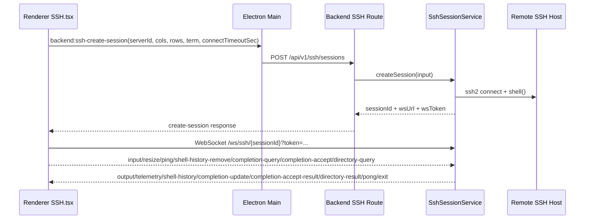
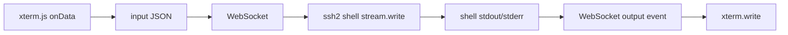
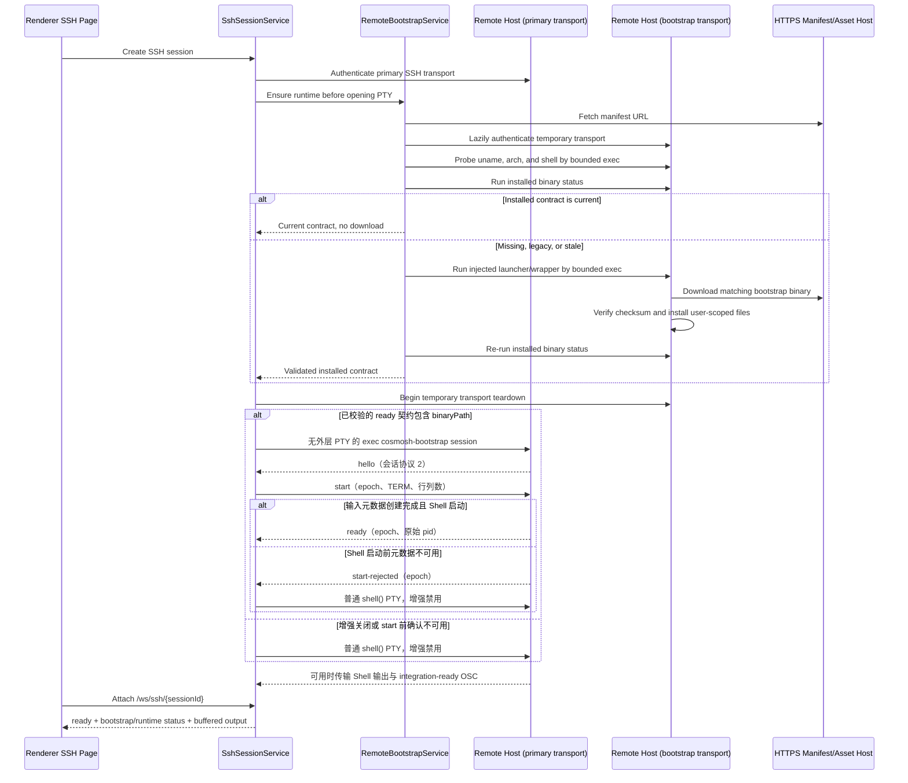
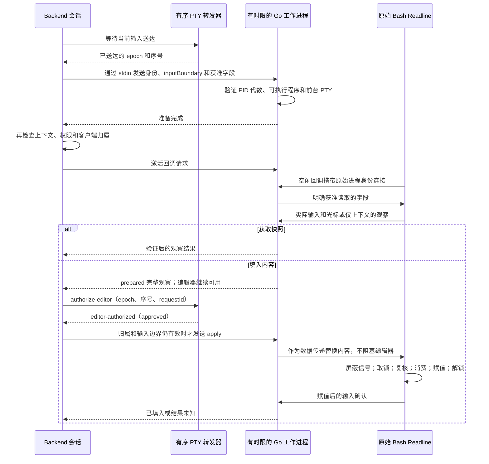
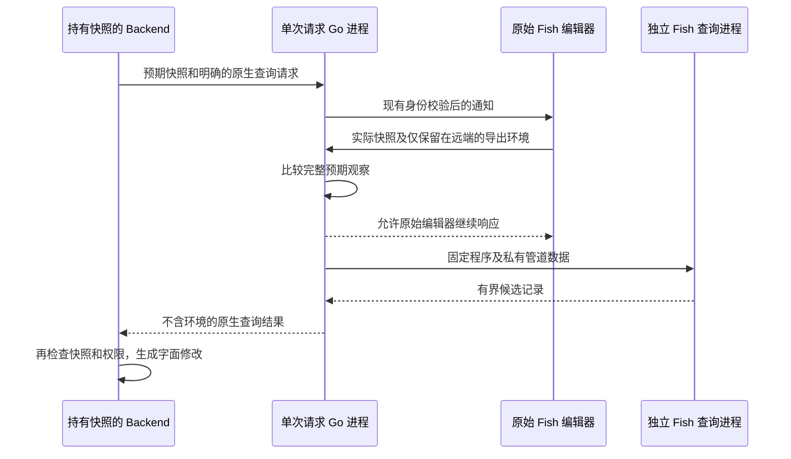

# SSH 终端实现

## 1. 集成概览（`ssh2` + `xterm.js`）

Cosmosh 终端链路分为控制面与数据面：

- **控制面**：Renderer 通过 Main 的 IPC bridge 调用后端创建会话。
- **数据面**：Renderer 直接连接后端 WebSocket 会话端点，传输终端 I/O 流。



## 2. 后端会话生命周期

### 创建会话

- 路由：`POST /api/v1/ssh/sessions`
- 服务：`SshSessionService.createSession`
- 请求字段：
  - `cols` / `rows`：终端视口尺寸。
  - `connectTimeoutSec`：来自设置项 `sshConnectionTimeoutSec` 的会话级 SSH 握手超时。
  - `strictHostKey`：从 SSH 服务器配置透传的会话级主机密钥策略。
  - `enableSshCompression`：从 SSH 服务器配置透传的会话级 SSH 传输压缩策略。
- 步骤：
  1. 读取 server 记录与其关联 keychain 的加密凭据。
  2. 解析可信主机指纹。
  3. 认证主 SSH transport，使用相同连接策略的临时 transport 完成可选的 shell 打开前远端增强工作，再携带 UTF-8 locale 请求通过 `ssh2.Client.shell` 打开主 shell。
  4. 写入 `SshLoginAudit` 记录：
     - 会话创建成功时写入 `result = success`，并记录 `sessionId` 与 `sessionStartedAt`。
     - 主机信任/认证/连接失败时写入 `result = failed`，并记录 `failureReason`。
  5. 在内存中注册会话状态（`Map<sessionId, SshLiveSession>`）。
  6. 返回短期 attach token 与 WS 端点。

Locale 行为：

- SSH shell 创建时会通过 `ssh2` shell 环境选项请求 `LANG=C.UTF-8` 与 `LC_CTYPE=C.UTF-8`，让支持 UTF-8 的终端程序默认继承 Unicode 字符类型 locale。
- 不设置 `LC_ALL`，以保留远端用户对时间、排序、数字格式等 locale 类别的偏好。
- Cosmosh 不会向交互式 shell 输入流注入 locale 命令。如果 SSH 服务器的 `sshd_config` 未接受这些环境变量请求，服务器可能会忽略它们。

### 附加 WebSocket

- 路径：`/ws/ssh/{sessionId}?token=...`
- 非法或编码畸形的路径、token、session 直接拒绝（`1008`），URL 解码错误不得逃逸出连接边界。
- 若已有附加 socket，将被替换（`1012`），保持单活连接。连接所有权切换后，旧 socket 的 close/error 事件不得清理新连接持有的会话。
- 会话 attach 前，可见输出与可信 helper 事件共用一个保持到达顺序的有界 stream-frame 队列（2,048 个 frame、1 MiB）。Attach 会先发送 `ready`、待发送 bootstrap 状态与当前增强运行时状态，再回放保留的 frame；超限时按到达顺序淘汰最旧的完整 frame，不会重新分组剩余输出与事件。

### 关闭会话

- API 驱动关闭：`DELETE /api/v1/ssh/sessions/{sessionId}`
- 传输驱动关闭：socket close/error、SSH stream close、SSH client error。
- 释放行为：在 session 标记为 disposed 前发送 terminal `exit` 事件，再清理运行时所有权、关闭 SSH stream/client 与 WS。
- 审计收尾：回写对应 `SshLoginAudit` 的 `sessionEndedAt` 与 `commandCount`。
- Main 在判断窗口关闭或应用退出时，会把 SSH 会话注册表中所有尚未 disposed 的条目视为活动连接。用户确认 renderer 警告对话框后，`DELETE /api/v1/runtime/active-connections` 会在窗口销毁前通过同一服务释放路径关闭全部 SSH 会话。
- “通用 > 行为”中的“关闭窗口时询问”默认开启。关闭后，Main 会跳过 renderer 对话框，但仍会先调用批量关闭端点再继续关闭；设置读取失败时保留警告。
- 本地终端会话以及仅由端口转发规则持有的 SSH 传输不计入本次关闭警告。

## 2.1 连接审计与最近使用排序

- 服务列表中的 `lastLoginAudit` 映射为最近一次**成功连接**（`result = success`）。
- 这样“按上次使用排序”将基于真实成功连接，而不是失败尝试。
- 失败连接仍会写入 `SshLoginAudit`，用于后续日志查询/审计能力。

## 2.2 本地优先安全审计接入

- SSH 运行时在保留 `SshLoginAudit` 兼容能力的同时，新增写入本地优先 `AuditEvent`，覆盖安全核心操作。
- 当前与 SSH 相关的审计分类包括：
  - `ssh-session`：连接成功/失败与会话关闭生命周期事件。
  - `ssh-host-trust`：主机指纹信任确认事件。
  - `ssh-server` / `ssh-keychain`：路由层的服务器/钥匙链实体变更事件。
- 关联策略：
  - `requestId` 用于串联同一请求链路。
  - `sessionId` 用于串联同一运行时会话。
  - `relatedRecordId` 用于关联兼容记录（例如可关联已有登录审计记录 ID）。
- metadata 在落库前会脱敏，敏感键按策略替换，占位后再执行大小上限控制。
- 审计写入采用 best-effort，不会因为日志写入失败而中断 SSH 会话创建或关闭流程。

## 3. 数据流协议

### Client → Server

- `input`：UTF-8 字符串形式的终端输入字节。
- `resize`：带边界归一化的 cols/rows。
- `ping`：心跳。
- `close`：显式断开请求。
- `shell-history-remove`：携带所显示来源的编号和完整命令文本，请求原生精确移除。不接受未绑定来源的历史删除。
- `completion-query`／`completion-cancel`／`completion-accept`：不透明的查询、取消和候选选择。不接受当前输入、猜测目录、来源偏好或替换文本。
- `directory-query`／`directory-cancel`：为明确操作请求或取消一次新的纯目录观察。

### Server → Client

- `ready`：附加确认。
- `output`：shell stdout/stderr 输出。
- `telemetry`：CPU/内存/网络 + 命令历史快照。
- 本地终端不发布历史来源，遥测的`recentCommands`数组为空，也不读取历史文件。
- `shell-history`：携带当前来源及从新到旧的完整原生记录，或明确的空列表原因。
- `shell-history-remove-result`：绑定请求及来源的原生移除结果；`removed-from-reader`不确认历史文件已更新。
- `completion-update`：累积更新的展示候选、来源状态及准确的快照／上下文身份。
- `completion-accept-result`：确认填写，或明确的过期／不可用／不支持／结果不明状态。
- `directory-result`：绑定新上下文的目录，或不附带目录的明确失败。
- `bootstrap-status`：backend 侧通道安装器返回的远端 bootstrap 探测、下载、安装与失败状态。
- `remote-enhancement-runtime-status`：backend 持有的 `pending`、`active` 或 `disabled` 信任状态，以及已校验 helper 契约。
- `remote-shell-event`：仅通过 active 运行时 gate 转发的 helper shell 状态。
- `pong`：ping 响应。
- `error`：协议/运行时错误。
- `exit`：会话关闭与原因。

### 3.1 History 同步模型

- SSH 历史只通过符合条件的原始 Shell 的原生历史接口读取。符合条件的 Bash 5.1／5.2、Zsh 5.8／5.8.1／5.9 和 Fish 4.0.1 可以发布来源；不支持的版本或编辑器／历史策略显示不支持或暂不可用。
- 会话连接后，助手声明`history-read`且当前编辑器绑定可用时才刷新历史。读取会等待已有私有编辑器请求结束；等待可以取消，也不会阻塞普通 PTY 输入。
- 每次接受原生观察后都会替换全部历史副本。来源编号绑定 Shell 身份、历史库名称和权限周期。SSH 历史不再扫描混合文件，也不再通过改写文件降级删除。
- 本地终端启动、回车和遥测均不扫描 Shell 或程序历史文件；原生历史按键继续由本地 Shell 处理。
- SSH 与本地终端输入处理器只转发 PTY 输入，不保留命令缓冲，也不把按键内容加入补全历史。密码提示和交互程序共用同一输入通道，仅凭回车无法确认 Shell 命令。历史只从 Shell 自身的历史来源读取，原始`cd`输入不会更新补全目录。
- 当已激活的可信 helper 声明 `command-start` 时，backend 将每个唯一 `commandId` 作为命令计数与延迟 history 刷新的权威触发源。重复生命周期事件不会重复计数。
- 私密、暂不可用或不支持的观察会清空旧记录及待处理操作。关闭权限、更换 Shell、接受编辑器不可用或命令开始事件会使来源失效；重复或过期事件不会影响有效来源。
- `shell-history`发布带来源编号、从新到旧的完整记录，或明确的空列表原因。快照补全直接使用当前原生视图；遥测不能恢复原生侧栏中已经失效的记录。
- 移除前的确认窗口说明精确文本匹配、共享原生历史以及无法确认文件更新的范围。`shell-history-remove`绑定所显示来源及缓存中的完整记录，结果同时绑定请求编号。多行或控制字符记录提供完整复制，填写和运行入口禁用，不会将命令压成一行。

### 3.2 自动补全模型

- 渲染层只发送不透明查询意图和候选编号。Backend 等待终端输入实际送达，读取原始编辑器，并使用已保存的来源和匹配设置。提示符文字、xterm 显示行及本地重建输入不能作为补全依据。
- `use-ssh-completion.ts`将查询、取消和填写限定到原始分屏／socket／会话。`terminal-completion-state.ts`拒绝过期快照及上下文，并在累积结果到达时按编号保留所选候选。
- 只有符合条件的 SSH 编辑器提供精确补全。本地终端返回`unavailable`，不读取历史文件或基于猜测 CWD 的路径，普通输入和 Shell 原生 Tab／历史按键继续可用。
- 备用屏幕、输入法组合输入、输入变化、分屏切换、断线或未确认编辑器会释放菜单的按键控制。填入已保存登录密码仍是明确点击的独立操作。
- `SnapshotCompletionController`合并静态命令资料、当前原生历史、来自快照的路径和符合条件的 Fish 补全；来源结果累积加入，不在中间用空列表替换已有候选。
- `packages/backend/scripts/generate-inshellisense.mjs` 会生成规范数据与按语言策略处理的补全说明资源：
  - `packages/backend/src/terminal/completion/generated-inshellisense.ts` 会以紧凑 tuple 载荷保留命令结构，并在模块加载时还原；生成条目仅保留 `descriptionI18nKey` 引用（不再冗余内嵌原始英文说明文本）。
  - `packages/i18n/locales/en/backend-inshellisense.json` 会根据上游说明全量重建。
  - `packages/i18n/locales/zh-CN/backend-inshellisense.json` 仅保留“英文源文本未变化”的手工翻译键；新键不会自动回填，英文源变化或删除时会自动清理对应中文键。
- backend 作用域 i18n 会将 `backend-inshellisense.json` 合并到 `backend.json`，从而支持补全说明翻译，同时保持基础 backend 语料与生成语料分离。
- 生成器会清理 LS/PS Unicode 分隔符（`U+2028`/`U+2029`），避免生成 TypeScript 文件触发异常行终止符警告。
- `completion/metadata.ts`使用已从快照解析出的字词读取命令资料。已完成的命令／子命令名称及选项区分大小写，因此`ssh-keygen -a`保留自己的参数值资料，不会误用`-A`。未知选项、未识别的子命令及`--`会停止解释。资料中的字面值保持为一个参数；明确的多词片段仍须经过相应 Shell 的引用处理。
- 匹配保留有意义的空格和 Unicode，优先字面前缀／子串，并按设置允许子序列。同一历史匹配等级内，原生新旧顺序优先。明确请求的 Fish 语义结果排在通用来源之前，避免大目录或大量历史隐藏全部原生结果；同等结果保留 Fish 顺序。去重比较修改后的完整输入与光标。
- 历史、命令资料、路径和 Fish 各自遵守独立权限及已保存的展示／查询设置。路径只使用同一次观察中的原始物理 CWD／HOME，缓存限定到会话且有效两秒，远端执行和取消清理均有时限。某个来源失败不会隐藏其他有效候选。
- **填入已保存的登录密码**是需要明确点击的独立操作。后端在有长度限制的可见输出尾部识别常见英文密码提示；这种识别无法证明请求密码的程序身份。按钮明确说明将填入服务器的登录密码，由用户判断是否适用。本地终端和仅使用私钥的会话没有可填入的登录密码；私钥口令永远不会用于此操作。
- 后端只发送一次性标识和 45 秒的有效期。任何输入、新提示、可信命令／提示事件或会话释放都会使旧操作失效。完整 SGR 样式和括号粘贴模式切换（`CSI ?2004h/l`）保留可见文本，切换与新的密码提示合并在同一输出片段时也能识别；这些控制序列和空格都不能延长原操作的有效期。清行、光标控制与不完整转义序列会清除保留的提示文本。最多保留 64 个字符的控制前缀，用于跨片段隔离未完成序列；OSC／DCS／SOS／PM／APC 内容直接丢弃，不予保留，其中的换行和被控制序列消费的结束字符不能生成操作。拒绝后需要新的可见文本；提示文字被不完整样式序列分隔时，可能需要完整重绘后才能再次提供按钮。
- 点击发送`credential-fill { token }`。后端异步读取设置后，再次检查注册会话、当前打开的 WebSocket、PTY、操作标识、有效期、登录密码和持久化权限。共享消息入口会拒绝被替换连接的消息；写入前先消费标识，避免并发点击重复填入。
- 输入、助手状态变化和标识消费会清除操作，但保留尚未结束的输出控制序列状态。只有新建或释放输出通道才完全重置该状态；输入不能把不可见控制序列的后半段变成新的密码提示。
- 操作原样写入已保存的登录密码，不追加回车。含控制字符或超过 8 KiB 的值不可填入。渲染层只收到操作／结果元数据；凭据不会进入补全响应、诊断历史或操作日志。填入后由用户手动按回车提交。
- 为保留已有偏好，持久化字段继续使用`terminalAutoCompletePasswordEnabled`，现在控制独立操作。关闭普通自动补全不影响该操作；无法识别的提示格式不显示按钮。
- 接受候选只发送所选快照／候选编号。Backend 保留完整字面修改，停止慢来源并等待清理，在修改前复核设置、原始编辑器状态及有序输入授权。填写不发送回车；结果不明时不自动重试。
- 候选说明只用于展示：前端先解析可选的`detailI18nKey`，再使用有界来源说明或本地化来源标签。插入文本、修改范围和排序分数保留在 Backend 内部。
- 建议默认只展示提示。明确进入列表之前，`Tab`、方向键、`Enter`和`Escape`保持终端原有行为。
- `terminalAutoCompleteFocusShortcut`配置进入列表的快捷键：默认`Ctrl+Shift+Space`，也可选择`Ctrl+Alt+Space`或`Alt+/`。点击菜单也会进入列表；点击候选会直接填入该候选。
- 只有进入后的列表会接管不带修饰键的方向键、`Escape`及配置的应用按键（`terminalAutoCompleteAcceptKeys`：`Tab`、`Enter`或两者）。未配置为应用按键的`Enter`保留 Shell 提交行为。鼠标和键盘操作使用准确的展示候选编号；被移除的非选中行不能静默变成另一项修改。
- 继续输入、修饰组合键、输入法组合输入、切换分屏或标签页、失去焦点、断开连接、关闭补全都会释放列表的按键控制。首个输入事件原样传递，已失效请求的响应不会重新打开旧列表。等待手动请求结果时，也不会接管普通终端按键。
- 列表通过 xterm 输入框临时设置的组合框无障碍属性关联当前候选。DOM 焦点保留在 xterm，使输入及输入法正常工作；列表关闭时恢复原有属性。
- 已经关闭且没有候选的菜单保持列表引用不变，并跳过未变化的焦点、选中项更新。主窗格与分屏先使提交前的目录状态失效，再原样发送一次输入，随后同步更新可选的补全界面。界面异常只记录窗格身份，避免异常导致字符丢失或私密输入进入日志。快速逐字浏览器测试覆盖允许读取、关闭读取权限和关闭建议三种情况。
- 候选面板布局约束：
  - 面板锚点会在终端可视区域内进行夹取，外层容器或分屏尺寸变化时会重新计算，
  - 面板宽度会按当前 pane 可用空间动态计算（并受桌面目标宽度上限约束），锚点夹取也按该实际宽度计算，避免横向溢出，
  - 面板内容区使用最大高度与纵向滚动（`max-h`）保证长候选列表可完整访问，
  - 长命令与说明文本使用截断，避免横向溢出。



## 4. 主机校验与信任流程

- SSH 连接使用 `hostHash: 'sha256'` 与 `hostVerifier`。
- `strictHostKey=true`：主机指纹必须已被信任，未知指纹返回 `SSH_HOST_UNTRUSTED`。
- `strictHostKey=false`：本次会话允许未知主机指纹继续连接。
- 若指纹未知：
  - backend 返回 `SSH_HOST_UNTRUSTED` 载荷。
  - renderer 打开信任确认弹窗。
  - 用户确认后调用 trust endpoint。
  - renderer 重试 create-session。

## 4.1 SSH 传输压缩

- SSH server 记录持久化 `enableSshCompression`，默认值为 `false`。
- SSH 服务器编辑器会在“安全”分区中以服务器级开关暴露该能力。
- 关闭时，backend 会向 `ssh2` 传入 `algorithms.compress = ['none']`，明确保持默认“不启用传输压缩”策略。
- 启用时，backend 优先协商 `zlib@openssh.com`，其次是 `zlib`，最后以 `none` 作为兼容性回退。
- SSH terminal 会话创建可以携带显式 `enableSshCompression` 值，使 retry/split 流程绑定到已解析服务器快照。
- SFTP 会话与端口转发启动会在 backend 读取同一个持久化服务器标记，因此 shell、文件系统与转发传输保持一致。

## 5. 异常处理与重连

### 当前行为（已实现）

- attach 超时：30 秒。
- 任意 socket close/error 都会让 UI 进入失败状态。
- `SSH.tsx` 的 retry 按钮提供手动重试，并且只作用于活动 pane。其临时 target-readiness 状态变化不会销毁或重连同级 pane runtime。
- 重试严格绑定到当前 tab 最近一次成功解析的目标快照，不会重新读取全局“当前选择”。
- 若首次连接在快照落库前失败，手动重试会回退到该 tab 的最新 intent 重新解析。
- 每次连接都有 attempt identity（`attemptId`），并带有过期结果丢弃与可取消的连接前异步流程。
- Pane 在重连时保留原 xterm 实例、已加载 addon、renderer、尺寸与事件监听器，但替换 backend PTY 会形成明确的 terminal-emulator session 边界。Renderer 会先让旧 attempt 失效，关闭旧 WebSocket/backend session，排空旧会话排队 write，再通过带有 `excludeAltBuffer` 与 `excludeModes` 的 `SerializeAddon` 捕获 normal buffer，然后才创建下一条 backend session。
- 有序边界会确认当前 attempt 仍拥有 pane，清理 pane reducer 状态、命令 marker/时间线与自动补全 bookkeeping，再用一个本地 xterm 输出 chunk 依次写入 CAN + RIS、安全 normal-buffer snapshot、SGR reset 与分隔换行。之所以不直接调用同步的 `Terminal.reset()`，是因为 xterm 6 的该 JavaScript API 不会清除排队 write，也不会清除未完成的 parser 序列。Reset 字节与 snapshot 绝不会进入 `onData`、WebSocket 或 backend PTY。
- Session-boundary reset 会让 xterm 回到 normal buffer，在不恢复 alternate buffer 的前提下重建保留的文本/样式 scrollback，清除选区/decoration，重置 parser 状态以及 application cursor keys、mouse tracking、bracketed paste、insert、origin 等 session-local VT mode；terminal options、行列尺寸、addon、WebGL attachment 以及已注册的事件/parser handler 保持不变。Inline image、命令 marker/时间线、选区与 alternate-buffer 内容明确属于旧 session，不会恢复。
- 如果 normal-buffer 序列化失败，renderer 会记录失败并继续执行干净 reset，而不会阻塞重连；历史保留采用 best-effort 语义，PTY 恢复仍保持可用。
- Cosmosh 替换本地终端 PTY 时采用相同边界：SSH 与本地 PTY 都是独立会话，即使它们共享 renderer controller。首次连接使用新建的 xterm，不执行 reset。
- Primary 与 secondary pane 都用各自的 attempt identity 约束 reset 与新 session 创建。Reset 与历史回放共用同一个有序 xterm write，因此 capture 后才被替代的 attempt 不会让后继 attempt 看到空白或只恢复一部分的 buffer。过期 attempt 不能接入延迟返回的 WebSocket/session；延迟结果会被显式关闭。
- 隐藏 tab 不会触发新的连接副作用，只有 active tab 允许发起连接。
- 启用 `sshReconnectOnFocus` 后，重新激活标签页会重连所有没有 connecting/open socket 的失败 pane。延迟创建标签页第一次激活时始终启动 primary pane，不受该偏好开关影响。
- 当前尚未实现自动指数退避重连。

### 推荐下一步（规划中）

- 仅针对临时性 WS 传输故障加入有界自动重连。
- 对主机校验失败/认证失败保持不可重试终态。

## 6. 当前代码中的性能策略

- Renderer 在初始化 SSH 终端时，将设置项 `sshMaxRows` 绑定到 xterm `scrollback`。
- Renderer 使用 `FitAddon` + resize observer 保持终端尺寸同步。
- 当设置项 `terminalHardwareAccelerationEnabled` 开启时（默认开启），Renderer 使用 `@xterm/addon-webgl` 为终端渲染启用硬件加速。
- 当设置项 `terminalInlineImagesEnabled` 开启时（默认关闭），Renderer 可以使用 `@xterm/addon-image` 提供实验性的终端内联图片能力。该插件会在新建的 SSH 与本地终端窗格中解析 SIXEL 与 iTerm inline image protocol 输出。
- 当设置项 `terminalWebLinksEnabled` 开启时（默认开启），Renderer 使用 `@xterm/addon-web-links` 识别终端输出中的 HTTP/HTTPS URL。
- Backend 对终端尺寸做归一化限制（`20-400 cols`、`10-200 rows`）。
- Backend 会在终端 JSON 解析或 transport 写入前拒绝任何超过 1 MiB 的单条客户端 WebSocket 消息，并以关闭码 `1009` 断开连接。
- 通过 pending output queue 避免 attach 前早期输出丢失。
- pending output 采用“条目数 + 字节数”双上限；超过上限时丢弃最旧输出并记录日志。
- 遥测采用 5 秒定时采样 + 轻量文本解析，降低帧级开销。
- 遥测、历史与补全使用的后台 SSH exec 探测限制为 15 秒和 1 MiB stdout；超时、输出过大、client 同步失败或 channel error 会按数据不可用收敛，不会让周期任务持续悬挂。
- history 刷新使用防抖 + 节流策略，平衡实时性与远端执行开销。

## 6.1 渲染层可配置的 xterm 选项（设置驱动）

渲染层现在会在 `SSH.tsx` 初始化 `Terminal` 时，将设置项映射到 `ITerminalOptions`，用于控制终端运行时行为。

- **主题 / SSH 样式**：
  - `altClickMovesCursor`、`cursorBlink`
  - `fontFamily`、`fontSize`
- **主题 / 高级样式**：
  - `cursorInactiveStyle`、`cursorStyle`、可选 `cursorWidth`
  - `customGlyphs`、`fontWeight`、`fontWeightBold`、`letterSpacing`、`lineHeight`
- **终端 / 高级终端配置**：
  - `drawBoldTextInBrightColors`
  - `scrollSensitivity`、`fastScrollSensitivity`、`minimumContrastRatio`
  - `screenReaderMode`、`scrollOnUserInput`、`smoothScrollDuration`、`tabStopWidth`
- **终端 / 运行时**：
  - `terminalHardwareAccelerationEnabled` 控制 SSH 与本地终端会话（包括分屏窗格）是否加载可选 `WebglAddon`，默认开启。
  - `terminalInlineImagesEnabled` 控制 SSH 与本地终端会话（包括分屏窗格）是否加载可选 `ImageAddon`，默认关闭，并采用构造期生效策略：开关或参数变化会作用于新建终端实例。
  - `terminalInlineImageOptions` 是通过 Settings Editor 编辑的 JSON 设置项，并使用严格 JSON Schema。当前仅暴露 `enableSizeReports`、`pixelLimit`、`sixelSupport`、`sixelScrolling`、`sixelPaletteLimit`、`sixelSizeLimit`、`storageLimit`、`showPlaceholder`、`iipSupport`、`iipSizeLimit`；本轮不暴露 Kitty/TGP 选项。
  - 内联图片仅在开启后支持 SIXEL 与 iTerm inline image protocol 输出。远端输出可能分配解码后的图片缓冲，因此校验会限制像素数量、序列字节数、存储 MB，并将 `sixelPaletteLimit` 上限固定为 `4096`。
  - 内联图片插件与 WebGL 插件按共存生命周期加载：renderer 会先在 `terminal.open(...)` 前加载 `ImageAddon`，再在 open 后同步 `WebglAddon`，使 WebGL 绑定已挂载的 renderer。`ImageAddon` 初始化失败只记录 warning，不会关闭 WebGL，也不会阻断终端启动。
  - 内联图片渲染只会把图片 canvas 固定在 renderer canvas 上方，并强制该图片层使用同步透明 2D context。DOM 文本行、选区、装饰层和链接覆盖层仍由 xterm 自己管理图层关系，因此选中文本对比度会保持默认 renderer 行为；透明 context 可避免 WebGL 开启时完整的图片 canvas 层变成不透明黑色覆盖层。
  - 内联图片解码依赖 `@xterm/addon-image` 内部的 WebAssembly，因此 renderer CSP 允许 `script-src 'wasm-unsafe-eval'`，但仍不启用通用 JavaScript `unsafe-eval`。
  - `ignoreBracketedPasteMode` 由设置项 `terminalBracketedPasteEnabled` 推导（开启时为 `false`，关闭时为 `true`）。
  - 粘贴安全警告是在 `SSH.tsx` 页面层执行的防护，会在输入进入 `terminal.paste(...)` 或原始 websocket `input` 前拦截。默认值为：`terminalWarnOnMultiLinePaste=true`、`terminalWarnOnLargePaste=true`、`terminalLargePasteWarningThreshold=5120`、`terminalWarnOnControlCharactersPaste=true`。
  - 控制字符粘贴检测会检查混入的 ESC、BEL、ANSI 控制序列，以及除 Tab/换行形式以外的 C0/C1 控制字节。警告确认仅作用于单次粘贴；允许一次粘贴不会关闭后续警告。
  - 字符宽度兼容模式由设置项 `terminalCharacterWidthCompatibilityModeEnabled` 推导；开启时，renderer 会加载 `@xterm/addon-unicode11`，并让新建终端实例切换到 Unicode 11 字符宽度表。
  - Unicode 宽度切换依赖 xterm 的 proposed `unicode` namespace，因此 renderer 创建的 SSH/本地终端实例会在加载 `@xterm/addon-unicode11` 前设置 `allowProposedApi: true`。
  - 开启后，右键粘贴、拖拽文本插入、选区工具栏插入会统一走 xterm `terminal.paste(...)`，从而让 shell 侧 bracketed paste 机制避免多行内容被立即执行。
  - `terminalCopyOnSelectionEnabled` 默认关闭。开启后，xterm selection-change 事件会通过 `navigator.clipboard` 将非空终端选区写入系统剪贴板；纯空白选区会被忽略。
  - `terminalRightClickSelectsWord` 直接映射到 xterm `rightClickSelectsWord`，默认关闭。
  - `terminalForceSelectionModifier` 默认值为 `off`。`alt` 会映射为 xterm `macOptionClickForcesSelection=true`，并在该终端实例中关闭 `macOptionIsMeta`，避免 macOS Option 键冲突。`shift` 与 `ctrl` 会作为设置值持久化，供后续平台特定选择处理使用；当前 xterm 原生生效路径仅为 macOS Option-click。
  - `@xterm/addon-clipboard` 会以 Cosmosh 自有 provider 加载，用于处理终端剪贴板读取/写入（OSC 52）。
  - 远程 SSH 会话从服务器记录字段 `terminalClipboardAccess` 读取剪贴板策略；本地终端会话从设置项 `localTerminalClipboardAccess` 读取策略。
  - 两种策略默认均为 `off`。支持模式包括 `off`、`writeAskRead`、`readWrite` 和 `askAlways`。
  - 读写剪贴板时始终通过 toast 提示；若该次操作刚刚通过显式权限对话框允许，则不再额外发送 toast。该允许只作用于单次剪贴板请求。
  - `@xterm/addon-clipboard` 负责协议 base64 编解码；provider 只在调用 `navigator.clipboard` 前后接收和返回已解码文本。
  - 每个 SSH/本地 xterm 实例（包括分屏窗格）都会加载 `@xterm/addon-serialize`，让 renderer 操作可以序列化当前选区，而无需触碰 xterm 内部结构。
  - 终端右键菜单仅在当前激活窗格存在选区时启用`复制为 HTML`。该动作只用 `serializeAsHTML({ onlySelection: true, includeGlobalBackground: true })` 序列化选中范围，并写入一个同时包含 `text/html` 与 `text/plain` 的 Clipboard API item；它不会向后端会话发送数据，也不会持久化剪贴板历史。
  - `terminalWebLinksEnabled` 控制 SSH 与本地终端会话（包括分屏窗格）是否加载 `@xterm/addon-web-links`。该设置默认开启，仅影响新建的 xterm 实例，识别到的 HTTP/HTTPS 链接会通过 Cosmosh 的 Electron 外部 URL 桥接打开。
  - `terminalWebLinksRequireModifierKey` 默认开启。开启时，Windows/Linux 链接需要 `Ctrl+单击`，macOS 链接需要 `Cmd+单击`，普通单击仅用于选择/聚焦终端文本，链接悬停时仅在按住所需修饰键时显示 pointer 光标。关闭时，主键单击可直接打开链接。辅助键/右键在任何情况下都不会打开终端链接，以便右键始终保留给终端上下文菜单；macOS 上的 `Ctrl+单击` 也保留为上下文菜单手势，永远不会打开终端链接。

说明：

- 对可选数值（如 `cursorWidth`）采用防御式解析；为空或不合法时回退到 xterm 默认行为。
- 原有 `sshMaxRows` 仍保持映射到 xterm `scrollback`。
- SSH server 记录可通过 `disableCharacterWidthCompatibilityMode` 单独禁用该模式；最终生效规则是全局设置开启且服务器未禁用。本地终端只使用全局设置。
- 字符宽度变更只影响新建的 xterm 实例；已存在的 SSH 窗格会保留当前 Unicode 宽度 provider，直到该窗格/会话被重新创建。
- WebGL 加载是尽力而为：初始化失败会回退到 xterm 默认渲染器，且不会中断终端会话。如果 WebGL 上下文丢失，renderer 会释放该 add-on，在当前 SSH 页面运行期停止重试 WebGL，并显示一次警告。

## 6.2 终端分屏交互模型

- 渲染层在 `SSH.tsx` 中提供受限分屏序列：
  1. 单终端，
  2. 左右双栏，
  3. 横向三栏，
  4. 最右侧终端再纵向拆分为上下两栏。
- 分屏入口在终端右键菜单（`拆分终端`），关闭入口同样在右键菜单（`关闭终端`）。
- 终端右键菜单会为`复制`、`粘贴`、`查找...`、`清屏`显示按平台解析的快捷键提示，并与实际键盘处理保持一致（macOS 显示：`⌘C`/`⌘V`/`⇧⌘F`/`⌃L`；非 macOS：`Ctrl+Shift+C`/`Ctrl+Shift+V`/`Ctrl+Shift+F`/`Ctrl+L`，且已绑定处理逻辑）。`复制为 HTML`特意只保留在菜单中，因为它依赖选中的富文本 xterm 范围，而不是终端标准快捷键。
- 终端右键行为由设置项 `terminalRightClickAction` 控制，默认值为 `contextMenu`。`paste` 会消费右键并通过同一套粘贴警告路径粘贴剪贴板文本。`copyOnSelectionElsePaste` 在当前激活窗格存在选区时复制选区，否则通过同一套粘贴警告路径执行粘贴。
- 当 SSH tab 变为 active 时，renderer 会把键盘焦点恢复到当前激活的 xterm 实例，让切换 tab 后的输入直接落到终端里。
- 当前实现最多同时展示 4 个终端窗格。
- 每个分屏窗格会针对同一已解析目标（同一 SSH 服务器/本地 profile）独立创建后端终端会话，从而支持独立输入输出。
- Secondary pane 在重试场景下始终复用 primary pane 的目标快照语义，避免会话目标漂移。
- 新增分屏窗格从空白视口启动，仅接入并展示该窗格自己的会话流，避免来自其他窗格的陈旧缓冲内容串入。
- 每个 pane 独立持有 xterm、WebSocket、backend session、transport 状态、telemetry、补全状态、远端增强信任状态、cwd、line state、调试历史与命令 marker。Primary 与 secondary 消息经过同一条 pane-aware reducer。
- 关闭任意 pane 只释放该 pane 的 socket/backend session，并保持其余 pane id 与运行时不变。关闭原始 primary 不会通过重命名其它 pane 来转移归属。
- 补全弹层锚点必须始终基于当前激活窗格容器计算，主窗格容器 ref 在重渲染时不能覆盖镜像窗格的激活几何信息。
- 终端内文本搜索由主窗格与镜像窗格统一加载 xterm `SearchAddon` 实现。右键`查找...`会以纯查找模式打开共享 `SearchReplacePanel`，提供可配置筛选开关（`区分大小写` / `匹配正则表达式`）以及紧凑的上一个/下一个导航动作，在当前激活窗格中跳转并高亮匹配结果。
- 当搜索词清空或关闭搜索面板时，会主动清理搜索高亮装饰，避免陈旧搜索标记在退出搜索后持续占用额外内存。
- Orbit Bar 在搜索全流程中保持抑制（包括空搜索词状态和 ESC 关闭路径），避免搜索高亮期间重新弹出选区动作条。
- Orbit Bar 与依赖选区的终端右键菜单动作会优先通过 xterm `getSelectionPosition()` 解析选区几何，只有不可用时才回退到 DOM selection blocks。这保证 `WebglAddon` canvas 渲染下 Orbit Bar 定位与`联网搜索`启用状态仍然可用。
- Orbit Bar 与终端右键菜单可以将显式路径交给 SFTP。`./` 和 `../` 要求来源分屏当前的物理目录，`~` 要求已确认 HOME。点击时按分屏编号重新读取状态，分屏激活后的渲染尚未完成也不会借用其他分屏目录。缺少元数据时禁用依赖它的动作。绝对路径与 file URL 仍可使用；裸相对名称和多行选区会被拒绝。保留反斜杠、文件名标点和引号内空格。
- 从选区在 SFTP 中打开目录时，即使同一服务器已经存在其他 SFTP 标签页，也始终会用该 `initialPath` 创建新的 SFTP 标签页，且不会替换当前 SSH 终端标签页。

## 6.3 命令时间线

- “命令时间线”位于“设置 > 终端 > 运行时”且默认开启。只有该设置已启用，并且当前 pane 中通过认证的远端增强运行时处于 active 状态并声明 `command-start` 时，符合条件的 SSH pane 才会在右侧使用 40 px 命令槽。该槽由左侧 34 px 最近命令轨道和右侧 xterm 6 px 滚动条组成，并紧贴 pane 右边缘，不保留根容器尾部内边距。Renderer 通过 xterm 内边距预留轨道，并把 xterm scrollable element 扩展到完整命令槽，使原生滚动条继续留在负责其悬浮显示、轨道点击和滑块拖动的节点内。关闭该设置只会移除命令时间线轨道与菜单，不会关闭其他远端增强能力。普通 SSH、本地终端、已禁用 helper、握手失败或未声明该 capability 的 helper 都不会获得 fallback 轨道；所有终端仍使用窄滚动条。
- 用户按 Enter 时先记录隐藏的 pane-local xterm 输入 marker。可信 `command-start` 会在此前终端输出完成解析后消费最早的待确认 marker，记录输出起始行，并从 xterm 行中仅重建已提交的命令。命令保留前会通过配置项或启发式 prompt 解析移除虚拟环境装饰以及用户、主机、工作目录等 prompt metadata。Helper 发出的已清洗可执行文件名只作为生命周期 metadata，绝不会替代界面中的完整输入。`command-end` 负责记录输出结束行。
- 只有 normal buffer 内容超过两个可见屏幕且保留的可信命令超过三条后，才启用最近命令入口。该阈值不会改变固定轨道的预留状态，因此入口满足条件时不会改变终端列数。在 normal buffer 中，终端内的鼠标移动会显示符合条件的入口，连续五秒无鼠标移动后隐藏。来自 xterm 内的键盘/IME 输入或粘贴会立即关闭各层菜单并隐藏入口。闲置状态会对可见与键盘用户隐藏线条，但仅保留其紧凑鼠标命中区域，使命中区域上的鼠标移动无需等待新的 `pointerenter` 即可恢复悬浮。命令列表或命令行操作菜单打开期间，入口保持可见，除非被 xterm 输入主动收起。运行 alternate-screen 程序时隐藏并禁用入口，但继续保留固定轨道。
- 居中的入口最多呈现最新八条统一线条，每条宽 12 px、高 2 px，间距 10 px，以约 60% 透明度使用 `color.text`。这些线共同构成一个菜单入口，不再编码输出量，也不提供逐线的上一条/下一条导航。
- 鼠标悬浮时，整组线条会 morph 为一个受视口边界约束、固定 256 px 宽的共享菜单卡片。靠近滚动条的一侧保持固定，卡片覆盖轨道并向左展开。正常挂载的 Portal 配合 CSS `@starting-style` 完成 180 ms transform/opacity 入场，只有鼠标离开的退场会保留 Portal 以执行 140 ms 反向过渡。`relatedTarget` 判断与统一的 80 ms 离开宽限覆盖入口、命令卡片与 portaled 命令行操作菜单之间的跨越，快速重新进入会从当前过渡状态继续，而不是重新开始。命令行操作菜单会阻止仅由悬浮打开的父菜单恢复 xterm 焦点所导致的 focus-out 关闭，并在自身打开期间保持父级命令卡片，因此跳过操作菜单 Portal 的鼠标移动不会同时关闭两层界面。外部交互、Escape 与选择动作仍会关闭操作菜单及父级卡片。由于无需点击、悬浮即会打开卡片，紧凑命中区域使用默认箭头光标。键盘打开保持即时，`prefers-reduced-motion` 仅保留短暂透明度过渡。
- 卡片展示来源 pane 中仍有效的全部 marker，并按从旧到新的顺序排列。菜单打开或内容更新时自动滚动到底部。长命令行保持单行截断；悬浮或聚焦命令行时，通过共享且可换行的 Tooltip 显示内存中的完整命令。选择命令行会对其输入 marker 调用 `scrollToLine` 并恢复 xterm 焦点；右键菜单可复制内存中的命令，或将命令插入同一 pane 且不附加 Enter。右键操作菜单打开期间，鼠标离开会保留两层菜单，直至外部交互、Escape 或选择动作关闭它们。
- 完整命令字符串只保存在 renderer 内存中，绝不持久化、记录日志、发送、加入 telemetry，也不复制到远端增强调试记录。信任丢失、重连/重置、pane 释放或 xterm scrollback 回收都会同时释放 marker 与命令文本，因此条目只属于当前 pane、当前连接与 normal buffer 仍保留的 scrollback。
- Primary 与 secondary runtime 都会在 write 解析完成、滚动、调整尺寸、buffer 切换和 marker 释放后刷新模型。由于后代 xterm 的内边距变化本身不会调整稳定 host 的尺寸，轨道预留状态变化会显式进入现有 pane fit/resize 流程。Xterm host 与固定轨道在信任、活动、菜单和 alternate-screen 状态变化期间保持稳定 DOM 祖先，确保 TUI 进出与闲置显隐既不会重建运行时，也不会让 PTY 列数失步。

## 7. 开发排查清单

当 SSH 会话行为异常时，按以下顺序检查：

1. 会话创建 API 的入参与校验路径。
2. 主机校验分支（`SSH_HOST_UNTRUSTED` 与直接建连分支）。
3. WS attach token 与 sessionId 是否匹配。
4. 数据流方向是否完整（`input` 写入与 `output` 回放）。
5. 会话释放路径是否正确（API close、传输关闭或 SSH 错误触发）。

### 7.1 可重复执行的真实 Shell 测试

`pnpm test:terminal`运行后端共享终端／SSH 与 renderer SSH 单元测试。真实 PTY 行为使用独立入口：先执行`pnpm terminal:fixture start`启动临时 OpenSSH 容器，再运行`pnpm test:terminal:live`，最后通过`pnpm terminal:fixture stop`停止环境。

测试环境使用独立的 Bash、Zsh、Fish 账户、专用生成密钥、固定校验的主机指纹和仅监听本机回环地址的端口。文件样本覆盖空格、引号、Unicode、符号链接和大目录，不挂载宿主机用户目录或生产凭据。Windows 使用 Debian WSL 内的容器运行时；Linux 默认使用 Docker，也可以通过`COSMOSH_FIXTURE_RUNTIME`选择 Podman。生命周期和环境配置见`scripts/terminal-fixture/README.md`。

同一个临时容器重新启动时，账户准备脚本可以再次执行。它复用指向预期目录的符号链接，发现目标已改变时报告错误，不会覆盖现有链接。手动重新启动容器后须核对回环端口，因为容器运行时可能重新分配端口。

真实测试入口在环境不可用时明确失败。单元测试通过不能证明真实 Shell、网络延迟或 Electron 交互已得到验证。

输入顺序验证包含 Linux 元数据／会话测试、模拟 0／150／300 ms 往返延迟的三项真实 Bash SSH 场景，以及经过生产送达传输的 35 项 Fish 编辑器场景。Zsh 原生填写也已在 5.8 和 5.9 上进行真实 PTY／文件锁检查。受支持版本限定为 Bash 5.1／5.2、Zsh 5.8／5.8.1／5.9 和 Fish 4.0.1；本轮验证没有独立运行 Zsh 5.8.1。

完整 Electron 验收使用实际 Main／preload、Node Backend、SQLCipher、xterm UI 事件和一次性 OpenSSH 账号。Linux Electron 43.7.1／Node 24.21 通过 Bash、Zsh 和 Fish；Windows Electron 43.7.1 通过 Fish，打包后的`win-unpacked` Windows 应用重复通过完整 Fish 流程。每种 Shell 都验证了主机指纹信任、SHA 校验的助手安装／更新、原始编辑器就绪、快速输入逐字节精确、私密原生历史、按不透明候选填写且不发送回车、中间光标路径修改、旧建议失效、原生 Tab／历史键、权限撤销与不重连恢复、基于新鲜物理 CWD 的相对 SFTP 交接，以及无渲染错误或输入 containment 警告。同一组本机构建的 amd64 助手字节在更新检查中下载三次；arm64 助手已完成构建和哈希校验，但未在远端执行。完整桌面流程未单独加入网络延迟：0／150／300 ms 覆盖仍位于真实送达传输边界。Windows x64 NSIS 安装器和 blockmap 已成功构建，但执行安装器仍是单独的打包检查。Windows 开发 profile 因主机 Prisma schema-engine CLI 在两个源码工作区均失败而先种入空 SQLite 数据库；随后实际 Backend 运行时成功应用全部内置迁移。

凭据回归覆盖真实密码输入不会自动提交，以及真实加密私钥登录不会复用口令。测试仅隔离数据库／传输边界，直接使用生产凭据处理器。单元测试包含设置读取延迟、重复点击、新提示／清除提示、过期、连接替换、会话释放与分屏结果隔离。

### 7.2 浏览器交互检查

运行`pnpm --filter @cosmosh/renderer dev --port 28767`，再使用`playwright-cli open`打开`http://127.0.0.1:28767/tests/terminal-autocomplete.html`。在仓库根目录执行`playwright-cli run-code --filename=packages/renderer/tests/terminal-completion.browser.cjs`。产物保存在已忽略的`.playwright-cli/`目录；检查结束后关闭浏览器并停止 Vite。

独立密码操作使用`/tests/terminal-credential.html`，执行`playwright-cli run-code --filename=packages/renderer/tests/terminal-credential.browser.cjs`。测试使用生产组件、分屏 reducer 和真实 xterm，只替换服务端操作／结果消息及请求捕获边界。检查处理中禁用按钮、保留焦点、不携带密码的请求、手动回车提示、过期、断开连接和窄窗口边界。密码专用 Electron 接线仍需独立验收。

这些检查使用实际的 xterm、补全 Hook 与菜单，覆盖只展示提示时的按键、明确进入列表、组合键、输入法、过时响应、分屏与焦点切换、原生 Tab 输出同步，以及终端会话依赖回调的稳定性。仅替换 WebSocket 传递边界。真实远端编辑器行为和完整 Electron 生命周期已由上方的必需 SSH fixture 验收覆盖；这些浏览器文件保持为渲染边界回归。

## 8. 远端增强运行时

远端增强是用于主机感知 SSH 能力的可选运行时层，例如 OS/发行版检测、未来 SFTP helper、命令快捷嗅探与补全支持。当前阶段会维护版本化 helper 契约，并提供有界的 cwd/命令生命周期事件；后续能力必须继续挂在相同 gate 之后，并复用同一用户级远端 helper 边界。

### 8.1 归属与开关

- `packages/backend/src/remote-bootstrap/service.ts` 负责交互 shell 打开前的编排。它会获取 manifest、探测远端主机、读取已安装状态，仅在需要时注入下载 wrapper，复验安装结果，返回可信运行时契约，解析 JSON-line 状态并写入审计事件。
- `packages/remote-bootstrap` 负责 Go 安装器、helper 生成器、OSC 协议/能力声明、已安装状态校验器与 wrapper 渲染器。模块级构建、测试、路径和安全说明见 `packages/remote-bootstrap/README.md`。
- 最终门控为`全局设置 && 持久化服务器字段 && 请求 override !== false`。请求字段只能进一步关闭：过期的 renderer 快照不能重新启用当前数据库记录已关闭的服务器。全局设置与持久化服务器字段默认均为 true，因此在用户未关闭任一门控前，部署级启用条件由 manifest URL 控制。
- 任一开关关闭时，backend 不会执行任何远端命令，会忽略此前已安装 helper 发出的运行期 shell OSC 事件，并会发送 code 为 `REMOTE_ENHANCEMENTS_DISABLED` 的 skipped `bootstrap-status`。
- Backend 需要 manifest URL 才会加载 bootstrap manifest。`COSMOSH_REMOTE_BOOTSTRAP_MANIFEST_URL` 是最高优先级 override。未打包的开发运行会默认使用滚动的 `remote-bootstrap-dev` manifest，因此本地开发无需每次设置 shell 环境变量也能测试远端增强。CI 打包也可以在 app 打包前生成 `remote-bootstrap/manifest-url.json`，让安装包无需用户手动配置环境变量即可发现 GitHub 托管的 manifest。正式 tag release 指向同版本 GitHub Release；`main` push 构建指向 `remote-bootstrap-dev`；分支名包含 `remote-bootstrap` 的 push 构建和手动 workflow dispatch 可以指向分支专用临时 prerelease，例如 `remote-bootstrap-branch-codex-remote-bootstrap-ci-release`。普通 PR 与 feature branch 构建默认不写入 packaged URL。远端增强启用但缺少配置时，不会执行远端 probe 或任何其它远端命令，只会明确上报 `MANIFEST_URL_NOT_CONFIGURED`。

开发环境默认 manifest URL 为 `https://github.com/agoudbg/Cosmosh/releases/download/remote-bootstrap-dev/cosmosh-remote-bootstrap-manifest.json`。只有需要覆盖默认值时才需要在启动 Cosmosh 的同一个终端里设置 `COSMOSH_REMOTE_BOOTSTRAP_MANIFEST_URL`，例如测试分支专用临时 prerelease：

先启动 `pnpm dev:renderer` 并等待 `http://127.0.0.1:2767` 就绪，再在第二个终端启动 `pnpm dev:main`。远端增强必须在 Electron 窗口中测试：直接打开 Vite URL 不具备 preload bridge，也不会启动由 Main 管理的 backend 子进程，因此仅在浏览器中运行 renderer 无法完成 bootstrap 或创建 SSH 会话。

```powershell
$env:COSMOSH_REMOTE_BOOTSTRAP_MANIFEST_URL="<manifest-url>"
pnpm dev:main
```

```sh
COSMOSH_REMOTE_BOOTSTRAP_MANIFEST_URL="<manifest-url>" pnpm dev:main
```

### 8.2 会话流程

关闭目录权限会清空当前和上次已知的目录状态，并禁止导航使用这些信息。先前收到的诊断事件可能仍在窗格的有限调试记录中保留；该权限不会删除全部过往报告，也不会卸载远端助手。

重复验证状态界面时，在已有前端测试服务器中打开`/tests/terminal-enhancement-status.html`，再运行`playwright-cli run-code --filename=packages/renderer/tests/terminal-enhancement-status.browser.cjs`。测试使用生产状态映射和窗口组件，仅替换传入的观察结果；它验证浏览器行为，不代表 Electron/SSH 传输或新的补全填写已启用。

服务器增强开关在打开终端时确定。修改服务器设置后，需要从服务器列表重新打开连接；重试现有标签页会保留原连接意图。Fish 支持说明列出已验证的 4.0.1 与原生按键配置，以及关闭原生灰色建议的要求，不会根据泛化的不可用结果推断具体是哪项条件不满足。

Fish 输入边界识别原生 Tab、Shift+Tab 和 Ctrl+R。原生按键配置符合要求时，补全／历史分页操作进行期间暂停观察，原始读取器重新满足条件后允许再次检查；这些按键不再使整个连接持续处于不确定状态。未知序列和脚本绑定仍会暂停精确操作。不完整的按键／粘贴帧等待剩余字节，提示符不能清除尚未解决的输入边界。历史为空时引导用户查看增强状态；普通输入和 Shell 原生按键继续工作。

SSH 侧栏无需开启调试模式即可打开**增强状态**。连接失败优先于保留的运行状态信息。即使输入或目录功能暂停、关闭，读取成功但为空的原生历史视图仍可显示为可用。只有逻辑路径的目录属于部分可用，上次已知目录不会显示为当前目录。总开关、服务器开关、助手缺失、版本不匹配、超时、能力不支持及编辑器未确认均有对应说明。重新打开助手总开关需要重新连接。目录权限关闭后不再在当前状态中使用目录信息，已安装助手仍可能发送报告。精确填写同时要求快照／填写能力和当前已确认的原始编辑器；路径与 Fish 来源根据各自设置及最近一次不含文本的查询结果显示状态。打开诊断窗口保留这些结果，新输入、上下文、窗格、会话或权限变化会清除它们。主动查询没有结果时说明失败原因，打字查询不反复通知。旧提示符正则设置已隐藏，保存的值仍可供命令时间线显示读取，不再控制补全。



- 主 SSH transport 会先完成认证，但在 bootstrap 结束前不创建任何 channel。第一次真正需要远端命令时，backend 才会使用相同凭据、host-key 策略、压缩设置与代理策略懒创建第二条已认证 transport。每条使用代理的 transport 都会获得独立 socket。
- Bootstrap probe/install/status `exec`通道仍只运行在临时 transport。主 transport 打开终端通道前，Backend 会启动临时 transport 的关闭；底层 socket 可以稍后关闭。已校验的 ready 状态含有`binaryPath`时，主 transport 通过无外层 PTY 的`exec`运行已安装助手的`session`命令。助手持有内部 PTY 和原始登录 Shell，不保证 sshd MOTD、PAM tty 或 utmp 行为。增强关闭、发送`start`前确认不可用，或在`ready`之前收到精确匹配的`start-rejected`，都允许以增强禁用状态使用普通`client.shell(...)`。其他启动后结果不明确的情况均使连接失败，不启动第二个 Shell 或重放输入。
- 开关关闭或 manifest 缺失／无效时不会创建临时 transport。其解密得到的登录密码会被丢弃，永远不会复制到 session state、状态 payload 或审计 metadata。
- Backend 会在下载前查询已安装 binary。只有 manifest version 与 asset SHA-256、受支持 protocol、helper 内容与 profile hook 均为最新时才跳过下载；旧 binary 缺失新字段时会被视为不兼容并重装。PTY 创建前会再次读取 status 复验安装。
- 校验成功的 manifest 会缓存五分钟，并由并发 session 共享同一个 in-flight 加载。失败结果不会缓存。取消单个 session 只会停止该 session 的等待，不会取消其它 session 正在等待的共享 manifest 请求。
- 每条侧通道命令都使用 `ssh2 exec`，并受 `REMOTE_BOOTSTRAP_EXEC_OPTIONS` 限制：60 秒、256 KiB 输出；整个可选的 shell 打开前 ensure 对设置读取、manifest I/O、临时 proxy/SSH 建连与 exec 工作共享更严格的 15 秒总预算。共享 deadline 到期时，backend 会停止等待 proxy 准备、关闭活动 exec channel、销毁临时 client、发送 `BOOTSTRAP_ENSURE_TIMEOUT`，并立即继续创建普通 PTY。取消后才完成的预连接 proxy socket 会在返回时立即销毁。安装器输出按 JSON lines 解析，永远不会写入交互式终端流。
- Ensure 建连失败或超时不会把有效的主 SSH 认证变成 shell 创建失败。Backend 会启动临时 transport 的关闭，以 `disabled` 运行状态打开主 PTY、报告失败，并在该 session 内忽略所有 helper 派生事件。如果主 transport 本身在 ensure 期间失败，其错误会取消临时工作，并继续通过现有 SSH 错误路径让普通 session 创建失败。
- Go `install`/`status` 输出只用于建立安装标识与信任状态，不会直接提供 cwd、输入状态或命令生命周期数据。实时 shell 数据随后由 Go 生成的 helper 通过 OSC 777 发出，并继续受运行时 gate 约束。
- Renderer 会为每个 pane 分别保存 bootstrap 状态、运行时信任状态、可信 cwd/line state、telemetry、生命周期状态与最多 200 条远端增强调试记录。启用 Settings `remoteEnhancementsDebugEnabled` 后，终端右键菜单会显示来源 pane 的`远端增强调试`；浮层跟随活动 pane，绝不会用 primary pane 数据代替。
- Renderer 只会在可信 `command-start` 到达后，从自身已渲染的 xterm 行重建仅含命令的时间线标签；helper 事件 payload 仍然只携带已清洗的可执行文件名。Prompt 身份 metadata 会在保留前丢弃，时间线标签不会进入调试历史或传输协议。
- 调试浮层只记录状态/事件 payload，不记录 terminal `input`、terminal `output`、密码、私钥材料或完整屏幕输出。
- Terminal `ready`、`output`、telemetry、history、completion 与 shell-state 消息都与 bootstrap 进度彼此独立。成帧会话启动后，即使关闭增强数据，也不会关闭其终端传输。

### 8.2.0 本次连接的输入送达

成帧终端传输与 OSC 777 Shell 观察协议 v3 相互独立。其版本为`2`：助手发送`hello`，Backend 发送含规范小写 UUID v4 epoch、初始`TERM`及尺寸的`start`，助手先创建输入顺序元数据，再启动一个登录 Shell。`ready`包含原始 PID，Backend 将其限定为 2 至 2,147,483,647 的整数。旧版本协议在启动前判为不可用；ready 之前精确的`start-rejected { epoch }`证明 Shell 启动前创建元数据失败，允许回退到普通 SSH。其他启动后失败的结果不明确，不会再启动 Shell。助手恢复登录`argv[0]`、控制终端、前台进程组、`TERM`、`SSH_TTY`及继承的工作目录。连接中断时关闭子进程，终端输出结束后报告退出，信号退出使用`128+signal`。

进入 ready 后，每次非空输入写入，包括粘贴和凭据填写，都获得连续的安全整数序号，每批最多 64 KiB。输入／输出使用 Base64 换行分隔 JSON，每帧上限为 96 KiB。独立的远端读取器在每个输入帧进入队列前更新`received`并撤销现有授权，即使前一批 PTY 写入阻塞也如此。完整写入 PTY 主端之后才更新`delivered`并发送回执。送达不表示 Shell 或前台程序已经消费字节。Backend 允许最多 1 MiB 待确认输入；助手队列上限为 4,096 帧、1 MiB。无效帧、超载、部分写入失败及断线会关闭连接，不重放输入。尺寸调整使用同一有序通道。输入／输出不会进入持久化文件、进程参数、原始日志或调试事件；Shell 原生历史和普通 OSC 输出仍独立处理。

`internal/inputorder`在`/tmp/cosmosh-input-<uid>/<epoch>.state`保存固定 128 字节，内容只有格式标记、epoch、原始 PID、收到／送达的序号、一个请求 UUID、授权状态／序号和单调时钟到期值；不包含输入、历史、目录或替换文本。文件以独占方式创建，所属目录权限为 0700，普通单硬链接文件权限为 0600。打开时拒绝符号链接，检查 UID／大小／模式，并比较路径与已打开 inode 的身份。清理只移除自己持有的 inode。授权要求`received == delivered == requested sequence`，只能使用一次，按远端单调时钟在 1.5 秒后到期。

私有控制器要求每个请求都有`inputBoundary: { epoch, sequence }`，等待送达，并确认终端的原始 PID 与编辑器绑定匹配。普通 SSH 传输，以及上下文、权限、归属或输入边界变化的请求均被拒绝。`prepared`观察匹配后，通过有序终端通道交换`authorize-editor`与`editor-authorized`，绑定准确的 epoch／序号／请求编号；回执始终包含布尔结果和序号，包括零值。此后 Backend 才可向私有工作进程发送`apply: true`。明确取消／完成／超时会发送`revoke-editor`；新输入在本地撤销授权，远端接收时也使同一个授权失效。迟到的有效回执无法恢复已取消操作。所有顺序控制帧都不携带编辑器文本。

Shell 仍须确认原始读取器符合条件、完整观察匹配。最终临界区以不等待的方式取得元数据锁，重新检查状态和排队输入，消费有效授权，完成本地修改，并在恢复信号、重绘或远端回执之前释放锁。因此输入接收和修改具有明确顺序：较新的接收序号会拒绝旧修改；已经进入临界区的修改会先完成，随后才能记录新输入。等待桌面授权时绝不持锁。转发器更新元数据最多重试取锁 1.5 秒，无法继续则关闭会话，不强行解锁或重放输入，从而限制适配器损坏或中断对普通输入的影响。

送达传输也覆盖真实 SSH 凭据输入、任务控制、Ctrl+D／退出、断线和前台编辑器。精确菜单已接入，并由 Linux Bash／Zsh／Fish 与 Windows Fish Electron 流程覆盖。启动后关闭增强数据权限会保留已经建立的终端传输；打开会话时已关闭增强，则使用普通`shell()`。

### 8.2.1 远端 Shell 事件协议

Remote Bootstrap 安装 helper 后，交互式 shell 启动文件会 source 用户级 shell integration。helper 会通过交互 PTY 上的 OSC 777 控制序列发送运行期 shell 状态：

```text
ESC ] 777 ; cosmosh ; <base64-json> BEL
```

Backend 解析规则：

- `SshSessionService` 会先把 SSH 输出流经过 `RemoteShellEventOscParser`，再写入 xterm。
- Parser 会返回按原始顺序排列的可见输出/helper 事件 frame，`SshSessionService` 不得再按类型对它们分组。事件之前的可见字节，尤其是 `command-start` 之前的输入回显与换行，必须先进入 xterm，renderer marker 才能捕获有效的输入/输出边界。
- WebSocket 未 attach 时同样遵循该顺序契约：可见输出与已接受的 helper 事件进入同一个有界 pending-frame 队列，并在 attach 控制消息之后按到达顺序回放。若运行时信任在 attach 前被禁用，只移除队列中的 helper 事件，普通终端输出仍可回放。
- Cosmosh OSC 会从可见终端输出中剥离并解码，但只有 backend 运行时 gate 进入 `active` 后，事件才会应用并转发。
- Gate 在交互 Shell 启动前校验成功并再次检查权限后进入`pending`，匹配的`integration-ready`将其切换为`active`。10 秒内没有握手则禁用。原始 Shell 的版本/能力不匹配会禁用运行时；其他 Shell 实例只暂停可用状态，不替换原始身份。
- 非 Cosmosh OSC 与普通 ANSI 输出会保持可见、原样流式透传，包括跨 SSH chunk 拆分的序列。
- 非法 JSON、非法事件形状、不规范的 Base64、超过 32 KiB 的解码 JSON，以及超过 48 KiB 的编码 OSC 会被丢弃。单个 cwd 和可执行命令名仍分别限制为 4 KiB 和 255 字节。
- 支持 SSH chunk 切分；未完成的 OSC 数据会缓冲到 BEL 或 ST 结束符到来。
- 协议常量与 Backend/Renderer 消息类型来自`packages/api-contract/src/terminal-protocol.ts`，当前 helper 协议为 v3。已有安装/status 校验流程会更新旧帮助程序，v2 事件不能激活 v3 会话。

服务端到 renderer payload：

```ts
type RemoteShellEventMessage = {
  type: "remote-shell-event";
  event:
    | "integration-ready"
    | "prompt-ready"
    | "cwd"
    | "cwd-invalidated"
    | "command-start"
    | "command-end"
    | "foreground-command"
    | "line-state";
  shell: "bash" | "zsh" | "fish" | "sh" | "ash";
  shellInstanceId: string;
  helperVersion: string;
  protocolVersion: number;
  capabilities: string[];
  cwd?: string;
  physicalCwd?: string | null;
  homeDirectory?: string | null;
  command?: string;
  exitCode?: number;
  durationMs?: number;
  commandId?: string;
  promptGeneration?: number;
  lineLength?: number;
  cursorIndex?: number;
  timestamp: number;
};
```

共享 TypeScript 类型实际是 discriminated union，而不是上面的可选字段简图。`cwd` 必须包含解码后的绝对 cwd；命令事件必须包含有界、已清洗的可执行命令名与 `commandId`；`command-end` 还必须包含 `exitCode` 和 `durationMs`；`line-state` 必须包含 `lineLength`、`cursorIndex` 与 `promptGeneration`。事件名不在精确 capability 集合中时会被拒绝。动态 cwd/command 字符串在 helper JSON envelope 内使用规范 Base64 字段，避免 tab、换行、引号或反斜杠破坏 JSON。

当前第一期 helper 行为：

- Bash 5.1 及以上版本把已有字符串或数组形式的`PROMPT_COMMAND`钩子保留为原生数组元素，保持其顺序、原始退出状态和错误行为。Cosmosh 回调成功返回，并受到`errexit`保护；前一条命令状态由 Bash 自己恢复。更早版本保留普通终端行为，不启用这些钩子。帮助程序发送`cwd`、`prompt-ready`，以及带匹配 command id、exit code 和 duration 的`command-end`。受保护的`DEBUG`trap 会在 prompt 设置完成后，为每条已提交命令行发送一次`command-start`与一次`foreground-command`。参见[Bash 交互行为](https://www.gnu.org/software/bash/manual/html_node/Interactive-Shell-Behavior)。
- Zsh 使用`precmd`、`preexec`和提供数值编辑器元数据的`line-pre-redraw`。初始化`add-zle-hook-widget`前显式加载`zsh/zle`，兼容没有预先加载 ZLE 的最小 Zsh 5.8 安装。必需的钩子全部注册成功后才可用，部分失败会移除已安装的钩子。提示符 CWD 暂不启用，等待用户提示符钩子结束后的空闲 ZLE 观察确认。额外添加的`chpwd`钩子会使异步目录变化立即失效；重绘还会检查 PWD/HOME 是否改变。 元数据回调在局部模拟模式前保存上一条命令的退出状态，并用`LOCAL_TRAPS`／`noxtrace`隔离 DEBUG 跟踪；回调结束后恢复用户处理函数，避免其输出进入元数据命令替换。
- Fish 使用`fish_preexec`、`fish_postexec`和`fish_prompt`事件，保留用户提示符函数原样。Fish 在提示符事件之后调用提示符和标题函数；后续函数改变 PWD/HOME 时，一次`cwd-invalidated`事件会停用当前代数的目录。下一次稳定的目录与提示符配对可恢复。即使 Fish 正在暂存提示符输出，元数据也直接发往 PTY。持续改变目录的提示符函数，需要新的合格私有编辑器观察确认后才能启用目录。
- Sh/Ash 安装 prompt-capture fallback，并且只声明 `cwd` 与 `prompt-ready`；不声明命令生命周期支持。
- 所有 shell 都只在其声明的 hook 集合成功安装后发送 `integration-ready`。非交互 shell 不发送 OSC 事件。
- 对所有可提取出可执行命令名的已提交命令，helper 都会发送 `command-start` 与 `foreground-command`；事件只携带经过清洗的可执行命令名（例如 `vim`），不携带完整命令行或参数。
- OSC 事件不发送完整命令文本、输入缓冲、密码或原生补全列表。Zsh `line-state`只包含数值长度和光标元数据。按请求读取的编辑器快照使用下述独立私有通道。

Backend 状态模型：

- `terminal/shell-context.ts`维护权威`ShellContext`，通过`{ type: 'shell-context', context }`发布，包含会话/Shell 身份、准确的版本/能力、独立权限、可用状态（`unavailable`、`initializing`、`ready`、`busy`、`paused`）、原因及 revision/input/prompt/cwd 代数，不包含当前输入或凭据。Renderer 按分屏保留最新状态，不写入调试历史；旧版本状态及回放的 cwd/prompt 事件不能覆盖它。
- 每个交互 Shell 获取 Linux UUID。重复 source 保留身份与钩子注册，新进程获取独立身份，Fish 内部元数据不再导出。只有原始 Shell 的更新提示能够恢复因其他 Shell 导致的暂停。Sh/Ash 保留不带提示代数的目录能力，不声明编辑器能力。
- 输入在转发 PTY 前就使异步工作失效。回车、换行、Ctrl+C、Ctrl+D 暂停可用状态；命令结束后仍等待新的提示。目录操作边界与结果发布会重新检查当前代数和权限。
- Renderer 在发送提交前立即停用来源分屏的目录。Backend 回显不含文本的`submissionToken`，避免已经在途的旧上下文重新启用目录操作。在忙碌、初始化、已有提交或其他 Shell 中再次提交，以及一个批次包含多个提交边界（CRLF 计为一次），都会在后端保留`requiresEditorConfirmation`。仅收到提示符不能恢复。符合条件的 Bash、Zsh 和 Fish 恢复必须等待当前输入边界送达，并取得新的原始 Shell 观察。不支持的 Bash 按键配置和未知 Fish 输入边界仍保持暂停，更新的提示符不能覆盖这些限制。
- 默认范围设置按持久化版本更新实时会话。关闭 CWD 权限会清理缓存并拒绝 cwd 事件；关闭输入权限会停止增强输入跟踪、候选请求和渲染命令捕获，普通终端输入输出继续工作。历史／路径设置各自对应权限。原生补全默认主动查询，选择关闭会撤销来源权限。关闭全局增强会禁用运行时，再次开启需要重连。初始化设置读取保留在可选的 15 秒预算中，失败时普通 SSH 仍可连接；快照查询与填写各自重新读取已保存设置。
- 补全边界：Bash、Zsh 和 Fish 声明`editor-state`、`input-snapshot`、`input-apply`及`history-read`，实际可用性独立检查。不透明快照编排合并结构化路径、静态命令资料、当前 Shell 原生历史及符合条件的独立 Fish 补全。原生 Tab 保持不变。每个消费者使用实际观察中重新确认的原始 Shell PWD/HOME，复核归属与权限，无法确认时拒绝操作。终端到 SFTP 的操作通过`directory-query`取得这次观察。长期保存的`ready`元数据不能证明目录始终是最新状态。
- 成帧会话将私有观察和最终修改绑定到已送达的 epoch／序号。普通 SSH 的本机写入回调、等待时间和空的本地队列不能提供此类授权依据。快照编号还绑定准确的终端传输和输入边界，因此即使公开上下文尚未更新，新输入也会使缓存候选不可用。新菜单通过快照编排发送意图与不透明编号。
- 每个 session 都持有明确的 `pending`、`active` 或 `disabled` 增强运行状态、PTY 创建前校验得到的契约，以及会在激活、禁用或 session 销毁时清理的握手 timer。
- 每个`SshLiveSession`保存已确认目录／前台状态，以及最近的 command id、清洗后的可执行命令名、exit code 和 duration。唯一的结构化`command-start`驱动命令计数与历史刷新；缺少该能力时，Enter 边界只更新计数并触发 Shell 自有历史刷新，不保留输入文本。
- `ShellContext.cwd`是唯一可供远端操作使用的目录来源。待确认报告仅保留在后端，在对应`promptGeneration`到达时启用；缺失、过期或被输入打断的配对保持目录不可用。Sh/Ash 每次无代数提示都需要新报告，提交或暂停会清除待确认报告。`lastKnownCwd`仅供显示。逻辑路径用于显示，物理路径和 HOME 用于文件操作。物理目录由继承实际 Shell 工作目录的外部`pwd -P`读取，避免内置命令返回已删除目录的缓存；只移除该程序输出的最后一个换行。未设置或非绝对 HOME、物理目录读取失败均保留 null，不裁剪目录字符。Bash 在用户`PROMPT_COMMAND`之后报告，并保留用户钩子接收到的退出状态。
- 收到 `foreground-command` 并设置 `remoteShellForegroundCommand` 后，backend 会返回空 completion response，直到下一个 `prompt-ready`；`command-end` 不会提前清除抑制状态。这能覆盖短命令、长时间前台进程以及未知 TUI/REPL 程序，不需要维护命令白名单。
- Renderer 使用当前`shell-context`确定目录、提示符代数及输入提交状态。原始`cwd`、`prompt-ready`和`line-state`事件仅保留为诊断元数据，不能授权补全或恢复提交前的目录。命令生命周期事件仍维护 pane-local xterm 导航 marker。
- 独立的已保存登录密码操作由本地 backend 基于有界输出检测；Shell hook 永远不捕获密码输入，补全不包含凭据来源。

#### Bash 私有编辑器交互

编辑器可用性与目录就绪状态分别报告。`ShellContext.editorAvailable`表示原始适配器已经绑定当前提示符；仅有`input-snapshot`／`input-apply`声明并不充分。编辑器不可用时不会清除独立确认的 CWD。暂停状态下保留的适配器允许重新观察上下文，但每次快照或填写仍必须在操作时确认原生编辑状态和已送达输入。

Backend 从校验过的安装状态保留程序绝对路径，只以正确引用的路径和固定`editor-request`子命令启动程序。JSON 请求通过 stdin 传输，必须包含有序`inputBoundary`；仅上下文请求省略输入，历史请求省略输入和 CWD。输入内容不进入进程参数、OSC 事件、审计记录、文件或调试历史。交互使用现有 SSH 通道和单次请求 Go 进程，不增加常驻服务。

Bash 5.1／5.2 使用随程序打包的`cosmosh-bash.so`可加载内置模块。在 Shell 普通执行线程中注册空闲回调之前，模块先解析所有必需的 Bash／Readline 符号。回调通过非阻塞私有 socket 交换数据，工作进程等待桌面端授权期间，回调会返回，不占用输入。适配器不安装终端按键绑定，也不注入转义序列。模块缺失、版本或符号不兼容、编辑配置不满足要求时，停用编辑能力并保留普通终端。

`scripts/build-shell-native.mjs`和`scripts/shell-native`在固定的 Debian Bullseye 容器中构建四个模块：Bash 和 Zsh 各包含 Linux amd64／arm64，glibc 兼容上限为 2.31。带原生模块标记的 Go 程序嵌入这些产物，并将匹配 Shell／架构的模块安装在用户 XDG 数据目录的程序旁。状态报告`nativeModulePath`和`nativeModuleCurrent`；安装器校验完整字节、所有者、0600 权限及 inode 身份，后续安装会原子修复损坏内容或不安全权限。普通开发构建不包含原生模块，对应编辑能力明确不可用。arm64 交叉编译与 ELF 检查不能替代运行验证。



- 每次远端请求的总时限为 1.5 秒，包含首个 stdin 数据帧；Backend 将交换过程限制为三秒，并最多额外等待 1.75 秒完成通道清理。取消时先发送 stdin EOF，再等待通道关闭。工作进程在发送最终结果之前移除自己创建的端点，收到 SSH 终止信号时同样执行清理。每个会话仅保留一个执行中操作和一个快照，快照在十秒到期时主动清除。输入上限为 8 KiB UTF-8，JSON 帧上限为 256 KiB。换行、不支持的控制字符及无效光标位置均被拒绝。
- 回调独立检查 Bash 原生执行／trap 状态、主提示符元数据、Readline 状态、原始 PID、前台标准输入 PTY 及内核待处理字节。`read`、`read -e`、`read -s`、信号处理脚本中的读取、续行和搜索均不能作为输入快照。用户移除 DEBUG 处理后，内置读取器也不能冒充主编辑器。Bash 原有信号回调继续在普通线程中负责取消和用户信号脚本。 若 Bash 经正常中断路径遗留增量搜索状态，清理仅在下一次符合条件的主 Readline 读取器启动时进行；活动搜索及其他读取状态不会被预先改动。
- 用户独占的`/tmp/cosmosh-editor-<uid>`目录权限为 0700，socket 权限为 0600。Bash 对端必须具有准确的原始 PID、UID、启动时间及控制终端；使用 Shell 脚本的 Zsh／Fish 适配器保留子进程身份检查。不移除已有端点，清理时按 inode 身份确认只删除自己创建的端点。
- 模块与工作进程使用带长度前缀的二进制协议 v2，上限为 256 KiB。读取输入之前传递输入 epoch／序号并明确权限字段，桌面端交互仍使用 JSON。不完整、过大、版本错误或未获请求的数据均被拒绝。socket 取消及有时限的生命周期会清除模块内存中的私有缓冲。
- 共享协议中的光标和补全范围统一使用 Unicode 码点，原生适配器在经过确认的 UTF-8 环境中转换 Readline 字节位置。组合符号和 ZWJ 分别计为独立码点。填入前核对完整原文、光标、模式、提示符代数及请求的目录元数据，再通过 Readline 原生删除、插入和光标接口完成一个撤销组，不发送回车、不执行命令文本。原生撤销可以一次恢复原文字，光标可能恢复到行末。
- PS2 前面的无可见输出标记用于停用续行输入。适配器保留用户提示符后缀并要求`promptvars`；标记被替换时撤销能力。重复 source 保留归属，不创建按键绑定。每个主提示符启用新的元数据代数。卸载只恢复仍由自己拥有的回调，`NODELETE`保证其他模块保留的函数指针继续有效。
- CWD 捕获只读取内核`/proc/self/cwd`元数据。一次性的 Go 工作进程在请求时限内验证回调给出的物理路径与目标 Shell 的`/proc/PID/cwd`指向同一目录，把可能缓慢的文件系统查询放在交互 Shell 之外。工作进程保留 Shell 原始的逻辑 PWD 拼写，不以自身进程解析该拼写。仅上下文请求不读取输入缓冲。
- Bash 编辑器自动请求要求经过验证的原生 Emacs 编辑配置。用户宏、其他`bind -x`处理器、不安全的可打印字符映射、vi 模式和非 UTF-8 环境会使该配置不符合条件。Backend 保留原生按键行为，在转发 Tab、搜索／宏／模式快捷键或未知转义序列之前撤销待处理快照。新的原始读取器观察符合条件且当前输入边界已确认送达后，编辑能力可以恢复；仅有新提示符不能证明输入已被消费。Bash 历史另有持续生效的隐私限制：读取器进入 vi 模式，或信号清理丢失已调出记录的来源证明后，历史读取保持不可用。
- 观察与填写都检查有序输入边界。最终填写暂时屏蔽信号，以非阻塞方式取得元数据 flock，重新检查原生资格与完整捕获结果，消费准确且未到期的授权，并在一个撤销组内修改。锁描述符在恢复信号和重绘前关闭，最终比较与赋值之间无法记录新输入。桌面授权和 socket 传输都在此临界区之外进行。
- 目录与输入权限独立检查。输入、权限变化、WebSocket 客户端替换、生命周期事件及会话结束会取消请求并清除快照。原生回调取消不需要废弃已注入的按键。授权后丢失确认仍返回`unknown`，不会自动重放修改。
- 敏感缓冲直接在原生内存与私有 socket 之间传输，不进入 Shell tracing、DEBUG 或用户替换的`printf`函数。私有`history`基础操作按最新优先读取 Bash 已接受的内存历史，不包含输入或目录字段。关闭历史记录或 HISTFILE 未设置／为空时返回私密状态；上限为 200 条、每条 8 KiB、总量 64 KiB，最多检查 2,000 条记录。精确删除另行取得授权并完整扫描原生列表，不写入历史文件；上限与仅当前读取器有效的结果见下文。

真实 SSH 回归测试位于`src/terminal/integration/editor-bridge.live-test.ts`和`native-bash.live-test.ts`，覆盖原生填写／撤销、隐私、取消、模块失效、信号按键调整、原提示符／DEBUG 行为及私有端点归属。有序 Bash 检查还覆盖 0／150／300 ms 往返延迟。最终 Electron 路径已执行；完整版本／架构矩阵仍缺少独立 Zsh 5.8.1 和远端 arm64 执行。

#### Zsh 私有编辑器交互

Zsh 适配器复用上述有界工作进程、私有 socket、输入边界、权限检查和快照时限。通知使用原始 Shell 持有的匿名管道，两端均为非阻塞并在执行子程序时关闭，不创建文件系统 FIFO 或常驻进程。Go 打开报告的`/proc/PID/fd/FD`，校验 FIFO 类型、UID、inode、PID 启动代数和前台 PTY，再写入一个不含输入的通知字节。通知及接受观察之前必须得到桌面端激活，因此已取消请求遗留的字节不能授权后续请求。修改操作的第一次捕获会先返回并结束回调，再进入`prepared`等待桌面授权；获批后工作进程再次通知，比较第二次捕获后才返回替换数据。

64 位 Linux 上的 Zsh 5.8、5.8.1 和 5.9 需要打包的`cosmosh_zsh.so`、多字节支持及 UTF-8。显式加载`zsh/zle`后，安装函数暂时将`module_path`设为仅包含经过校验的模块目录，再调用`builtin zmodload cosmosh_zsh`，返回时恢复用户路径；Zsh 不接受绝对路径形式的模块名。模块注册一个内置命令`cosmosh_editor_apply`，用于状态检查、通知管道创建和原子填写，不添加钩子、trap 或按键。缺少模块、符号或受支持版本时，编辑能力不可用。

加载模块后，`builtin cosmosh_editor_apply notification`在原始 Shell 进程中创建管道，不经过 subshell。适配器先将`__COSMOSH_EDITOR_NOTIFY_FD`与`__COSMOSH_EDITOR_NOTIFY_KEEP_FD`声明为空、可写的普通标量。内置命令使用`pipe2(O_NONBLOCK | O_CLOEXEC)`，将两个描述符移动到不小于 10 的编号，在复制后重新设置`FD_CLOEXEC`，并登记为 Zsh 的`FDT_EXTERNAL`描述符。读写编号直接赋值，不打印输出。Zsh 5.8 的`sysopen`缺少`nonblock`选项，这个原生操作提供了所需的非阻塞创建能力。创建失败通过`zclose`关闭新描述符；观察回调注册失败由 Shell 关闭两端。创建成功后管道归 Shell 持有，卸载原生模块不会关闭；它会保留到通过`exec {name}<&-`／`>&-`显式关闭或进程退出。

模块明确依赖`zsh/zle`，因此引用原生参数方法期间不能卸载 ZLE。卸载`cosmosh_zsh`会移除内置命令，符合条件的重新加载可以恢复。模块检查原始进程归属及真实 Emacs／局部按键映射身份，复制元数据或同名自定义映射不能取得访问权限。

普通`zle -F`回调读取通知，一次性的回调局部 DEBUG trap 提供只读编辑器参数，返回后恢复用户原有的字符串或函数形式 trap。通过用户 widget 读取会改变 Zsh 原生删除／恢复文字的连续操作记录，即使使用`nolast`也如此。因此快照和仅上下文请求都不调用可写 widget。工作进程确认权限范围之后才读取输入；仅上下文请求完全省略 BUFFER/CURSOR。读取私有数据之前关闭 tracing。

- 支持的观察要求 UTF-8、主提示符 Emacs 编辑模式，且不存在续行、活动选区、递归读取、未完整按键、待处理终端字节或宏按键。原生搜索、补全选择菜单、`vared`和 vi 模式会被拒绝，不修改其按键。用户 widget 函数返回普通编辑状态之后才允许观察。
- Zsh 输入转发之前暂停目录可用性，包括可能被用户绑定到自定义读取器的可打印字符。恢复在输入停止 120 ms 后进行，只请求上下文，不阻塞 PTY 转发。请求会合并，等待上一工作进程完成 EOF 清理后再读取最新状态。客户端附加或权限变化会重新安排被取消的恢复；关闭输入权限但保留 CWD 权限时仍能恢复目录。回调缺失或编辑状态不受支持时保持暂停。
- 只有获准填写才临时注册唯一名称的可写 widget。它通过一次原生`cosmosh_editor_apply`调用读取本地标量，不传递命令文本参数，屏蔽信号并以不等待的方式取得输入锁。随后确认真实 ZLE 参数方法、主读取器、前台`SHTTY`、排队输入、代数及完整缓冲／光标，消费授权并调用原生 BUFFER／CURSOR 赋值方法。恢复信号或重绘前关闭锁。清理只移除仍属于自己的 widget。最终确认在 widget 返回后执行，包括组合字符光标规范化；不匹配保留`unknown`，不能直接重试。
- 在多个检查／赋值命令外包一层 Shell 脚本文件锁不能提供此边界：SIGWINCH 可以在内置命令之间重新进入提示符计算，使提示符代码运行时输入接收仍等待锁。原生内置命令把信号延后、比较及赋值放在同一次本地操作中，在任何提示符或网络工作前释放锁。
- 取消不会注入按键或锁定提示符代数。重复 source 保留管道和身份；用户移除的注册不会被静默重新接管。读取回调会先校验描述符、FIFO 类型、inode、UID 和注册归属。失去归属的描述符不被读取或关闭；EOF 或永久错误只移除 Cosmosh 自己的回调，暂时无数据时继续保留。

`src/terminal/integration/zsh-editor.live-test.ts`测试真实 Zsh 5.9、autosuggestions 0.7.0、syntax-highlighting 0.7.1、原生补全与提示符钩子，覆盖私有内容 tracing、连续删除／恢复文字、排队按键、密码读取、取消与激活竞态、异步目录／HOME 及组合字符。原生模块还在 Zsh 5.8 和 5.9 上通过真实 PTY／文件锁检查，覆盖填写、撤销、拒绝、按键映射身份及模块生命周期。Zsh 5.8.1 属于明确允许的版本，但本轮未独立运行。API 行为遵循[Zsh 行编辑器文档](https://zsh.sourceforge.io/Doc/Release/Zsh-Line-Editor.html)；只读 trap 的差异通过 Zsh 编辑器实现和真实 SSH 测试确认。

#### Fish 私有编辑器交互

Fish 复用相同的私有请求、授权和确认流程，以固定的`notification: { signal: 'URG' }`通知代替终端按键注入。Linux amd64/arm64 工作进程取得 pidfd，验证原始进程和前台 PTY，再通过该描述符发送 SIGURG。不支持 pidfd 的内核无法启用此适配器。SIGURG 默认被忽略，因此回调缺失不会终止 Fish，也不会替换用户已有的 SIGURG 处理器。

- 已验证基线为 Fish 4.0.1、UTF-8 和主 Emacs 输入编辑器。Fish 3.6 和 4.0.0 保留普通终端、原生 Tab 和独立确认的目录行为。适配器要求较新的实时`commandline`及`status is-interactive-read`行为，仅凭版本号不能启用。
- 用户必须已经明确关闭原生自动建议（`fish_autosuggestion_enabled=0`）；Cosmosh 不修改此设置。开启时，普通打字也可能自动加载任意补全脚本，脚本还能在检查结束后修改按键。因此原生灰色建议继续正常工作，Cosmosh 精确输入读取和填写保持不可用。
- 按键检查仅在提示符事件之后第一次原生标题计算时进行。先调用原始标题函数，保留传入的退出状态和管道状态；已有事件订阅或私有名称冲突会阻止包装。用户替换包装函数后撤销归属。信号回调绝不调用`bind`，因为 Fish 等待后续按键时可能仍持有按键映射锁。
- 只允许明确列出的原生操作和经过验证的系统函数依赖。自定义可打印字符前缀、原始转义前缀、切换模式的映射、函数缩写、用户按键／历史钩子及未知事件处理器会暂停精确编辑。检查函数名称不会自动加载用户文件。系统函数需要来源检查；缺少来源信息的原生定义按官方 4.0.1 完整内容校验，未知发行版或版本保持关闭。
- 每次读取输入前，都重新检查处理器归属、处理器注册是否变化、自动建议设置、主输入状态、Emacs 模式、搜索／分页／选区及待处理终端字节。不支持嵌套`read`、密码输入、断点、多行输入或运行中的程序。仅上下文请求完全省略输入。
- Backend 只保留固定的转义／粘贴边界元数据，不完整序列等待剩余字节。Tab、Shift+Tab 和 Ctrl+R 已被识别；符合条件的原生`complete`、`complete-and-search`及`history-pager`不会使整个连接持续不可用。搜索／分页进行期间仍拒绝精确观察，直至读取器重新符合条件。未知序列及不合格／脚本映射保持暂停，更新的提示符不能清除未解决的输入边界。普通终端输入和原生按键始终转发。
- 修改操作在等待桌面授权前结束第一次捕获回调，再通过第二次 pidfd 通知重新捕获和比较。填写函数使用`block --local`暂缓事件；作用域内继承的 FD 9 保持元数据锁，助手在其中消费授权并检查 PTY 待处理字节。函数在原生缓冲／光标赋值前复核实际读取器、模式、分页、选区、完整原文及光标。撤销组结束、排队事件、重绘、拒绝或远端确认发生之前，描述符已经关闭。等待桌面及重绘期间不持锁。
- 精确填写还比较请求的目录元数据，把替换和光标移动组合为一次原生撤销操作，再确认实际赋值结果，不求值或发送回车。Fish 会丢弃命令替换中的空字段，因此私有传输用明确标记表示空输入。文本只存在于内存和私有管道／socket 交互中。历史删除消费独立的完整记录授权，释放锁之后才进行历史／文件操作，不编辑当前输入缓冲。

`src/terminal/integration/fish-editor.live-test.ts`通过真实 SSH 测试官方 4.0.1 和发行版 Fish 3.6，覆盖 Unicode、中间编辑、旧建议拒绝、一次撤销、原生灰色建议、密码输入、搜索／选区／vi／多行拒绝、自定义按键边界和不触发自动加载的检查。测试环境按 SHA-256 固定官方发行文件。完整 Electron 与前端补全接入已在 Fish 4.0.1 上执行；延迟覆盖仍位于传输层，Fish 3.6 保持普通终端／原生按键支持。

#### 独立 Fish 原生候选来源

私有`native-completion`操作要求 Backend 持有的当前输入快照、独立的原生补全／输入／CWD 权限、可用的原始 Fish 编辑器和已确认物理目录。工作进程在未变化的送达边界重新观察并比较输入、光标、提示符、模式及目录。回调只通过远端经过身份检查的私有 socket 传输原始导出环境，不把这份环境附在桌面端响应中。快照编排按已保存的查询模式，将仅供展示的 Fish 候选与当前其他来源合并。

`terminalNativeCompletionMode`使用现有设置选择器，路径为`advanced.runtime.remoteEnhancements.nativeCompletionMode`，可选`off`、`manual`（新配置默认值）和`automatic`，分别表示不查询、主动进入建议列表时查询和随输入查询。菜单消费者同时执行所选查询时机及输入／CWD 能力与权限检查。`off`关闭 Backend 查询权限，其余模式仍受全局和服务器增强开关限制。

已保存配置和前端启动缓存使用同一个设置规范化函数。旧的`terminalNativeCompletionEnabled: false`转换为`off`，`true`转换为`manual`；有效的显式模式优先于旧开关。显式模式无效，或没有模式且旧开关格式错误时，结果为`off`；设置缺失时使用新默认值。规范化结果移除旧字段。当前 HTTP／JSON 写入要求当前结构，拒绝旧字段和无效值，无需变更数据库表结构。



独立进程以同一用户、原始 Fish 可执行文件、新操作系统会话和进程组运行，不连接终端，并启用私密模式。它继承导出环境，加载已保存的**非交互式** Fish 配置及已安装补全文件，不复制仅用于交互的配置、临时函数和未导出变量。目标命令存在于内建命令、已定义函数或 PATH 时，Fish 才自动加载它的补全文件。配置可以运行程序并修改变量；固定程序在查询之前恢复已确认逻辑目录，并验证物理位置。进程隔离不限制用户脚本的文件或网络副作用。

查询文字通过继承的私有管道作为数据传递，不进入进程参数、临时文件或命令求值。启动 stdout／stderr 在合计 64 KiB 限制内丢弃，与结果管道分开。导出环境最多 1,024 个不同名称、64 KiB；结果帧最多 256 KiB、128 个候选，候选文本合计最多 64 KiB。原生执行期限为一秒，仍包含在现有工作进程的 1.5 秒总期限内。取消、EOF 或过量输出会在回收主进程之前终止其进程组。主动关闭输入／输出管道并限制进程等待，防止脱离进程组的子进程持有描述符而使请求持续等待；不承诺终止主动脱离的进程。

Fish 公开的`complete --do-complete --escape`返回**补全后的当前字词**，不只返回需要追加的后缀。接口不提供光标参数或结构化候选／标志，因此此来源只支持现有简单字面语法，且光标必须位于单行输入末尾。Fish 自己取消转义，Backend 再验证字面语法并比较值，随后重新引用为一个参数。未引用展开、命令替换、多词片段和不支持的编码转义被忽略。开头的`~/`使用同一次原始快照中的 HOME，已引用的波浪号保留字面含义。由于接口不暴露`NO_SPACE`标志，不自行添加分隔空格。

说明文字只用于普通文本展示，最多 1 KiB，包含控制字符的说明被忽略。Fish 直接添加说明中的 LF／TAB，导致多行说明与额外候选可能完全相同；公开接口无法恢复其来源。这些行仍须通过字面验证和重新引用，但该来源不能保证完整复制原生 Tab 的列表。不支持的控制字符文件名被忽略，并将结果标为`partial`，原生 Tab 继续可用。结果必须包含固定结束帧。`timeout`及`unavailable`不携带候选；输入、权限或归属变化后，即使 SSH 清理阶段已经收到结果，也不能发布。

真实 SSH 测试`native-completion.live-test.ts`覆盖实际 Git 分支、已安装自定义补全、原始导出变量／CWD、不复制临时定义、旧输入拒绝、编辑器响应及慢脚本子进程取消。Linux 助手测试覆盖特殊文件名、说明歧义、启动／结果大小限制、同名函数覆盖、超时，以及使用小容量输入管道的独立读者。这些测试补充完整 Electron 矩阵；延迟仍位于传输层，打包版本覆盖见上文。

#### 绑定输入快照的补全修改

`completion/snapshot-edits.ts`从实际完整输入中识别范围受限的字面值简单命令。单词范围包含原来的引号和光标后的部分，解码前缀只包含光标前的字符。空格和制表符分隔单词，不换行空格仍作为文件名字符。仅当前单词允许引号尚未闭合。变量或命令展开、管道、重定向、复合命令、含义不明确的转义和不支持的语法不生成精确候选，Shell 原生补全仍可使用。

字面参数使用对应 Shell 的单引号规则。Fish 在单引号中转义反斜杠和单引号；Bash/Zsh 先关闭引号，转义单引号，再重新打开引号。以`-`开头的相对文件名增加`./`。没有引用的`~/`标记为使用同一快照确认的 HOME 解析；引号中的`~`保留字面含义。添加引号之后，完整替换内容仍须通过 8 KiB 上限检查。引号函数不执行文本。

每个`ShellEditorController`在十秒有效的私有快照中最多保存 128 个候选替换内容。来源提供码点范围，由控制器构造完整输入，并保留范围外的所有字符。展示候选只包含不透明标识、标签、说明、类型和来源，不包含填写文本或修改范围。后续来源追加候选，不改变已有标识。按标识填写时，再次检查会话、上下文、权限、有效期，并由原始 Shell 比较完整观察结果。输入、快照替换、权限撤销、到期和会话结束都会清除关联修改。

`SnapshotCompletionController`通过不透明的查询／取消／填写消息提供这些修改，新前端消费者不提交替换文本。公开 WebSocket 不提供原始编辑器快照或替换缓冲。`completion-edits.live-test.ts`经过真实 Bash、Zsh 和 Fish 编辑器填写，再明确执行固定的参数检查命令，核对文件名字节与未改变的后续参数；测试另行确认接受候选本身没有执行命令。

#### 使用时重新确认目录

`directory-query`的生命周期独立于补全和历史。Backend 在等待前记录原始 socket、会话、Shell／进程绑定、提示符、输入代数及有序终端的 epoch／序号。它取消当前补全查询，重新读取已保存设置，等待路径／原生来源和编辑器清理，即使公开上下文已经就绪，也会进行一次新的纯目录私有观察。只需 CWD 权限，不请求输入或历史快照。纯上下文确认可以推进修订号，但新输入或其他归属不能成为旧操作的来源。

成功时先发布确认后的 Shell 上下文，再发送目录结果。缺少物理目录、权限关闭、运行时不支持或 Backend 十秒时限到达时，返回`unavailable`且不附带目录；输入或归属变化返回`stale`。socket 被替换或会话结束时丢弃旧回复。前端最多等待十二秒，放弃时发送`directory-cancel`，编号只撤销自己的观察。普通输入不等待这些操作。明确的 SFTP 绝对路径无需查询 CWD；相对路径及波浪号路径必须使用此次新结果。这项 API 不会替代使用`lastKnownCwd`或缓存的就绪上下文。

#### 累积更新的快照补全

合格的 Fish 候选了解当前命令的参数含义，因此优先于通用历史、静态命令资料和文件系统推测，并保留 Fish 返回的顺序。剩余行继续按已有相关性和时间顺序排序。这是来源优先级规则，不依赖加分常数；即使目录或历史中有大量通用匹配，也不能遮住全部请求到的原生结果。完全相同的修改仍会去重。已经发布的候选在查询结束前始终绑定同一修改；后续批次会挤出当前选中项时，前端可以在数量上限内保留这一行。

补全通知属于可选的观察结果。取消时先清除私有候选并终止来源，再发布失效状态。首次更新发送失败也会释放查询；填写确认发送失败会被处理，不会重复修改。发布 Shell 上下文或清除密码提示时，WebSocket 发送失败不能中断普通输入。诊断只包含固定失败类别和消息类型，不包含消息内容或异常文本。

每次查询在到达时记录 Shell 实例、输入代数以及有序终端的 epoch／序号。Backend 读取当前已保存的总开关、来源选择、匹配方式、数量上限、输入触发字数及原生模式。输入权限关闭时不进行捕获。暂停的编辑器先经过仅观察上下文的操作确认；已有上下文／历史交互可以完成清理。上下文确认可以推进修订号，但新输入不能成为旧查询的输入。每次等待结束后都会复核这些条件。

首次更新合并当前允许使用的原生历史和静态命令资料。路径与独立 Fish 来源随后分别追加到同一组私有草稿。每次更新按修改后的完整输入及光标排序去重，保留已绑定修改的稳定编号，包含当前全部排序候选及独立来源状态。某个来源超时或不支持不会清空其他来源。已保存设置限制每次展示 3—20 项，最多三次累积发布最多绑定 60 个修改，低于编辑器的 128 项上限。快照及私有草稿十秒后到期。Fish 结果使用`source: 'fish'`；默认`manual`模式只在显式请求时查询，`automatic`还允许达到输入字数要求的键入请求。

替换查询会取消旧来源，等待清理完成后才启动下一次查询。已有后台历史和上下文操作会被等待，菜单持有快照期间的新后台工作保持排队。接受候选时隐藏菜单而不取消其查询，停止远端来源，等待清理，再读设置，然后填写仍然绑定的候选。取消原生查询时必须保留候选；新的输入或针对查询／新填写请求编号的取消仍会使全部内容失效。修改授权后丢失确认返回`unknown`，不重试、不发送回车。普通输入转发不等待这些可选操作。

前端分别保存各分屏展示中的查询／快照与等待中的填写。查询等待期间允许最初的上下文确认；展示更新要求`contextRevision`与当前值完全相同。分屏、焦点、权限／设置、输入或传输变化会取消等待中的工作。公开补全消息只包含展示资料；原始快照、替换内容和来源查询数据不持久化，也不写入日志。本地终端对这个协议明确返回不可用。

`snapshot-completion.test.ts`使用真实编辑器／来源控制器，仅隔离 SSH／设置边界，覆盖上下文／历史排队、等待时继续输入、累积候选编号、慢查询期间填写、延迟取消、未知确认、来源隐私、设置变化和到期。`path-cleanup.test.ts`另外验证延迟关闭和安全停用来源。这些检查补充完整 Electron→SSH 验收矩阵。

#### 基于快照的历史与命令资料基础

`resolveSnapshotSuggestions`使用实际编辑器输入、原生来源中从新到旧的历史，以及独立的来源开关。它直接将已解析的字词交给现有命令资料；已完成的命令和子命令名称要求精确匹配，匹配设置只用于正在编辑的字词。未知选项、未识别的子命令及结束选项的`--`都会停止资料建议。正在编辑的字词不会被当作已完成的子命令或已使用的选项。资料明确区分单个参数值与包含多个字词的片段，例如`data science`始终作为一个完整参数引用。受支持的片段保留常规命令和选项的直接写法，并按原始 Shell 引用特殊字面字符。字词修改保留全部后续参数；完整历史只在光标位于输入末尾时提供，包含多行或控制字符的记录不会生成可填写修改。

`normalizeShellHistory`保留完整原文和最新的重复项，每次来源观察最多 200 项、每项 8 KiB、总计 64 KiB。原生历史适配器只提供当前 Shell 允许读取的记录；这个纯函数不会验证远端来源，也不会替来源过滤私密历史。`scoreCompletionMatch`保留有意义的空格，统一字面前缀、子串和可选的 Unicode 子序列匹配。同一历史匹配等级内，新旧顺序优先于命令长度。不匹配的路径不会获得来源加分。`rankSnapshotSuggestions`按修改后的完整文本与光标去重，同分来源顺序固定，最多保留 128 项。同名但修改不同的候选保持独立。

历史权限独立于请求参数执行，直接刷新和删除请求也受限制。`remoteEnhancementsHistoryEnabled`是默认开启的独立读取权限；`terminalAutoCompleteHistoryEnabled`只控制建议展示。关闭建议展示后，已获准的历史读取和历史列表继续可用。关闭读取权限、停用助手和断开连接都会取消已排队及正在进行的历史任务，并立即清空会话中的两份历史副本。重新开启权限会创建新的取消周期；即使旧请求的 SSH 结果在关闭权限之前已经返回，也不能再次填充历史。旧设置文档保留原有建议偏好，并由共享设置注册表补齐新读取权限的默认值。关闭 SSH 通道无法撤销远端已经完成的删除。不支持的 Shell 不会降级为改写历史文件。

前端同时检查历史读取权限和建议展示设置。修改建议来源时，已打开的菜单及其在途请求会在下一次绘制之前失效，迟到的回复不能恢复已关闭的历史建议。Bash、Zsh 与 Fish 原生来源使用精确缓存替换和绑定来源的侧栏移除。快照编排只使用当前获准的来源，并在填写历史候选之前复核其身份。

#### Shell 原生历史观察与移除

私有编辑器工作进程为符合条件的 Bash、Zsh 和 Fish 提供`history`及`history-delete`。这两个仅供 Backend 使用的操作要求独立历史权限和原始 Shell 中可用的回调，不要求输入／CWD 权限。`ShellNativeHistory`包含`ok`／`partial`／`private`状态和从新到旧的完整记录，不附带当前输入或目录。只有原始 Shell 的原生读取器提供记录；前端命令不能直接调用该基础操作或指定历史文件。来源编号绑定 Shell 身份、不透明的原生命名空间及权限周期。来源变化、禁用／私密策略、记录不存在或有序授权撤销都会阻止删除。成功只确认当前读取器不再返回该原文；Bash／Zsh 不改写历史文件，Fish 原生保存结果也不能证明文件持久化。

##### Fish

Fish 适配器在原始交互进程中使用`builtin history search --null --max 200`，不读取猜测的历史文件，也不另开登录 Shell。查询之前先拒绝私密模式和显式为空的历史命名空间。发现自定义或可自动加载的`fish_should_add_to_history`后，该原始 Shell 的历史策略在整个生命周期内保持不可信，包括编辑器检查最初不可用的情况。删除函数、再次出现提示符或执行普通命令都不会解除这个隐私限制。默认以 ASCII 空格开头的记录在 Fish 内过滤，之后才进入 Go 助手，因为 Fish 可能暂时保留这类不应保存的历史。

NUL 分隔保留记录内部和末尾的换行及有意义的空格；`read --delimiter ''`不受用户 IFS 分词设置影响。原生查询和逐条读取循环都必须成功完成。用户的`fish_read_limit`导致读取失败时，整个来源被拒绝，不会把截断列表报告为成功。私有解析器限制传输字节、JSON 转义大小、记录数、单项及总大小；超大记录被跳过时，保留下来的完整记录标为`partial`。取消请求会阻止控制器返回成功观察，包括已经收到`done`但 SSH 清理尚未完成的情况。工作进程时限约束整个交互，但无法中断 Fish 内部的历史文件 I/O；`--max`只限制返回条数，不限制所有底层文件访问。

`history-delete`将一条完整记录及命名空间绑定到原始 Shell 身份和提示符代数。Fish 先用区分大小写的原生精确查询确认该文字存在，再通过已有私有通道检查 Backend 授权，之后才允许删除。它执行原生`history delete --exact --case-sensitive --`、调用原生`history save`，然后重复精确查询。最近历史的有限列表无法确认目标不存在；精确查询必须完整返回 NUL 分隔内容和最终成功标记。前导短横线、内部／末尾换行和有意义的空格始终作为数据处理。命名空间变化、记录不存在、私密／自定义策略或权限撤销都不能授权该操作。

`history-removed-from-reader`只确认原始行编辑器不再返回该完整文字，不能确认历史文件已经更新。Fish 的保存内建命令可能在写入失败后仍返回成功；近期内存记录可能已经消失，但之前保存的文件记录仍然存在。仍可查到的旧文件记录，或授权后丢失确认，都返回`unknown`。只有输入修改使用`applied`；传输层拒绝将两种结果用于另一种操作。界面必须单独处理历史结果，并说明文件更新尚未确认。

Fish 精确删除匹配当前命名空间内的所有相同文字。原生保存或后续正常退出可能更新共享历史文件，影响其他会话，因此不能描述为只删除当前连接中的一行。原始 Fish 进程缓存按名称选择的历史对象及首次解析的数据目录，修改导出的 HOME／XDG 值不会改变同一进程的来源身份。来源启用和删除界面必须表达匹配范围及文件更新的限制。

`fish-history.live-test.ts`通过 SSH 验证真实 Fish 4.0.1，覆盖从新到旧的去重、精确 Unicode／多行记录、跟踪模式、前导空格隐私、私密模式、禁用历史、自定义策略移除、超大记录和原生读取上限。移除测试覆盖完整文字、命名空间变化、授权撤销、已保存记录，以及独立不可写数据目录中的旧记录和近期记录。另一个原生行编辑器验证近期文件记录可能在当前会话移除后仍存在。单元和传输测试还覆盖独立权限、未请求字段、JSON 大小、取消、延迟清理和操作结果混用。

`history-session.live-test.ts`使用真实 Fish PTY 驱动生产 OSC 解析器、会话服务、控制器和 SSH 传输，验证自动发布、历史库与来源替换、精确移除、拒绝旧来源，以及输入和 CWD 读取关闭时的历史权限清理。`tests/terminal-history.browser.cjs`使用生产分屏 reducer 和侧栏，仅替代 WebSocket 边界，覆盖完整复制、多行限制、来源／分屏／权限失效、明确的移除范围、等待与结果状态、窄窗口布局。这些检查补充完整 Electron→Backend→SSH 验收矩阵。

##### Bash

Bash 在原始 Readline 空闲回调内读取 GNU History 内存列表，按最新优先排序。关闭记录或`HISTFILE`为空／未设置时返回`private`；ASCII 空格开头的记录不会进入私有回复，包括`HISTCONTROL=ignorespace`在写入时已排除的记录。Readline 可能把尚未提交的召回编辑暂时写入历史条目，并关联撤销记录。适配器跳过所有这类条目并返回`partial`；条目仍存在时拒绝删除。如果正在召回历史时发生信号清理，Readline 可能清除撤销指针而不恢复原文。从 vi 模式的读取器返回 Emacs 后，未提交编辑也可能留在内存中。观察到任一情况后，模块在该 Shell 进程余下的生命周期内拒绝历史读取与删除，后续命令或模块重新注册也不会恢复。空白输入行上的 Ctrl+C 不触发此限制。若模块直到第一个主提示符之后才首次加载，也无法证明更早条目的来源，历史能力保持不可用。这个历史限制不影响输入快照、填写或 CWD 请求。适配器不会修改 Readline 的输入行或撤销状态来恢复原文。读取最多检查 2,000 条，最多发布 200 条完整记录，每条不超过 8 KiB、总量不超过 64 KiB；超过读取边界时也返回`partial`。命名空间由原始 Shell UUID 和模块随机初始化的修订号组成；观察到`HISTFILE`、`HISTSIZE`、记录开关变化或列表缩短时轮换，旧选择不会跨这些变化或模块重载继续有效。

删除时，Bash 先完整扫描当前原生列表；超过 10,000 条、总文本 8 MiB、任意单条 8 KiB 或 200 条精确匹配上限时，会在修改前拒绝。确认所选原文存在后另行取得有序授权，再屏蔽信号并持有输入元数据锁，最终复核来源、序号与目标成员。原生`bash_delete_history_range`会移除所有字节完全相同的记录，并更新 Bash 自身的会话计数；第二次完整扫描确认当前读取器已无目标。观察不一致返回`stale`；授权后无法确定结果返回`unknown`。本次操作不读取、改写或保存历史文件；Bash 正常退出时可能按自身设置保存剩余内存历史。Bash 5.1 的原生删除函数不会释放返回的指针数组，因此每次请求最多 200 个小型分配可能保留至该 Shell 退出；Bash 5.2 会释放。 GNU History 删除区间后不会维护当前位置，因此适配器通过`where_history()`和`history_set_pos()`保留同一条逻辑记录。当前正在召回的目标会在申请授权前被拒绝，避免 Readline 随后将编辑后的文字写回另一条记录。

##### Zsh

Zsh 从原始`hist_ring`按最新优先读取，排除当前 ZLE 行、`TMPSTORE`／`NOWRITE`记录和 ASCII 空格开头的记录。最多发布 200 条完整记录，每条不超过 8 KiB、总量不超过 64 KiB，最多检查 10,000 个节点；达到边界时返回`partial`。`HISTSIZE<=1`返回`private`。一旦观察到非空`HISTORY_IGNORE`，这个 Shell 此后的历史能力均为不支持，即使后来清空该选项或重新加载模块也不会恢复；原生`zshaddhistory`决策保持有效。不透明命名空间结合 Shell UUID 与随机初值的修订号，并在观察到`HISTFILE`、原生历史上下文、`HISTSIZE`或列表缩短时轮换。

Zsh 删除会预检当前读取器中所有字节完全相同的重复记录，再在短暂的原生信号屏蔽与元数据锁内复核完整来源及有序授权。若空白规范化后的同组还包含不同原文、存在私密`TMPSTORE`／`NOWRITE`节点，或当前编辑行／撤销状态仍引用目标，则拒绝修改。符合条件的精确重复记录从 Zsh 原生环与哈希归属中移除；持锁期间不执行历史文件 I/O、用户钩子或网络操作。仅当前读取器的确认不表示历史文件已持久删除；Shell 正常退出时仍可能按 Zsh 设置保存剩余历史。

#### 有界结构化路径来源

目录导航建议目前只支持直接的`cd path`/`pushd path`。带选项、多参数以及 Shell 前置词（`builtin`、`command`、`noglob`、`nocorrect`）的形式保留原生 Tab；不会把它们当作普通文件参数而绕过导航检查。

命令位置的路径建议要求明确路径前缀；裸名称属于 PATH 中的可执行程序查找。`cd`/`pushd`候选显示并填写与来源一致的绝对路径，避免 CDPATH 改变目标。只有逻辑目录与物理目录一致，且相对路径中的`.`/`..`都在普通片段之前时，才支持父目录建议。普通片段后的父目录、含`..`的绝对路径，以及逻辑目录经过符号链接时的父目录暂不支持，因为 Shell 的逻辑导航可能与文件系统遍历不同。原生 Tab 仍可使用。普通文件参数（包括`rmdir`）保留系统的路径遍历语义。

已安装助手的固定`path-query`命令从 stdin 读取`ShellPathQueryRequest` JSON：字面绝对目录`directory`、字面文件名前缀`fragment`、`directoriesOnly`、`fuzzyMatch`和`limit`（1—128）。目录与文件名不进入命令字符串。Go 标准库目录读取保留完整名称及远端`link/..`语义。先匹配再限制候选数量；扫描最多 10,000 项，仍有更多条目时返回`partial`，同时识别指向目录的符号链接。不支持编码的文件名被排除。

结果包含完整`ShellPathEntry`记录、扫描数量和`ok`、`partial`、`denied`、`missing`、`not-directory`、`invalid`、`unavailable`、`timeout`或`cancelled`状态之一。远端进程的三秒总时限涵盖 stdin 与阻塞的文件系统操作。Backend 复用有界 SSH 执行器，传输时限为 3.5 秒，输出上限为 1 MiB，并进行流式 UTF-8 解码。取消时尝试发送 TERM／关闭通道，并最多等待 1.75 秒确认，包括仍待返回的通道创建回调。无法确认清理时，此会话后续路径查询保持不可用；迟到的通道仍会关闭。远端自身时限独立生效，原始文件系统错误和命令文本不写入日志。

`RemotePathQueryController`合并相同的执行中查询、取消过时查询，并最多缓存八组查询结果两秒。权限与会话拥有者须在输入变化时调用`cancel()`，撤销权限或结束会话时调用`clear()`。缓存文件名主动到期清除，调用者获得独立副本。`resolveSnapshotPaths`从同一个私有快照读取完整输入和 CWD/HOME，保留引号对波浪号含义的影响，并构造已经引用的码点修改。包含换行或不支持控制字符的名称不会成为可填写候选。

原来的 Shell 通配扫描和按行切分来源已经移除。快照编排公开结构化来源结果，执行会话／权限生命周期检查；旧的直接写入 PTY 路径不能消费这些候选。测试覆盖超过 1,000 个文件、10,001 项扫描、特殊文件名、符号链接父目录、权限失败、阻塞读取、取消及异步 HOME/CWD 变化。

### 8.3 Manifest 与资产契约

```json
{
  "version": "1.2.3",
  "assets": [
    {
      "os": "linux",
      "arch": "amd64",
      "url": "https://downloads.example.test/cosmosh-remote-bootstrap-linux-amd64",
      "sha256": "0123456789abcdef0123456789abcdef0123456789abcdef0123456789abcdef"
    },
    {
      "os": "linux",
      "arch": "arm64",
      "url": "https://downloads.example.test/cosmosh-remote-bootstrap-linux-arm64",
      "sha256": "fedcba9876543210fedcba9876543210fedcba9876543210fedcba9876543210"
    }
  ]
}
```

- `version` 只能包含字母、数字、`.`、`_`、`+` 或 `-`。
- `assets` 必须非空。
- 每个 manifest asset 都必须包含 HTTPS `url` 与 64 位小写 `sha256`；任一 asset 格式错误都会让整个 manifest 无效，确保被污染的发布元数据明确失败。
- 当前目标矩阵只为 Linux `amd64` 与 `arm64` 远端选择 asset。
- 注入的 wrapper 会把所有 manifest 字段作为已引用的数据处理，永远不把它们当作可执行 shell source，然后使用 `curl` 或 `wget` 下载 binary，通过 `sha256sum` 或 `shasum` 校验后执行 `cosmosh-bootstrap install`。
- `cosmosh-wrappergen` 会在渲染 shell source 之前独立校验 manifest `version` 字符集、asset URL 必须为 HTTPS，且 SHA-256 必须为小写 hex。
- `scripts/build-remote-bootstrap-release.mjs` 会编译 `cosmosh-remote-bootstrap-linux-amd64` 与 `cosmosh-remote-bootstrap-linux-arm64`，计算 SHA-256，并写入被 git ignore 的 `packages/remote-bootstrap/dist/cosmosh-remote-bootstrap-manifest.json`。CI 可以覆盖下载 tag/base URL 与 manifest `version`，因此即使用固定 GitHub release tag，也可以发布类似 `dev-<commit-sha>` 的 manifest version。
- 正式 tag release CI 会把 helper assets 与 manifest 和桌面端安装包一起暂存，校验完整资产清单、生成校验和与 provenance attestations，然后才把 bundle 上传到同 tag 的 draft GitHub Release，并把该 tag 的 manifest URL 打进 app。`cosmosh-remote-bootstrap-*` 前缀是故意的，用来和 release 页面上的用户可见 app 安装包区分开。
- `build-main` CI 总是验证 Go package 与 manifest 生成路径。在 `push` 到 `main` 时，独立的写权限 job 会重新编译 helper assets，用 `--clobber` 发布到固定 prerelease tag `remote-bootstrap-dev`，并把 `https://github.com/<repo>/releases/download/remote-bootstrap-dev/cosmosh-remote-bootstrap-manifest.json` 打进 main 构建产物。在 `push` 到任意分支名包含 `remote-bootstrap` 的分支，或手动 `workflow_dispatch` 且 `publishRemoteBootstrap=true` 时，同一个 job 会发布到分支专用 prerelease tag `remote-bootstrap-branch-<sanitized-branch>`，并把这个 manifest URL 打进该分支构建产物。这些分支 prerelease 是临时内部测试桶，PR 合并或废弃后可以删除。普通分支和 PR 默认只验证构建链路，除非维护者显式选择发布路径。

### 8.4 远端要求与安装文件

支持的远端主机：

| 维度  | 支持值                             |
| ----- | ---------------------------------- |
| OS    | `linux`                            |
| 架构  | `amd64`、`arm64`                   |
| Shell | `bash`、`zsh`、`fish`、`ash`、`sh` |

远端需要具备的常见工具：

- `mktemp`：创建临时 wrapper 与下载目录。
- `base64`：解码 backend 注入的 wrapper payload。
- `curl` 或 `wget`：下载 HTTPS asset。
- `sha256sum` 或 `shasum`：校验下载文件。
- probe 识别出的目标 shell。

安装文件只落在远端用户作用域：

| 用途             | 默认路径                                                                                                                        |
| ---------------- | ------------------------------------------------------------------------------------------------------------------------------- |
| Bootstrap binary | `$XDG_DATA_HOME/cosmosh/bootstrap/bin/cosmosh-bootstrap` 或 `~/.local/share/cosmosh/bootstrap/bin/cosmosh-bootstrap`            |
| 原生模块         | 程序旁的`cosmosh-bash.so`（Bash）或`cosmosh_zsh.so`（Zsh）；由当前用户持有，权限必须为 0600                                     |
| Version marker   | `$XDG_DATA_HOME/cosmosh/bootstrap/bin/.version` 或 `~/.local/share/cosmosh/bootstrap/bin/.version`                              |
| POSIX helper     | `$XDG_CONFIG_HOME/cosmosh/bootstrap/helper.sh` 或 `~/.config/cosmosh/bootstrap/helper.sh`                                       |
| Fish helper      | `$XDG_CONFIG_HOME/cosmosh/bootstrap/helper.fish` 或 `~/.config/cosmosh/bootstrap/helper.fish`                                   |
| Bash hooks       | `~/.bashrc`，以及当前 login profile（优先 `~/.bash_profile`，其次 `~/.bash_login`，否则 `~/.profile`）内的 Cosmosh marker block |
| Zsh hook         | `~/.zshrc` 内的 Cosmosh marker block                                                                                            |
| Sh/Ash hook      | `~/.profile` 内的 Cosmosh marker block                                                                                          |
| Fish hook        | `$XDG_CONFIG_HOME/fish/conf.d/cosmosh.fish` 或 `~/.config/fish/conf.d/cosmosh.fish`                                             |

安装器具备幂等性。只有已安装版本、binary／helper／原生模块完整内容、模块所有者／模式及所有必需 Shell 钩子均为最新时才发送`skipped`。Bash 登录配置块检查`BASH_VERSION`，因此由 Dash 读取的通用`.profile`不会加载 Bash helper。选择登录配置时检查`.bash_profile`与`.bash_login`目录项本身，文件管理工具创建的悬空符号链接仍是有效的 Bash 候选；安装器会创建目标，不错误回退到`.profile`。Binary／helper／模块／version／profile 都采用原子替换，保留已有 profile 权限与符号链接目标。版本标记只在所有安装与配置更新成功后写入；`status`同时报告兼容字段`profilePath`与完整`profilePaths`集合。

### 8.5 安全与失败模型

- Wrapper 文件与 bootstrap 工作目录通过 `mktemp` 在 `${TMPDIR:-/tmp}` 下创建，使用受限权限并在退出时清理。
- 远端 wrapper 使用 `umask 077`；安装器目录/binary 使用 `0700`，新 helper/profile 在适用处使用 `0600`。原子替换已有 profile 时保留原模式。
- 缺少 `mktemp`、`base64`、下载器、hash 工具或目标 shell 时，会明确上报 `bootstrap-status` 失败，而不是静默降级。
- Go 安装器只在远端用户的 XDG 路径下持久化文件，并且只在 shell profile 的 Cosmosh marker block 内更新内容。不要求 root，也不写全局路径。
- Bootstrap 审计 metadata 只记录状态，不得包含 secret。SSH 凭据、私钥与终端输入都不属于该契约。
- Bootstrap/设置/manifest/安装失败会对增强数据 fail closed，但对已认证的普通 SSH shell fail open。只有本次 ensure 成功且 live helper 握手与其契约匹配时，先前安装的 helper 才可能被消费。

常见状态码：

| Code                           | 含义                                                                                                             |
| ------------------------------ | ---------------------------------------------------------------------------------------------------------------- |
| `REMOTE_ENHANCEMENTS_DISABLED` | 全局 Settings 或服务器级开关在执行任何远端命令前禁用了 bootstrap；该 session 内的运行期 shell OSC 事件会被忽略。 |
| `MANIFEST_URL_NOT_CONFIGURED`  | 远端增强已启用，但 backend 没有 manifest URL。                                                                   |
| `MANIFEST_FETCH_FAILED`        | Backend 无法获取 manifest URL。                                                                                  |
| `MANIFEST_INVALID`             | Manifest 结构、asset URL 或 SHA-256 校验失败。                                                                   |
| `ASSET_NOT_FOUND`              | Manifest 中没有匹配 probe 到的 OS/架构的 asset。                                                                 |
| `PROBE_FAILED`                 | 远端 OS、架构或 shell 不支持，或解析失败。                                                                       |
| `BASE64_NOT_FOUND`             | 远端无法解码注入的 wrapper payload。                                                                             |
| `MKTEMP_NOT_FOUND`             | 远端缺少 `mktemp`。                                                                                              |
| `DOWNLOADER_NOT_FOUND`         | 远端既没有 `curl` 也没有 `wget`。                                                                                |
| `HASH_TOOL_NOT_FOUND`          | 远端既没有 `sha256sum` 也没有 `shasum`。                                                                         |
| `CHECKSUM_MISMATCH`            | 下载得到的 binary 与 manifest SHA-256 不匹配。                                                                   |
| `BOOTSTRAP_ENSURE_TIMEOUT`     | 完整的可选 shell 打开前 ensure 超过 15 秒；活动侧通道工作会被取消，并继续创建普通 PTY。                          |
| `INSTALLATION_NOT_CURRENT`     | 安装后 status 与所选 version 或受支持运行时契约不匹配。                                                          |
| `HELPER_HANDSHAKE_TIMEOUT`     | PTY 创建后 10 秒内未收到有效 `integration-ready`；运行期 helper 数据已禁用。                                     |
| `HELPER_CONTRACT_MISMATCH`     | Live `integration-ready` 或后续 helper 事件与交互 shell 打开前的契约不匹配；运行时数据已禁用。                   |
| `FILE_INSTALL_FAILED`          | 安装器无法创建或复制用户级文件。                                                                                 |
| `PROFILE_UPDATE_FAILED`        | 安装器无法更新目标 shell profile hook。                                                                          |
| `VERSION_WRITE_FAILED`         | 安装器无法写入最终 version marker。                                                                              |

排查 bootstrap 行为时，先确认是哪一层 gate 停止了执行，再检查 manifest 有效性、远端 probe 支持、远端工具可用性，最后检查用户 profile 写入权限。缺少 manifest URL 时不应出现任何远端 probe 命令。

## 9. Windows 右键启动与本地终端工作目录

- 安装器集成选项可在资源管理器右键菜单注册“在 Cosmosh 中打开终端”。
- 安装器会写入 shell verb 元数据（`MUIVerb`、图标）以兼容资源管理器右键菜单解析路径。
- 资源管理器通过 `--working-directory <path>` 启动 Cosmosh。
- 启用终端启动应用注册时，安装器还会生成 `%LOCALAPPDATA%\Microsoft\WindowsApps\cosmosh.cmd` 作为稳定 CLI 启动 shim。
- Main 进程解析该参数并保存为一次性启动上下文。
- 渲染层如何处理该上下文由设置项 `terminalContextLaunchBehavior` 控制：
  - `openDefaultLocalTerminal`：自动打开 SSH 页签并使用默认本地终端配置。
  - `openLocalTerminalList`：打开 Home 并聚焦到本地终端列表。
  - `off`：忽略上下文启动自动跳转。
- 当选择 `openDefaultLocalTerminal` 时，会优先使用设置项 `defaultLocalTerminalProfile`（`auto` 或来自当前本地终端列表的具体 profile id），若不可用则回退到首个可用配置。
- 若 Cosmosh 已在运行，`second-instance` 会通过 IPC 事件把启动上下文推送到渲染层。
- `second-instance` 在解析上下文时会同时使用 CLI 参数与 Electron 提供的 `workingDirectory` 兜底，降低仅聚焦不触发新终端的情况。

## 10. 钥匙链凭据运行时说明（2026-03）

- SSH 连接阶段的认证材料统一从 `SshServer.keychainId` 解析。
- 当前钥匙链认证类型仍为 `password`、`key`、`both`，运行时行为与旧版保持一致，并为后续扩展认证方式预留入口。
- 无服务器引用的隐藏钥匙链会在后端清理流程中被回收，避免长期堆积孤儿密钥记录。
- 在下一次创建本地终端会话（`POST /api/v1/local-terminals/sessions`）时，Main 会透传一次 `cwd`。
- Backend 会校验 `cwd`，若路径不可用则回退到 `os.homedir()`。

## 11. macOS CLI 启动与本地终端工作目录

- 在 macOS 打包版本中，Main 会准备用户级启动脚本：`~/Library/Application Support/Cosmosh/bin/cosmosh`。
- 该脚本以 `--working-directory "$PWD"` 启动应用，因此会继承当前终端目录作为启动上下文。
- Main 会尝试在常见 PATH 目录（`/opt/homebrew/bin`、`/usr/local/bin`）创建到该脚本的符号链接；若无权限不会导致应用启动失败。
- 若因权限限制无法创建符号链接，应用会继续启动并在日志给出提示，用户可手动将脚本目录加入 PATH 或自行创建符号链接。
- 启动后上下文处理链路与 Windows 一致：Main 解析待消费 cwd，并在下一次本地终端会话创建时透传。

## 12. 服务器代理解析

- 全局代理模式为 `off`、`system` 或 `custom`，默认是 `system`。
- 单服务器代理模式为 `default`、`off` 或 `custom`；`default` 继承全局设置。
- 自定义 URL 支持 `http://`、`https://` 与 `socks5://`，可包含 URL 凭据；路径、查询参数与片段会被拒绝。
- 系统模式下，renderer 通过 Electron `Session.resolveProxy` 请求 Main 解析 `https://{host}:{port}/`，并在创建会话时携带临时规则字符串。
- Backend 按顺序解析 `PROXY`、`HTTPS`、`SOCKS5` 与 `DIRECT` 候选，建立隧道后把 socket 注入 `ssh2`。
- 所有代理候选共享会话连接超时。除非系统规则显式包含后续 `DIRECT`，代理失败就是终止错误。
