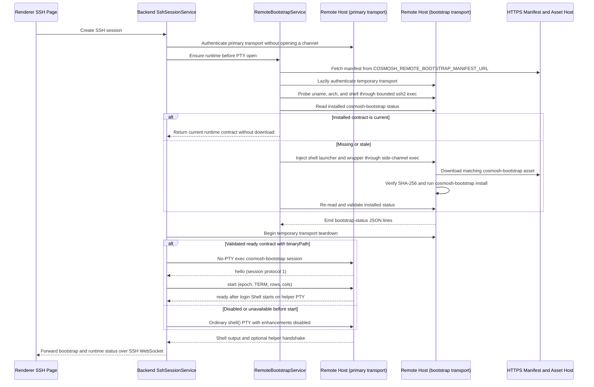

# Cosmosh Remote Bootstrap

`packages/remote-bootstrap` contains the Go tooling that Cosmosh installs on a remote SSH host for Remote Enhancements. It is intentionally user-scoped and shell-aware: the backend orchestrates when bootstrap should run, while this package owns the remote installer binary, generated shell helper, runtime protocol version, capability declarations, and the shell wrapper contract used to fetch and run that binary safely.

The module exists so Cosmosh can add remote-side capabilities without pushing privileged files, modifying global system state, or mixing bootstrap output into the interactive terminal stream. The installed helper emits a deliberately bounded shell-state contract and gives later runtime work a controlled place to add host-local behavior.

## What This Module Does

- Builds `cosmosh-bootstrap`, the binary downloaded and executed on the remote host.
- Builds `cosmosh-wrappergen`, a CLI that renders shell-specific wrappers for release and diagnostic workflows.
- Installs the current bootstrap binary into user-scoped XDG paths.
- Generates a versioned shell helper in Go and wires it into the user's shell startup file.
- Emits line-delimited `bootstrap-status` JSON so the backend can forward progress over the SSH WebSocket.
- Installs first-phase shell integration hooks that can emit runtime shell state over Cosmosh OSC 777 from the interactive PTY.
- Reports installed version, binary SHA-256, protocol, capabilities, helper integrity, and profile-hook integrity through `status`.
- Keeps installation idempotent by comparing the installed version, exact binary/helper contents, and every required shell hook before rewriting files.

## What This Module Does Not Do

- It does not open SSH connections. `packages/backend/src/remote-bootstrap/service.ts` owns runtime orchestration.
- It does not write root-owned or system-wide files.
- It does not persist credentials, terminal output, or user command history.
- It does not download files from the user's local machine. The remote wrapper downloads an HTTPS asset URL from the deployment manifest.
- It does not enable deeper Remote Enhancement behavior by itself. It only installs the first remote helper layer.

## Runtime Ownership



The interactive terminal transport is separate from the bootstrap side channel. `SshSessionService` authenticates the primary client first, then lazily creates a temporary client only if `RemoteBootstrapService` needs a probe/install/status command. That client reuses credential, host-key, compression and proxy policies with its own proxy socket; its teardown begins before the primary opens a terminal channel. Actual socket closure may complete later. With a validated ready contract and `binaryPath`, the primary instead opens a no-PTY `exec` for `cosmosh-bootstrap session`. The helper's `hello`/`start` handshake precedes a user login Shell on its own PTY. This path does not guarantee sshd MOTD, PAM tty messages or utmp behavior. If unavailable before `start`, Backend opens an ordinary `shell()` PTY with enhancements disabled; an uncertain result after `start` fails without another Shell or input replay. Disabled enhancements keep the ordinary raw SSH path. The optional ensure has a shared 15-second budget; expiry aborts temporary work and permits an ordinary PTY. Validated manifests use a five-minute success-only cache. Installer JSON status never enters the terminal output.

The session transport uses protocol `1`, independent of OSC 777 Shell protocol v3. Input/output bytes are Base64 in newline-delimited JSON frames capped at 96 KiB; each input chunk is at most 64 KiB. One UUID epoch and consecutive safe-integer input sequences bind all writes. `delivered` is emitted only after the full chunk reaches the helper-owned PTY master; it does not assert Shell consumption. Backend permits at most 1 MiB of unacknowledged input; the helper limits its queued receive work to 4,096 frames and 1 MiB. Resize and exit share this connection-scoped channel. The helper restores login `argv[0]`, `TERM`, `SSH_TTY`, controlling terminal, foreground process group and inherited working directory. Connection loss closes the child. This transport does not persist input or output, log raw input, or put input into process arguments or debug events. Shell-native history and OSC metadata in normal terminal output remain unaffected. Turning off enhancement data after startup does not close the terminal transport. Delivery alone does not activate the later precise menu or Shell-consumption recovery.

## Directory Layout

```text
packages/remote-bootstrap/
  cmd/
    cosmosh-bootstrap/
      main.go
    cosmosh-wrappergen/
      main.go
  internal/
    install/
      helper.go
      install.go
      install_test.go
    wrapper/
      wrapper.go
      wrapper_test.go
    session/
      protocol.go
      session_linux.go
      THIRD_PARTY_NOTICES.txt
  go.mod
```

- `cmd/cosmosh-bootstrap`: command entry point for remote installation and status inspection.
- `cmd/cosmosh-wrappergen`: command entry point for rendering shell wrapper source.
- `internal/install`: owns helper generation and the OSC protocol contract, validates install inputs, resolves user-scoped paths, copies the bootstrap binary, updates profile hooks, validates installed state, and emits status lines.
- `internal/wrapper`: validates manifest-derived wrapper inputs and renders POSIX or fish shell source with shell-safe quoting.

## Supported Targets

The current Remote Bootstrap target matrix supports Linux hosts only:

| Dimension    | Supported values                   |
| ------------ | ---------------------------------- |
| OS           | `linux`                            |
| Architecture | `amd64`, `arm64`                   |
| Shell        | `bash`, `zsh`, `fish`, `ash`, `sh` |

The remote host also needs common bootstrap tools:

- `mktemp` for temporary wrapper and download directories.
- `base64` for decoding the backend-injected wrapper payload.
- `curl` or `wget` for downloading the bootstrap binary.
- `sha256sum` or `shasum` for asset verification.
- The probed target shell itself.

Missing tools are reported as explicit `bootstrap-status` failures instead of falling back silently.

## Manifest Contract

The backend only runs a remote probe after it has loaded and validated the manifest configured by `COSMOSH_REMOTE_BOOTSTRAP_MANIFEST_URL`.

```json
{
  "version": "1.2.3",
  "assets": [
    {
      "os": "linux",
      "arch": "amd64",
      "url": "https://downloads.example.test/cosmosh-remote-bootstrap-linux-amd64",
      "sha256": "0123456789abcdef0123456789abcdef0123456789abcdef0123456789abcdef"
    },
    {
      "os": "linux",
      "arch": "arm64",
      "url": "https://downloads.example.test/cosmosh-remote-bootstrap-linux-arm64",
      "sha256": "fedcba9876543210fedcba9876543210fedcba9876543210fedcba9876543210"
    }
  ]
}
```

Validation rules:

- `version` must contain only letters, digits, `.`, `_`, `+`, or `-`.
- `assets` must be non-empty.
- Every asset URL must be HTTPS.
- Every `sha256` must be 64 lowercase hexadecimal characters.
- One malformed asset invalidates the entire manifest so polluted release metadata fails visibly.

The backend selects the first asset whose `os` and `arch` match the remote probe.

## Installed Files

The installer writes only inside the remote user's home/XDG scope:

| Purpose             | Default path                                                                                                         |
| ------------------- | -------------------------------------------------------------------------------------------------------------------- |
| Bootstrap binary    | `$XDG_DATA_HOME/cosmosh/bootstrap/bin/cosmosh-bootstrap` or `~/.local/share/cosmosh/bootstrap/bin/cosmosh-bootstrap` |
| Version marker      | `$XDG_DATA_HOME/cosmosh/bootstrap/bin/.version` or `~/.local/share/cosmosh/bootstrap/bin/.version`                   |
| POSIX helper        | `$XDG_CONFIG_HOME/cosmosh/bootstrap/helper.sh` or `~/.config/cosmosh/bootstrap/helper.sh`                            |
| Fish helper         | `$XDG_CONFIG_HOME/cosmosh/bootstrap/helper.fish` or `~/.config/cosmosh/bootstrap/helper.fish`                        |
| Bash profile hooks  | `~/.bashrc` plus the active login profile: `~/.bash_profile`, else `~/.bash_login`, else `~/.profile`                |
| Zsh profile hook    | `~/.zshrc`                                                                                                           |
| Sh/Ash profile hook | `~/.profile`                                                                                                         |
| Fish profile hook   | `$XDG_CONFIG_HOME/fish/conf.d/cosmosh.fish` or `~/.config/fish/conf.d/cosmosh.fish`                                  |

POSIX shell hooks are kept inside a Cosmosh marker block:

```sh
# >>> cosmosh bootstrap >>>
case :$PATH: in *:"/home/user/.local/share/cosmosh/bootstrap/bin":*) ;; *) export PATH="/home/user/.local/share/cosmosh/bootstrap/bin":$PATH ;; esac
if [ -n "${BASH_VERSION:-}" ] && [ -r "/home/user/.config/cosmosh/bootstrap/helper.sh" ]; then . "/home/user/.config/cosmosh/bootstrap/helper.sh"; fi
# <<< cosmosh bootstrap <<<
```

The `BASH_VERSION` guard is used in Bash profile blocks, including a shared `.profile`, so Dash/Sh readers do not source a Bash-specific helper. Zsh/Sh/Ash blocks use the corresponding shell helper without that Bash guard.

Fish uses a dedicated `conf.d/cosmosh.fish` file:

```fish
set -gx PATH "/home/user/.local/share/cosmosh/bootstrap/bin" $PATH
source "/home/user/.config/cosmosh/bootstrap/helper.fish"
```

## Shell State Integration

The installed helper is the user-scoped runtime boundary for shell-state events. It reports status over the interactive PTY with invisible OSC 777 control sequences:

```text
ESC ] 777 ; cosmosh ; <base64-json> BEL
```

Current protocol v3 behavior:

Each event carries a bounded `shellInstanceId`. Interactive processes generate Linux UUIDs; repeated sourcing preserves the same identity and hook registration. Fish internal state is unexported. Nested Shells get distinct identities, and non-interactive startup stays silent. The backend binds the first validated original Shell, pauses on foreign identities and resumes on a newer original prompt. Only implemented capabilities are advertised. Encoded OSC is bounded to 48 KiB and decoded JSON to 32 KiB.

| Shell  | Advertised capabilities                                                                                                      |
| ------ | ---------------------------------------------------------------------------------------------------------------------------- |
| Bash   | `cwd`, `command-start`, `command-end`, `foreground-command`, `prompt-ready`, `editor-state`, `input-snapshot`, `input-apply` |
| Zsh    | `cwd`, `command-start`, `command-end`, `foreground-command`, `prompt-ready`, `line-state`                                    |
| Fish   | `cwd`, `command-start`, `command-end`, `foreground-command`, `prompt-ready`, `cwd-invalidated`                               |
| Sh/Ash | `cwd`, `prompt-ready`                                                                                                        |

- Bash 5.1 or newer preserves existing `PROMPT_COMMAND` entries in a native array, retaining each user's command status, execution order and error behavior. Cosmosh callbacks succeed under `errexit`; older Bash versions keep plain terminal behavior without these hooks. A guarded `DEBUG` trap reports one command start per submitted line. Command end carries the same `commandId`, exit code, and measured duration.
- Zsh uses `precmd`, `preexec` and `line-pre-redraw`; all required hooks must register before readiness. CWD is emitted only at the prompt boundary.
- Fish uses `fish_preexec`, `fish_postexec` and `fish_prompt` events without replacing user prompt functions. PWD/HOME changes after reporting emit one `cwd-invalidated` event for the same generation; they cannot restore directory usability. A subsequent stable report/prompt pair recovers it. Functions that continually change directories need verified editor confirmation. Direct PTY metadata output also works inside captured prompt/title functions. The ordering follows Fish's [reader implementation](https://github.com/fish-shell/fish-shell/blob/3.6.4/src/reader.cpp).
- Prompt-bound CWD reports contain logical PWD, physical output from an external `pwd -P` child, and current absolute HOME. Physical output is Base64-encoded before command substitution, preserving filename newlines; Backend removes exactly the program's final LF. Unavailable physical/HOME values use empty encoded fields and normalize to null. Bash reports after user prompt hooks.
- Sh/Ash use a prompt-capture fallback and intentionally do not claim command lifecycle events.
- Every shell emits `integration-ready` only after its advertised hooks are installed, and non-interactive shells emit no OSC events.

Every event includes `helperVersion`, integer `protocolVersion`, and the helper's bounded `capabilities` list. The backend accepts no helper event until `integration-ready` matches the exact contract returned by `cosmosh-bootstrap status`. Event names must be advertised; command events require a bounded `commandId`, and `command-end` requires exit code and duration. Dynamic cwd and command strings are canonical Base64 fields inside the JSON envelope so valid tabs, newlines, quotes, and backslashes cannot corrupt JSON. Shared desktop types and protocol constants live in `packages/api-contract/src/terminal-protocol.ts`.

OSC and command-lifecycle events must never collect or contain terminal input, passwords, private keys, full screen output or native completion lists. Command events carry only a sanitized executable name, never submitted arguments. Zsh `line-state` carries only length, cursor index and prompt generation. A separately authorized private editor request may temporarily read the original Shell's active input buffer; its contents never enter the event stream or diagnostics.

## Idempotency and Repair Behavior

`cosmosh-bootstrap install` returns `skipped` when all of these are already current:

- `.version` matches the requested version.
- The installed binary exactly matches the executing installer.
- The shell helper exactly matches the Go-generated helper for that shell and version.
- Every expected shell profile hook exists. Bash requires both `.bashrc` and its selected login profile.

If the version and files exist but a profile hook was removed or edited, the installer repairs it instead of skipping. Binary, helper, version, and profile writes use same-directory temporary files plus atomic rename. Existing profile permissions and symlink targets are preserved. The version marker is written only after all files and profile updates succeed, which prevents a partial install from being mistaken for complete.

Before downloading an asset, backend invokes the installed binary's `status --shell <shell>` command. Download is skipped only when the reported version and binary SHA-256 match the selected manifest asset and the protocol, helper, and profile checks are current. Missing fields from an older binary are treated as incompatible and trigger reinstall. After install, backend reads `status` again before it allows the interactive shell to start.

## Status Output

All machine-readable progress is emitted as one JSON object per line:

```json
{"type":"bootstrap-status","phase":"download","state":"started","version":"1.2.3","message":"downloading bootstrap binary"}
{"type":"bootstrap-status","phase":"verify","state":"started","version":"1.2.3","message":"verifying bootstrap binary"}
{"type":"bootstrap-status","phase":"install","state":"started","version":"1.2.3","message":"installing bootstrap helper"}
{"type":"bootstrap-status","phase":"verify","state":"ok","version":"1.2.3","message":"bootstrap installed"}
```

Supported phases are `probe`, `manifest`, `download`, `install`, and `verify`. Supported states are `started`, `ok`, `skipped`, and `failed`.

`cosmosh-bootstrap status` emits one separate JSON object describing the installed runtime contract:

```json
{
  "installed": true,
  "version": "1.2.3",
  "protocolVersion": 3,
  "capabilities": [
    "cwd",
    "command-start",
    "command-end",
    "foreground-command",
    "prompt-ready"
  ],
  "helperCurrent": true,
  "profileCurrent": true,
  "binarySha256": "0123456789abcdef0123456789abcdef0123456789abcdef0123456789abcdef",
  "binaryPath": "/home/user/.local/share/cosmosh/bootstrap/bin/cosmosh-bootstrap",
  "helperPath": "/home/user/.config/cosmosh/bootstrap/helper.sh",
  "profilePath": "/home/user/.bashrc",
  "profilePaths": ["/home/user/.bashrc", "/home/user/.profile"]
}
```

Common failure codes include:

| Code                          | Meaning                                                                                               |
| ----------------------------- | ----------------------------------------------------------------------------------------------------- |
| `MANIFEST_URL_NOT_CONFIGURED` | Backend Remote Enhancements are enabled, but no manifest URL is configured.                           |
| `MANIFEST_FETCH_FAILED`       | Backend could not fetch the manifest.                                                                 |
| `MANIFEST_INVALID`            | Manifest shape, asset URL, or SHA-256 value failed validation.                                        |
| `ASSET_NOT_FOUND`             | Manifest has no asset for the probed remote platform.                                                 |
| `PROBE_FAILED`                | Remote OS, architecture, or shell is unsupported or could not be parsed.                              |
| `BASE64_NOT_FOUND`            | Remote host cannot decode the injected wrapper payload.                                               |
| `MKTEMP_NOT_FOUND`            | Remote host does not provide `mktemp`.                                                                |
| `DOWNLOADER_NOT_FOUND`        | Remote host provides neither `curl` nor `wget`.                                                       |
| `HASH_TOOL_NOT_FOUND`         | Remote host provides neither `sha256sum` nor `shasum`.                                                |
| `CHECKSUM_MISMATCH`           | Downloaded binary hash does not match the manifest.                                                   |
| `BOOTSTRAP_ENSURE_TIMEOUT`    | Backend's complete optional pre-PTY ensure exceeded 15 seconds and ordinary SSH continued.            |
| `HELPER_HANDSHAKE_TIMEOUT`    | The installed helper did not complete a valid runtime handshake within 10 seconds after PTY creation. |
| `FILE_INSTALL_FAILED`         | Installer could not create/copy user-scoped files.                                                    |
| `PROFILE_UPDATE_FAILED`       | Installer could not update the target shell profile hook.                                             |
| `VERSION_WRITE_FAILED`        | Installer could not write the final version marker.                                                   |

## Security Boundaries

- Manifest versions must match `^[A-Za-z0-9._+-]+$` before wrapper source is rendered.
- Manifest asset URLs must use HTTPS.
- Manifest fields are treated as quoted data, never shell source.
- Wrapper tests include adversarial version and URL cases with line breaks, shell metacharacters, and command substitutions.
- Temporary files are created under `${TMPDIR:-/tmp}` with `mktemp`.
- `umask 077` and `0700`/`0600` default modes keep new bootstrap files user-private; atomic profile repair retains an existing profile's mode. The packaged Bash module is installed beside the bootstrap executable at `cosmosh-bash.so` with mode `0600`; status checks its exact embedded bytes and a later install repairs damage without following a module-path symlink.
- Temporary wrapper/download directories are cleaned up on exit, interrupt, and termination signals.
- The installer does not require root and does not write outside the remote user's home/XDG paths.
- `internal/session` uses `github.com/creack/pty` v1.1.24. Its license notice is distributed in `internal/session/THIRD_PARTY_NOTICES.txt`, embedded in the helper binary, and displayed by `cosmosh-bootstrap licenses`.
- Bootstrap probe/install/status exec channels are confined to a temporary SSH transport. Its decrypted completion secret is discarded, and success, failure, or timeout starts teardown before the primary client opens its terminal channel; lifecycle guards remain attached until actual close. A validated helper starts a separate primary no-PTY exec only for the framed terminal session.
- Backend status/audit metadata should stay secret-free; the bootstrap contract never needs SSH credentials or private key material.

## Build and Test

Run tests from this package directory:

```sh
go test ./...
```

Build the remote installer for Linux targets:

```sh
node ../../scripts/build-remote-bootstrap-release.mjs
```

This release build requires Docker (on Windows, Docker inside the configured WSL Debian distribution). It compiles `native/bash/cosmosh_bash.c` for Linux amd64 and arm64 in a pinned Debian Bullseye image using native GCC and the AArch64 cross compiler. The builder checks both ELF architectures, the exported `cosmosh_editor_struct`, and a maximum glibc symbol version of 2.31 before the Go binaries embed the modules. The release build fails if either module is missing or invalid. CI additionally runs native-tagged installer tests on Linux. The generated `internal/nativeassets/assets/*.so` files are ignored; fixture tests use `node ../../scripts/build-bash-native.mjs --if-stale` to reuse matching artifacts and the cached builder image.

Ordinary `go test ./...` and `go run` builds omit the native module and keep Bash's native editor capability unavailable. They do not install or remove a preexisting `cosmosh-bash.so`. A tagged release binary installs its matching embedded module, reports `nativeModulePath` and `nativeModuleCurrent` in `status --shell bash`, and marks a damaged or missing module as an incomplete installation.

The CI/release helper writes git-ignored files under `dist/`: `cosmosh-remote-bootstrap-linux-amd64`, `cosmosh-remote-bootstrap-linux-arm64`, and `cosmosh-remote-bootstrap-manifest.json`. Tagged release jobs stage those files as short-lived workflow artifacts, then the single release writer uploads them with the desktop packages after inventory, checksum, and provenance validation. `main` branch builds publish the same file names to the fixed `remote-bootstrap-dev` prerelease with a manifest version such as `dev-<commit-sha>`. Pushed branches whose name contains `remote-bootstrap` and manual workflow dispatch runs can publish branch-scoped temporary prereleases for end-to-end package testing; ordinary PR and feature-branch CI runs use the script for compilation and manifest validation only. The rolling channels remain intentionally replaceable, while versioned release assets are mutable only during draft assembly; see [Release Security](../../docs/developer/core/release-security.md).

Render a wrapper for inspection:

```sh
go run ./cmd/cosmosh-wrappergen \
  --shell sh \
  --os linux \
  --arch amd64 \
  --version 1.2.3 \
  --asset-url https://downloads.example.test/cosmosh-remote-bootstrap-linux-amd64 \
  --sha256 0123456789abcdef0123456789abcdef0123456789abcdef0123456789abcdef
```

Inspect installed runtime state and resolved paths without writing files:

```sh
go run ./cmd/cosmosh-bootstrap status --shell sh
```

For local install tests, prefer a temporary home so the command cannot touch your real shell profile:

```sh
tmp_home="$(mktemp -d)"
HOME="$tmp_home" XDG_DATA_HOME="$tmp_home/data" XDG_CONFIG_HOME="$tmp_home/config" \
  go run ./cmd/cosmosh-bootstrap install \
    --shell sh \
    --version 0.0.0-dev
```

## Adding a Remote Enhancement

The `internal/editor` package serves private, request-scoped editor exchanges through
`editor-request` stdin and owner-checked Unix sockets. Bash's packaged loadable builtin
observes the original Readline reader through a bounded, nonblocking idle hook and uses
the same private worker; it never sends editor text through PTY commands or OSC events.
The worker rejects expired or mismatched requests. Its protocol, privacy rules, and
input-delivery acknowledgement semantics are documented in
`docs/developer/runtime/ssh-terminal.md` and the synchronized Chinese page.

Use this checklist when expanding the remote helper:

1. Keep the remote behavior user-scoped and non-root.
2. Add or update tests in `internal/install` or `internal/wrapper`.
3. Increment `RemoteShellProtocolVersion` for incompatible event-shape changes and keep Go declarations synchronized with `packages/api-contract/src/terminal-protocol.ts`.
4. Preserve the `bootstrap-status` JSON-line contract.
5. Keep manifest fields validated and shell-quoted before execution.
6. Update `docs/developer/runtime/ssh-terminal.md` and the Chinese mirror under `docs/zh-CN/`.
7. Update `docs/developer/core/project-map.md` if ownership or placement changes.

The backend TypeScript orchestration and this Go package must stay in lockstep. If a wrapper field, status phase, status code, or installed path changes in one layer, update the other layer and the documentation in the same change set.
